<p align="center">
  <picture>
    <source media="(prefers-color-scheme: dark)" srcset="package/docs/images/readme-banner-dark.png">
    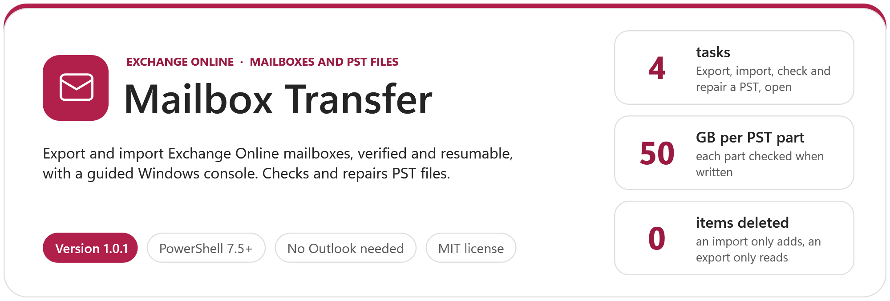
  </picture>
</p>

<p align="center">
  <a href="#get-started"><b>Get started</b></a> &nbsp;&middot;&nbsp;
  <a href="#how-it-works"><b>How it works</b></a> &nbsp;&middot;&nbsp;
  <a href="#console"><b>Console</b></a> &nbsp;&middot;&nbsp;
  <a href="#reports"><b>Reports</b></a> &nbsp;&middot;&nbsp;
  <a href="#requirements"><b>Requirements</b></a> &nbsp;&middot;&nbsp;
  <a href="#quick-start"><b>Quick start</b></a> &nbsp;&middot;&nbsp;
  <a href="package/docs/MailboxTransfer-UserGuide.md"><b>User guide</b></a> &nbsp;&middot;&nbsp;
  <a href="package/docs/MailboxTransfer-Guide.md"><b>Reference guide</b></a>
</p>

<p align="center">
  <a href="https://github.com/Nico77600/MailboxTransfer/releases/latest"></a>
</p>

**Author:** Nicolas Fabert  
**Version:** 1.0.1 ([changelog](CHANGELOG.md))

> [!TIP]
> **Download the latest release.** Open the [latest release](https://github.com/Nico77600/MailboxTransfer/releases/latest) and download **`MailboxTransfer-1.0.1.zip`** under *Assets* (its SHA-256 is in the release notes). That ZIP is the signed tool, with the HTML guides. Do not use the **Source code** archives or the green **Code** button: they are a copy of the repository, not the release package.

> [!IMPORTANT]
> Windows marks files downloaded from the Internet. After you extract the ZIP, check the publisher first (right-click a `.ps1`, for example `Invoke-MailboxTransfer.ps1`, Properties, Digital Signatures: `Nicolas Fabert`), then unblock the extracted folder once:
>
> ```powershell
> Get-ChildItem "C:\Tools\MailboxTransfer" -Recurse -File -Force | Unblock-File
> ```
>
> Replace the example path with the folder where you extracted the ZIP.

> [!IMPORTANT]
> **Mailbox Transfer requires PowerShell 7.5 or later (`pwsh.exe`) for the console, 7.4 for the command line.** Windows PowerShell 5.1 is refused before any code runs. PowerShell 7 is not bundled in the release: install it once with `winget install Microsoft.PowerShell`.

## Why

Mailbox Transfer exports Exchange Online mailboxes (**primary, archive and auxiliary archives**) to a verified local store or to **PST files**, imports PST files, stores and `.eml` files into a mailbox, and **checks and repairs PST files**. A guided Windows console for the person who does not want to type commands, a PowerShell 7 command line for the rest.

Moving a mailbox is easy until it is 50 GB. A mail client stops when the PC sleeps. A PST export hides the archive that grew into several archives. A copy that dies at 80 % leaves you guessing what arrived. Mailbox Transfer is made for the big, boring, long job.

<picture>
  <source media="(prefers-color-scheme: dark)" srcset="package/docs/images/readme-why-dark.png">
  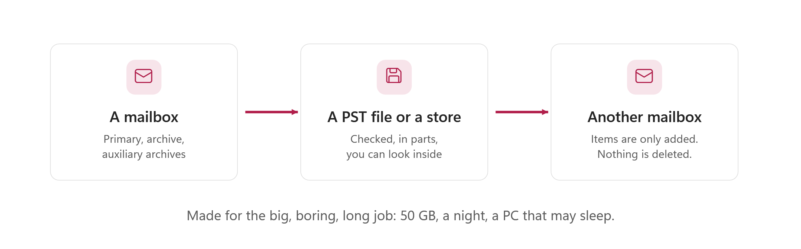
</picture>

- **You see before you copy.** Browse the mailbox like a mailbox, tick folders or messages, read the plan, then start. Nothing is changed in the mailbox unless you import, and an import only adds.
- **A long job survives.** Close the window, let the PC sleep, lose the network, get slowed down by Microsoft: press **Continue** and only what is left is done. An item whose answer was lost is looked for, not guessed.
- **PST done properly.** The real folder tree, split at 50 GB (you can change it), every file checked. A damaged PST is repaired into a new file, with a before and after. No Outlook and no third-party PST library involved.
- **Honest about time.** Microsoft lets about 4 GiB per hour into one mailbox. The window says so before you start, and shows a range, not a promise.

> [!CAUTION]
> An import writes to a real mailbox. It only **adds** items (nothing is deleted, overwritten or renamed), but it cannot be undone by the tool: try it on a test mailbox first.

## Get started

<picture>
  <source media="(prefers-color-scheme: dark)" srcset="package/docs/images/readme-start-dark.png">
  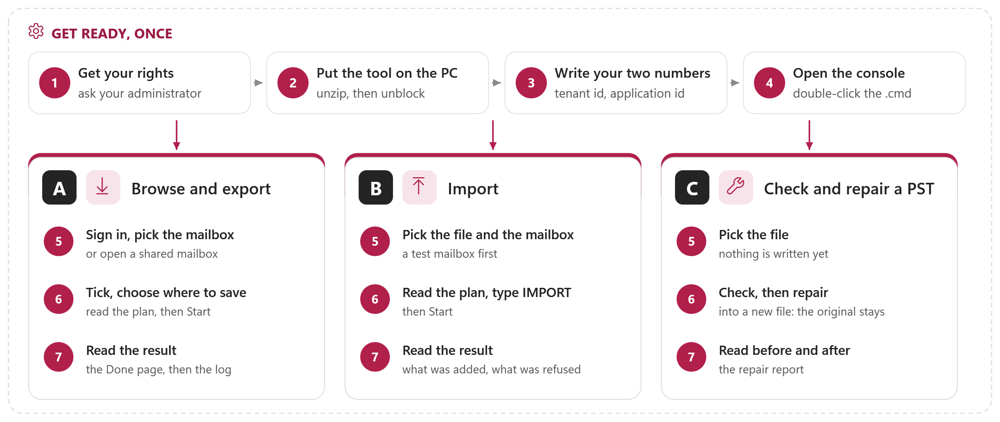
</picture>

One path for everyone. Set the tool up once (**1 to 4**), then take task **A** to browse and export, **B** to import, **C** to check and repair a PST, or all three. A fourth task, *Open an export or a PST*, reads a file like a mailbox and needs no step of its own. The commands use one example: the tool in `C:\Tools\MailboxTransfer`. Change only this folder to yours. The [user guide](package/docs/MailboxTransfer-UserGuide.md) explains each step with a picture, what you should see and what to do if not, in plain words.

### Set up once · 1 to 4

```powershell
# 1 · Get your rights. Give your administrator the table "Requirements" below (minimum permission for each task).
#     Checking and repairing a PST needs no right at all.

# 2 · On the PC, in PowerShell 7.5+: put the tool in its folder and unblock it.
#     Download MailboxTransfer-1.0.1.zip from the latest release (under Assets, not Source code) and extract it to C:\Tools\MailboxTransfer
Get-ChildItem C:\Tools\MailboxTransfer -Recurse -File -Force | Unblock-File

# 3 · Write your two numbers: tenant id and application id, in a file you create (the user guide, chapter 3, shows how)
notepad C:\Tools\MailboxTransfer\config\MailboxTransfer.config.local.psd1

# 4 · Open the console: double-click Start-MailboxTransferConsole.cmd, or
cd C:\Tools\MailboxTransfer
.\Start-MailboxTransferConsole.ps1          # or: .\Invoke-MailboxTransfer.ps1 -Gui
.\Start-MailboxTransferConsole.ps1 -Demo    # try it on made-up data first: no network, no mailbox
```

<details>
<summary><b>What you see</b> · the first page: the four tasks, the jobs to continue, the lights of this computer</summary>
<br>
<picture>
  <source media="(prefers-color-scheme: dark)" srcset="package/docs/images/console-task-dark.png">
  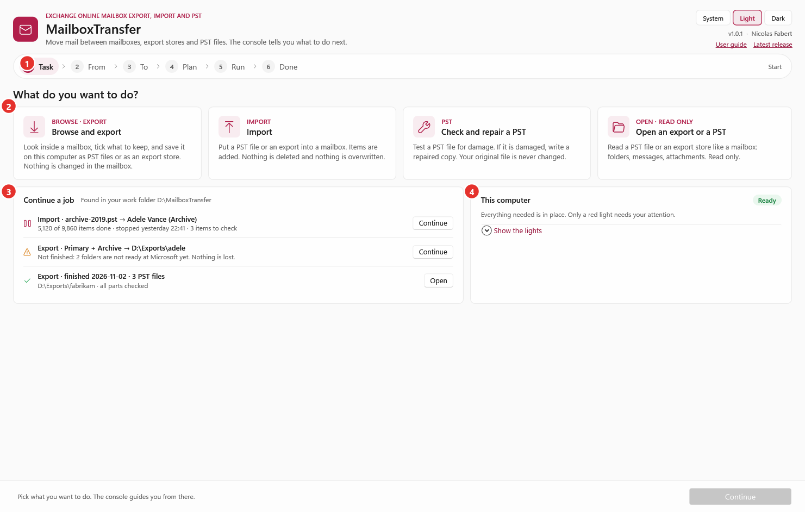
</picture>
</details>

### A · Browse and export · 5 to 7

```powershell
# 5 · Sign in and look inside the mailbox. Console: the card Browse and export, then Sign in. Reads only.
.\Invoke-MailboxTransfer.ps1 -Mode Browse -Mailbox Archive

# 6 · Tick what to keep, choose where to save, read the plan, press Start. Command line: the same, in one line.
.\Invoke-MailboxTransfer.ps1 -Mode Export -Mailbox Archive -StorePath D:\store -OutputPst D:\pst\adele.pst

# 7 · Read the result: the Done page (or the summary card) says what was written. Exit code 2: run it again, only what is left is done.
```

<details>
<summary><b>What you see</b> · Browse, Save, Plan, Run for one export to PST files</summary>
<br>
<table>
  <tr>
    <td width="50%" valign="top"><a href="package/docs/images/console-from-browse-light.png">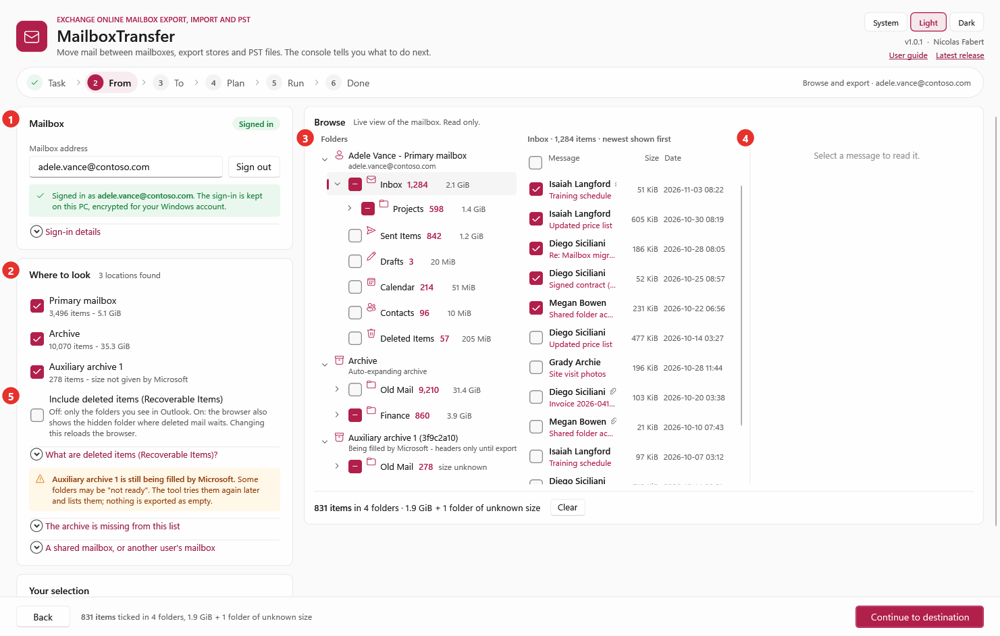</a><br><sub><b>From</b> &middot; browse the mailbox like a mailbox, tick folders or messages</sub></td>
    <td width="50%" valign="top"><a href="package/docs/images/console-to-pst-light.png">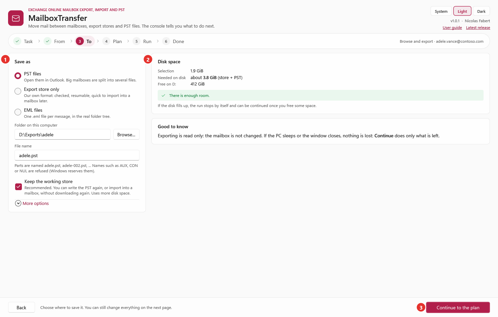</a><br><sub><b>To</b> &middot; PST files, EML files or an export store, and the room they need</sub></td>
  </tr>
  <tr>
    <td width="50%" valign="top"><a href="package/docs/images/console-plan-export-light.png">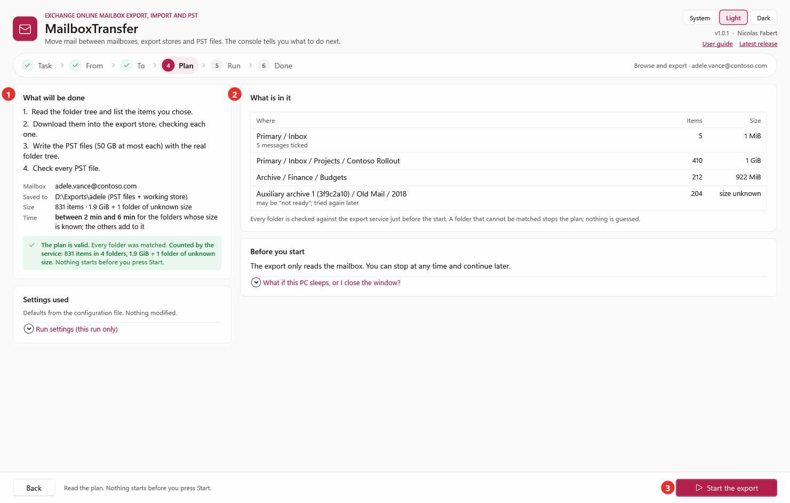</a><br><sub><b>Plan</b> &middot; what will be done, the time as a range, read before Start</sub></td>
    <td width="50%" valign="top"><a href="package/docs/images/console-run-export-light.png">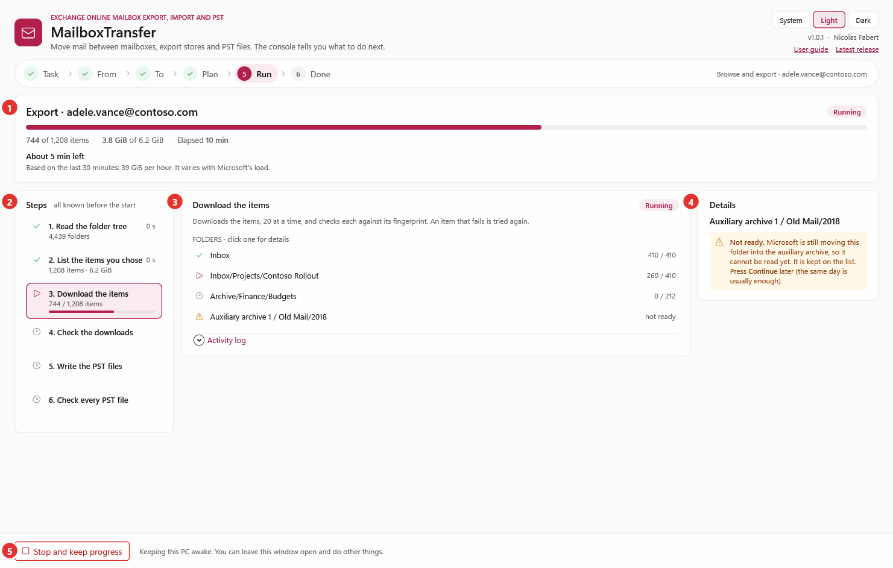</a><br><sub><b>Run</b> &middot; the steps, the folders, Stop and keep progress</sub></td>
  </tr>
</table>
</details>

### B · Import · 5 to 7

```powershell
# 5 · Pick the file (a PST, an export store or EML files) and the mailbox. Try a TEST mailbox first: an import cannot be undone by the tool.
# 6 · Read the plan (nothing is written), then import. In the console you type IMPORT to start.
.\Invoke-MailboxTransfer.ps1 -Mode ImportPst -PstPath D:\old\archive.pst -TargetRoot Imported/archive -WhatIf
.\Invoke-MailboxTransfer.ps1 -Mode ImportPst -PstPath D:\old\archive.pst -TargetRoot Imported/archive

# 7 · Read the result: what was added, and the items Microsoft refuses for good, with the reason, in <job>-not-imported.csv
```

<details>
<summary><b>What you see</b> · Source, Destination, Plan, Run for one import</summary>
<br>
<table>
  <tr>
    <td width="50%" valign="top"><a href="package/docs/images/console-import-from-light.png">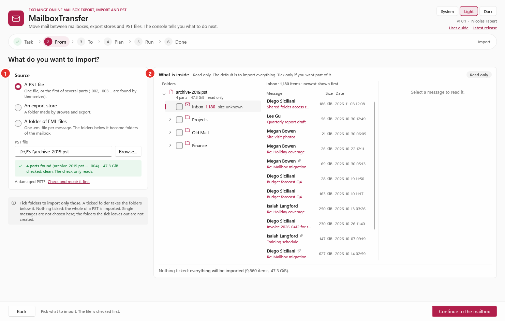</a><br><sub><b>From</b> &middot; the file, what the check found, the folders to import</sub></td>
    <td width="50%" valign="top"><a href="package/docs/images/console-import-to-light.png">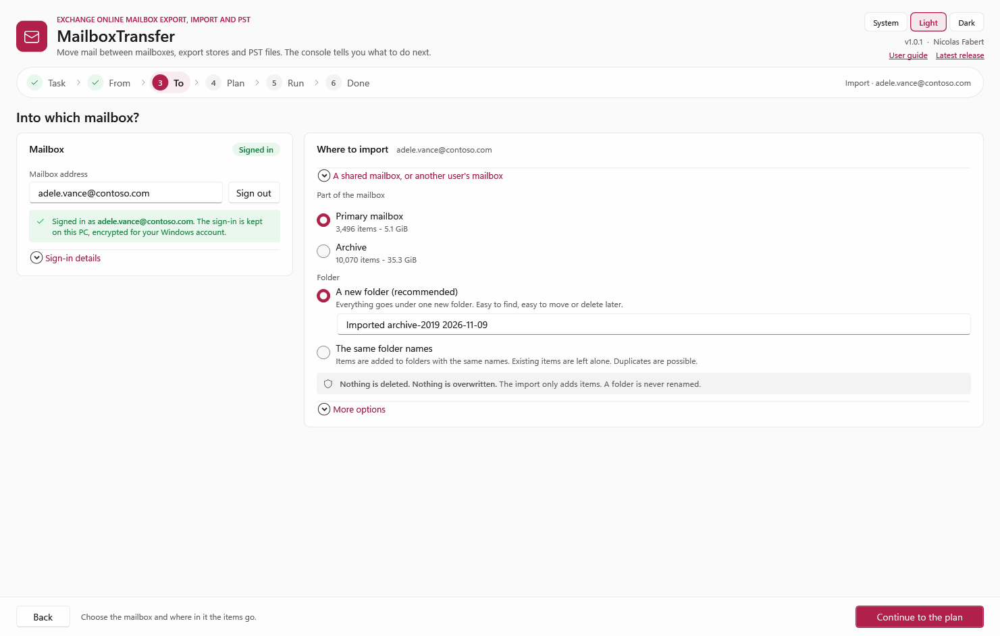</a><br><sub><b>To</b> &middot; the mailbox, the new folder, the room</sub></td>
  </tr>
  <tr>
    <td width="50%" valign="top"><a href="package/docs/images/console-import-plan-light.png">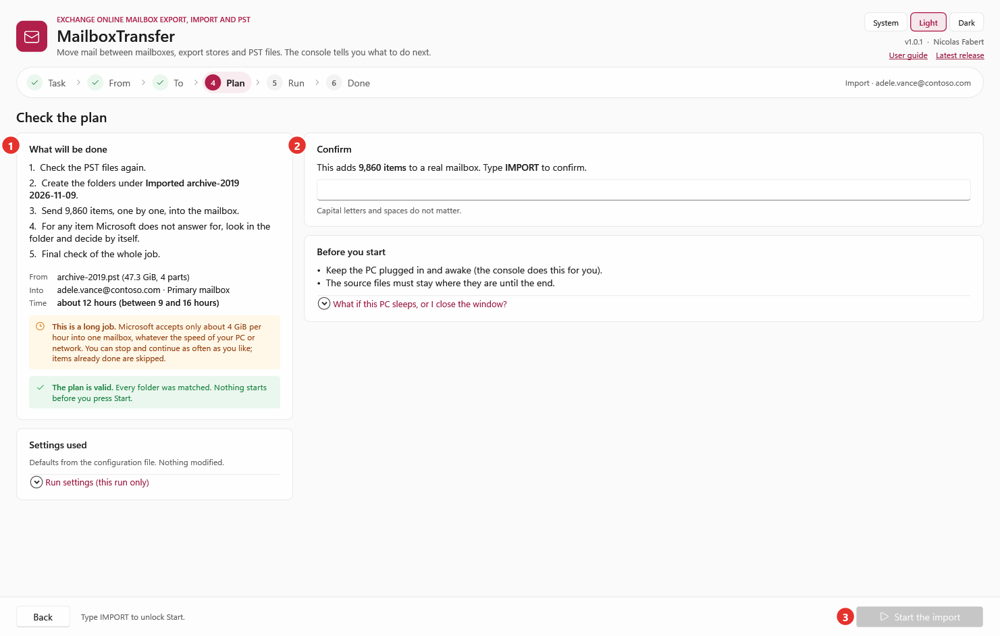</a><br><sub><b>Plan</b> &middot; type <code>IMPORT</code> to unlock Start</sub></td>
    <td width="50%" valign="top"><a href="package/docs/images/console-run-import-light.png">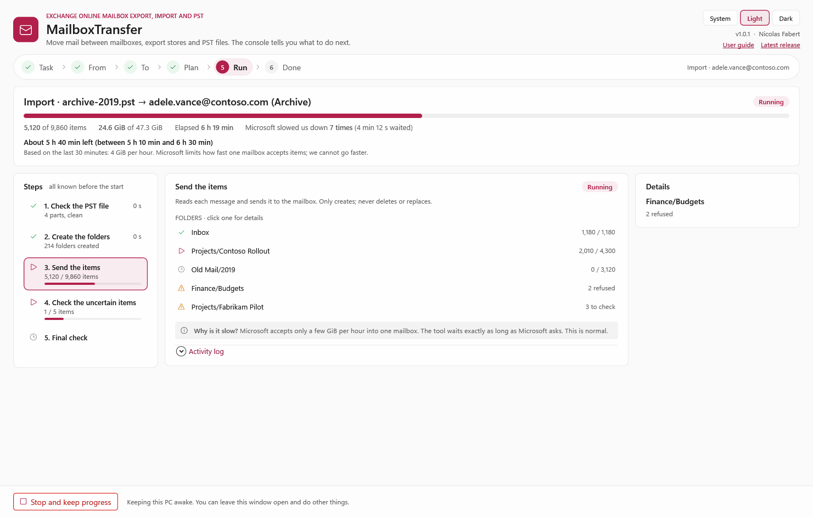</a><br><sub><b>Run</b> &middot; the bar, an honest time range, the folders</sub></td>
  </tr>
</table>
</details>

### C · Check and repair a PST · 5 to 7

```powershell
# 5 · Check the file. Nothing is written, no sign-in, no right needed.
.\Invoke-MailboxTransfer.ps1 -Mode CheckPst -Path D:\pst\mail.pst

# 6 · Repair into a NEW file: the original is never changed, and the new file appears only when complete.
.\Invoke-MailboxTransfer.ps1 -Mode RepairPst -Path D:\pst\mail.pst -Destination D:\pst\mail.repaired.pst

# 7 · Read before and after: <new file>.repair-report.csv and .json say what was recovered or lost.
```

<details>
<summary><b>What you see</b> · the check, the plan, the run, before and after</summary>
<br>
<table>
  <tr>
    <td width="50%" valign="top"><a href="package/docs/images/console-repair-from-damaged-light.png">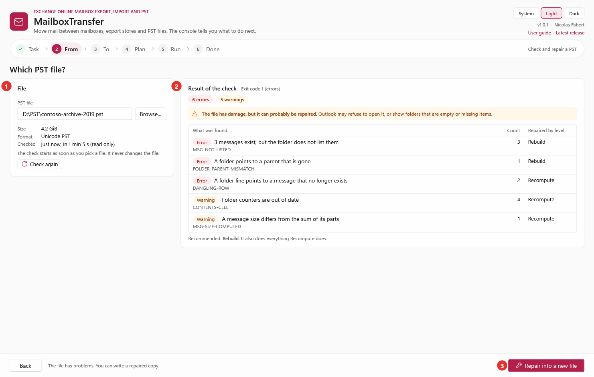</a><br><sub><b>Check</b> &middot; what was found, in words, and which level repairs it</sub></td>
    <td width="50%" valign="top"><a href="package/docs/images/console-repair-plan-light.png">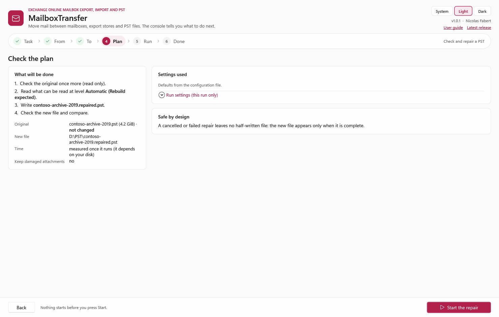</a><br><sub><b>Plan</b> &middot; the new file and the level; the original stays</sub></td>
  </tr>
  <tr>
    <td width="50%" valign="top"><a href="package/docs/images/console-run-repair-light.png">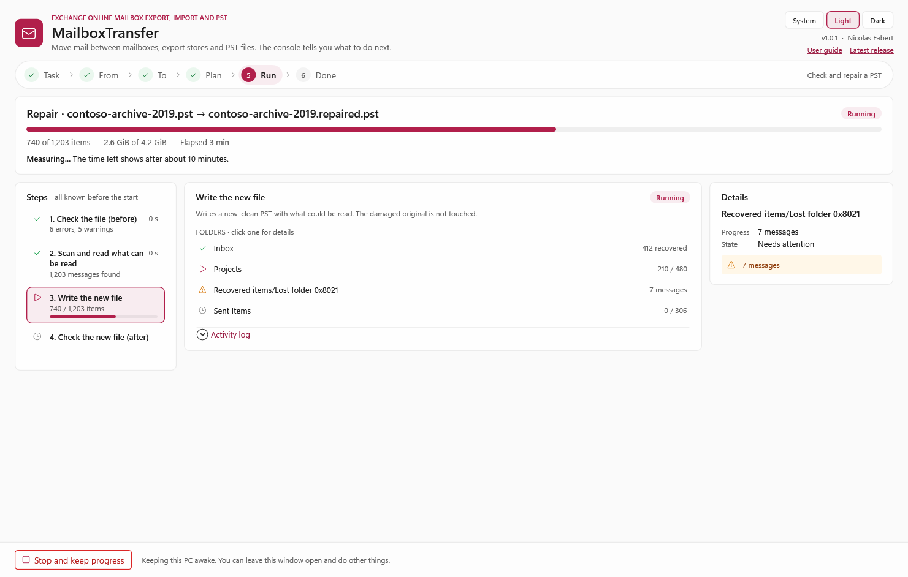</a><br><sub><b>Run</b> &middot; the repair, step by step</sub></td>
    <td width="50%" valign="top"><a href="package/docs/images/console-repair-done-light.png">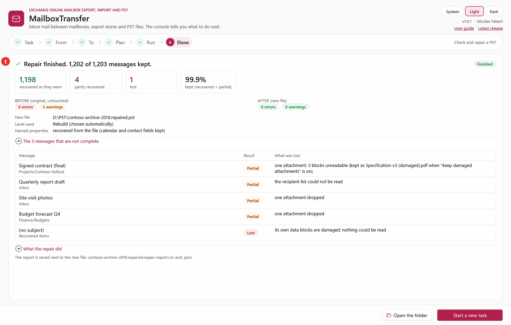</a><br><sub><b>Done</b> &middot; before and after, what was kept</sub></td>
  </tr>
</table>
</details>

## How it works

<picture>
  <source media="(prefers-color-scheme: dark)" srcset="package/docs/images/readme-tasks-dark.png">
  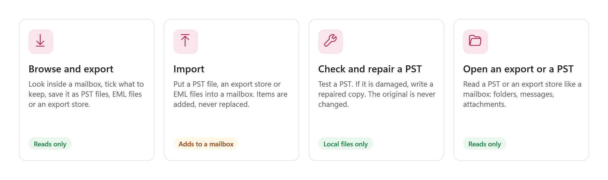
</picture>

| Task | What it does | Writes to a mailbox? |
|---|---|---|
| **Browse and export** | Sign in (or open a shared mailbox by its address), look inside a mailbox, tick folders or messages, save them as PST files, EML files or an export store | No |
| **Import** | Put an export store, a PST file or a folder of EML files into a mailbox: items are added, nothing is deleted or overwritten | Yes, adds only |
| **Check and repair a PST** | Test a PST, write a repaired copy; the original is never changed | No |
| **Open an export or a PST** | Read it like a mailbox | No |

Every task goes **Task, From, To, Plan, Run, Done**. One question per page, the safe choice is the default and says *recommended*, and the plan is read before anything starts. Only an import asks you to type `IMPORT`. The window follows Windows (light or dark) and has a switch in its top right corner; its *User guide* and *Latest release* links open your browser.

<picture>
  <source media="(prefers-color-scheme: dark)" srcset="package/docs/images/readme-path-dark.png">
  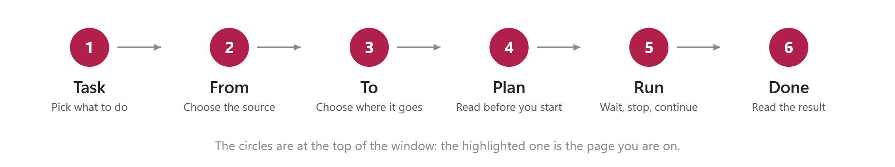
</picture>

### How it stays safe

<picture>
  <source media="(prefers-color-scheme: dark)" srcset="package/docs/images/readme-principles-dark.png">
  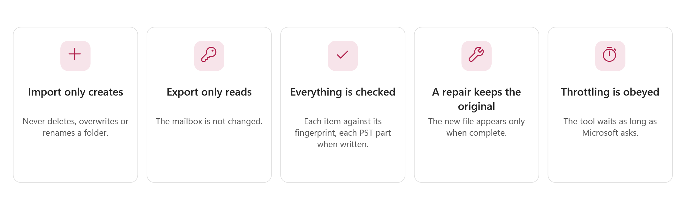
</picture>

1. **Import creates only.** It never deletes, never overwrites, never renames a folder.
2. **Export is read only.**
3. **Every downloaded item is checked** against its fingerprint; every PST part is checked when written.
4. **A repair never touches the original.** The new file appears only when complete.
5. **Microsoft's throttling is obeyed to the second.** The tool never works around it.
6. **The package checks itself.** Every script is signed by the author and every file is listed in a signed manifest; a changed file stops the tool before it runs (see *Package integrity*).

### Two formats

<picture>
  <source media="(prefers-color-scheme: dark)" srcset="package/docs/images/readme-formats-dark.png">
  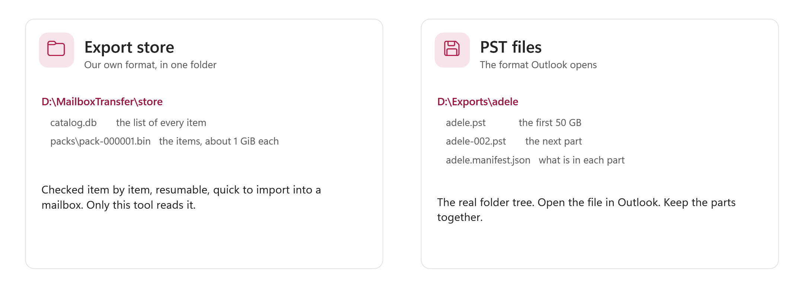
</picture>

### How fast, honestly

<picture>
  <source media="(prefers-color-scheme: dark)" srcset="package/docs/images/readme-speed-dark.png">
  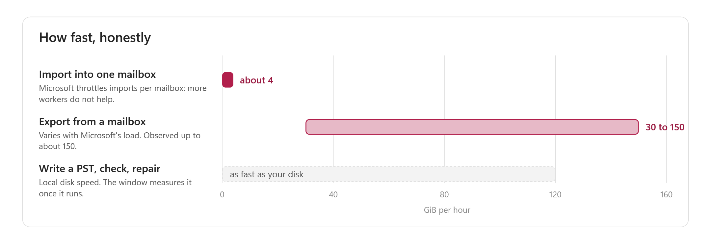
</picture>

| Direction | What to expect | Why |
|---|---|---|
| Import into one mailbox | about **4 GiB per hour** | Microsoft throttles imports per mailbox; more workers do not help |
| Export from a mailbox | **30 to 150 GiB per hour** (observed up to about 150) | varies with Microsoft's load |
| Write a PST, check, repair | local disk speed | measured by the window once it runs |
| Disk needed | store plus PST is about twice the data; a repair needs one more PST | said on the Plan page before you start |

## Console

The console is the guided way: one question per page, the lights of this computer on the first page, a plan before every run, and a Run page that says in words what is happening. It is a real WPF window; the pictures of this page and of the guides are taken from it with made-up data only (`contoso.com` names).

<picture>
  <source media="(prefers-color-scheme: dark)" srcset="package/docs/images/console-run-export-dark.png">
  
</picture>

## Reports

Every run tells you what happened, in the same words on screen and on disk.

<table>
  <tr>
    <td width="50%" valign="top"><a href="package/docs/images/console-done-export-complete-light.png">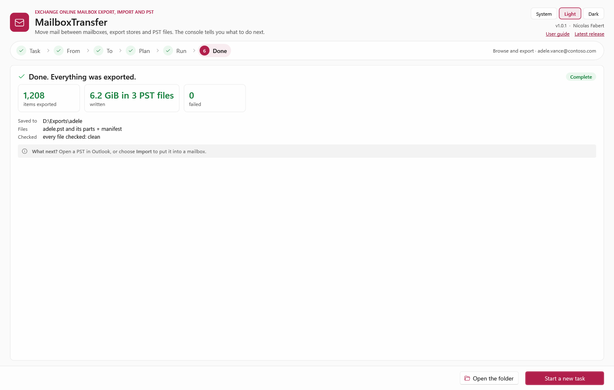</a><br><sub><b>Done</b> &middot; an export, complete: the result in words, the files, the counts</sub></td>
    <td width="50%" valign="top"><a href="package/docs/images/console-done-export-partial-light.png">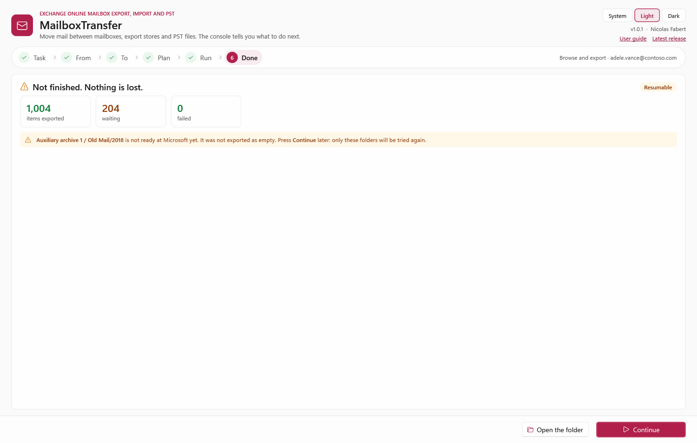</a><br><sub><b>Done</b> &middot; not finished: nothing is lost, press Continue later</sub></td>
  </tr>
  <tr>
    <td width="50%" valign="top"><a href="package/docs/images/console-done-import-decision-light.png">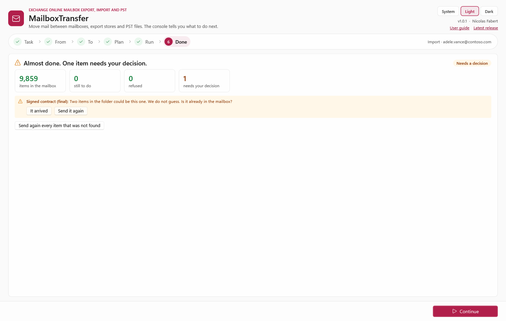</a><br><sub><b>Done</b> &middot; an import that needs a decision: the tool never guesses</sub></td>
    <td width="50%" valign="top"><a href="package/docs/images/console-repair-done-light.png"></a><br><sub><b>Repair report</b> &middot; the check before and after</sub></td>
  </tr>
</table>

| You get | Where | What it holds |
|---|---|---|
| **The Done page** (console) or **the summary card** (command line) | the window, or the end of the command | the result in words, the counts, the duration, what to do next, and the exit code rule: `0` complete, `1` error or items refused for good, `2` not complete (run again to continue), `3` uncertain items |
| **The log file** | `logs\MailboxTransfer_<date>.log` in the work folder (command line: `out\logs`, or `-LogFolder`) | one line per message with a time and a level (`INFO`, `OK`, `WARN`, `FAIL`), no colours, no secret; the runs of a day append to one file, files older than 14 days are deleted |
| **The list of refused items** | `report.csv` and `report.json` in the job folder; `<job>-not-imported.csv` for an import | one line per item that Microsoft refuses for good, with the reason (opens in a spreadsheet; formulas are neutralised) |
| **The PST manifest** | `<name>.manifest.json` next to the PST parts | the parts, their folders and items, the size of each, the items that could not be written |
| **The repair report** | `<new file>.repair-report.csv` and `.json` next to the repaired PST | the check before and after, and what was recovered or lost |
| **The events file** | `events.jsonl` in the job folder | what the console reads while a job runs; the format is public ([events contract](package/docs/MailboxTransfer-Events.md)) |

## Requirements

| | |
|---|---|
| Windows | 10 or 11, x64 or arm64 |
| PowerShell | **7.5** for the console, 7.4 for the command line (`pwsh.exe`, not Windows PowerShell 5.1) |
| Module | `Microsoft.Graph.Authentication` (the tool borrows its MSAL library to sign you in) |
| Disk | about twice the size of the data |
| Not needed | Outlook, Exchange Online PowerShell, any third-party PST tool |
| Rights | one app registration for your company (a public client, delegated permissions, admin consent), then the minimum permission for each task. See the table in the [user guide](package/docs/MailboxTransfer-UserGuide.md#2-before-you-start) and the exact rights in the [reference guide](package/docs/MailboxTransfer-Guide.md#4-the-exact-rights). |

### Minimum permissions

<picture>
  <source media="(prefers-color-scheme: dark)" srcset="package/docs/images/readme-permissions-dark.png">
  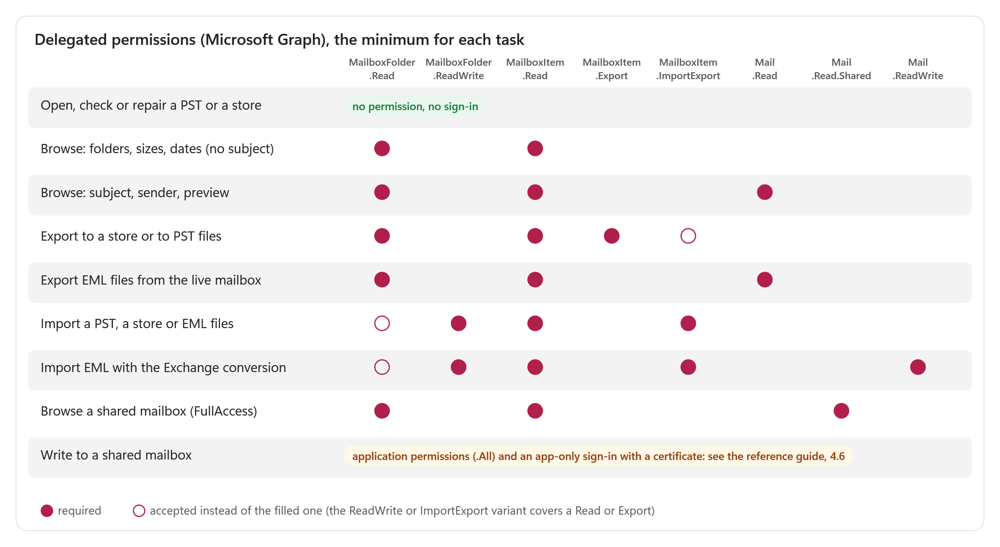
</picture>

> [!NOTE]
> **Shared mailboxes.** With the FullAccess right you can browse and export a shared mailbox. Importing into a shared mailbox or into another person's mailbox needs *application* permissions and a sign-in without a person: **app-only, with a certificate** (`-CertificateThumbprint`, or **The application (certificate)** in the console). The permissions and the steps are in the [reference guide](package/docs/MailboxTransfer-Guide.md#46-no-person-present-certificate-app-only).

## Quick start

The command line does what the console does, one mode at a time. Every mode is in the [reference guide](package/docs/MailboxTransfer-Guide.md#3-the-command-line).

```powershell
cd C:\Tools\MailboxTransfer
.\Invoke-MailboxTransfer.ps1 -Mode Browse -Mailbox Archive                                   # folder tree, read only
.\Invoke-MailboxTransfer.ps1 -Mode Export -Mailbox Archive -StorePath D:\store -OutputPst D:\pst\adele.pst
.\Invoke-MailboxTransfer.ps1 -Mode ImportPst -PstPath D:\old\archive.pst -TargetRoot Imported/archive -WhatIf   # the plan
.\Invoke-MailboxTransfer.ps1 -Mode CheckPst  -Path D:\pst\mail.pst                           # read only
.\Invoke-MailboxTransfer.ps1 -Mode RepairPst -Path D:\pst\mail.pst -Destination D:\pst\mail.repaired.pst
```

Keep exports, PST files and logs outside the tool folder, or in its `out\` and `logs\` folders: any other file inside the package is refused by the integrity check at the next start.

## Package integrity

The tool runs only from a package signed by its owner. `src\Test-PackageIntegrity.ps1` and `PackageIntegrity.psd1` must carry a valid, timestamped Authenticode signature of the certificate `0F28E442889F17B5F4D251E8F96E7CC6E2C9C6D6` (Nicolas Fabert); every PowerShell file of the package must be signed by the same certificate; every other file (C# engine, SQLite libraries, window definitions, guides, README, notices, launcher) must match the SHA-256 listed in the signed manifest. The entry scripts and the module check this before anything is compiled or shown. A changed, missing, duplicated, unlisted or reparse-point file stops the tool with a message that names the file.

There is no unsigned mode. A source checkout of this repository (no manifest) is started on purpose with `-DevelopmentMode`; the tool then says that nothing is verified. Edit only `config\MailboxTransfer.config.psd1` and your own `config\MailboxTransfer.config.local.psd1`: they are data, outside the check, like the generated `out\` and `logs\` folders. A signature detects a change; it does not stop the file system from being written.

## Content

| Path | Role |
|---|---|
| `package\` | What a release contains |
| `package\Invoke-MailboxTransfer.ps1` | The command line: every mode of the engine |
| `package\Start-MailboxTransferConsole.ps1`, `.cmd` | The console, and its double-click launcher |
| `package\MailboxTransfer.psd1`, `.psm1` | The module (the C# engine in `src\Engine.*.cs` is compiled in memory at the first use) |
| `package\module\` | The console (WPF), the events of a job, the EML commands |
| `package\src\` | The C# engine, the console view models and the integrity verifier |
| `package\config\` | `MailboxTransfer.config.psd1` (defaults, no private value) |
| `package\docs\` | The user guide, the reference guide, the events contract, images |
| `package\lib\sqlite\` | SQLite for the export store (see `THIRD-PARTY-NOTICES.md`) |
| `package\PackageIntegrity.psd1`, `product.json` | The signed manifest of the files, and the identity of the product |
| `tests\` | Pester tests, no network |
| `tools\` | The package builder, the signing helpers, the pictures of the documentation, and lab scripts for the maintainer |

## Documentation

The `package` folder of this repository holds exactly the files needed to run Mailbox Transfer. The ZIP of each [release](https://github.com/Nico77600/MailboxTransfer/releases) contains the same run-time files with the HTML guides; `.\tools\New-MailboxTransferPackage.ps1` builds that content from the repository.

| Guide | Content |
|---|---|
| **[User guide](package/docs/MailboxTransfer-UserGuide.md)** ([HTML](package/docs/MailboxTransfer-UserGuide.html)) | **For a beginner:** one step after the other, a picture for each, a glossary with **where to look** on the screen, and what to do when something goes wrong |
| **[Reference guide](package/docs/MailboxTransfer-Guide.md)** ([HTML](package/docs/MailboxTransfer-Guide.html)) | Parameters, modes, exit codes, the exact rights, the store and PST formats, EML fidelity, limits |
| [Events contract](package/docs/MailboxTransfer-Events.md) | The events file, the stop file and the job folder, for people who drive the tool from a script |
| [CHANGELOG](CHANGELOG.md), [SECURITY](SECURITY.md) | What changed in each version; how to report a vulnerability and how to check a release |

Both guides also exist as a single HTML file with a light and a dark theme (`package/docs/*.html`), pictures included: download them and open them locally, or use the copies in the release ZIP. The pictures are generated from made-up data by `tools\New-DocumentationImages.ps1`.

## Data handling

An export store and PST files contain **complete mail**: protect them like the mailbox. They stay on the disk you choose. The sign-in is cached per user under `%LOCALAPPDATA%\MailboxTransfer`, encrypted with DPAPI for your Windows account. The certificate of an app-only sign-in stays in the Windows certificate store (or the file you name); this tool stores none. There is no telemetry: the tool contacts Microsoft only, and only for the tasks that need a mailbox.

## Tests

```powershell
# PowerShell 7.5+ (pwsh); Pester 5 or later (the CI uses 6.1.0) and PSScriptAnalyzer 1.25.0 installed
Invoke-Pester -Path .\tests -Output Detailed        # no network, no tenant, no mailbox needed
```

The tests drive the real engine against a fake Microsoft Graph and synthetic PST files, the console in a headless WPF window on a fake engine, and the package integrity logic on a copy of the package. Large real-data corpora (kept outside the repository) add checks when they are present and are skipped otherwise. The cloud checks (a test tenant) are run by the maintainer with the scripts in `tools\`; nothing in the automated tests contacts the cloud. The engine is that of 1.0.0, validated offline and on one Microsoft 365 test tenant, including writing into a shared mailbox with a certificate.

## License

[MIT](LICENSE).

## Disclaimer

This Script is a Personal project.
It's provided "AS-IS". It's not an official Microsoft product so no support can be expected from Microsoft.

As any scripts you must read carefully the documentation and test it first in a Test environment before any run in Production.

An import writes to a real mailbox: try it on a test mailbox first.
