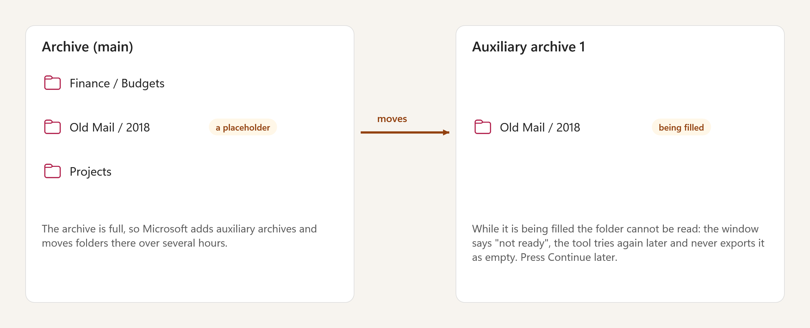
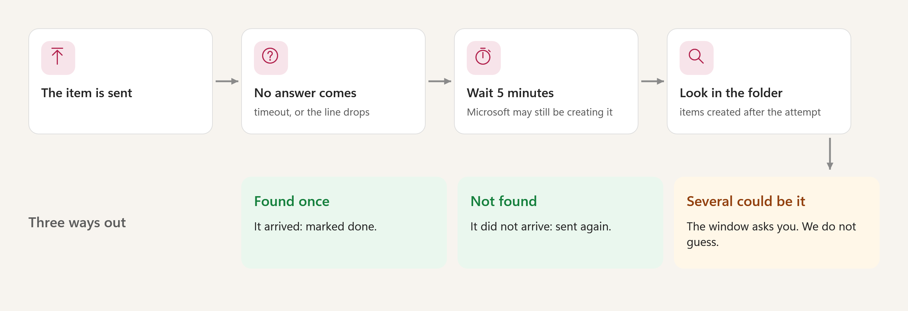
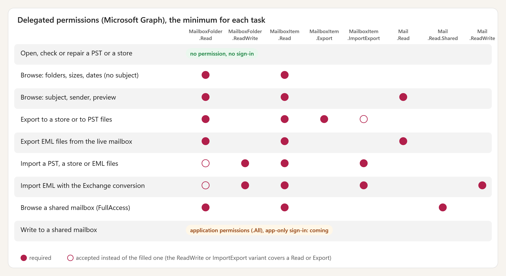
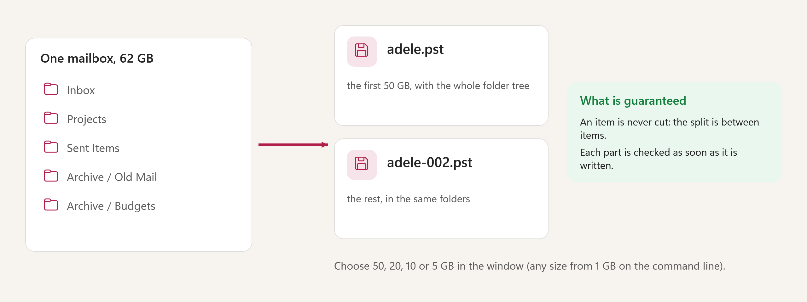
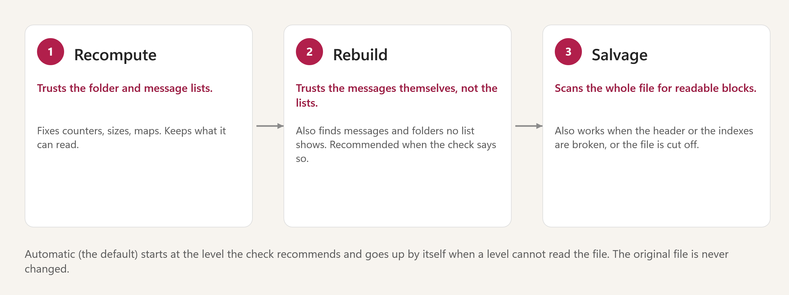
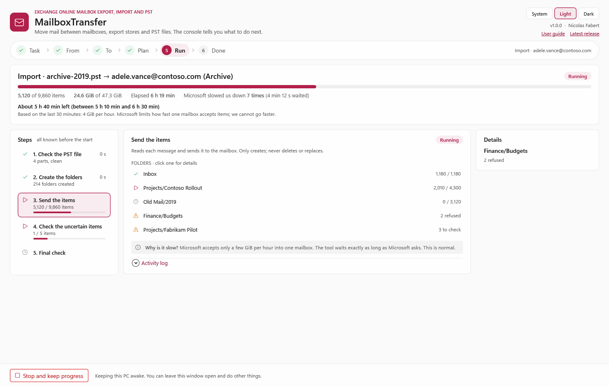

# Mailbox Transfer — Reference guide

> This guide is for the person who runs the tool every day and for the administrator who sets it up. It describes the parameters, the modes, the exit codes, the rights, the file formats and the limits. It does not teach the window step by step: that is the [user guide](MailboxTransfer-UserGuide.md), a second file, `MailboxTransfer-UserGuide.html`, in the same `docs` folder.

<!-- icon: layers -->
## 1. Overview

### What is in the package

```cards
terminal | Entry script | `Invoke-MailboxTransfer.ps1`: every mode of the engine on the command line. The console starts it as a child process for every long job.
file | Console | `Start-MailboxTransferConsole.ps1` and `MailboxTransfer.Gui*.ps1/.xaml`: the WPF window. `-Demo` runs it on made-up data.
gear | Engine | `MailboxTransfer.psm1` and `src\Engine.*.cs`: compiled in memory at the first use (a few seconds). Nothing is installed, no compiled copy is stored.
database | Store | `lib\sqlite`: SQLite for the export store (see THIRD-PARTY-NOTICES.md).
```

| Piece | Role |
|---|---|
| Engine | Microsoft Graph client with retry, export, import, the export store, a PST writer, reader, checker and repair, an EML writer and parser. No Outlook, no Exchange Online PowerShell and no third-party PST component. |
| Console | Task, From, To, Plan, Run, Done. One question per page. It follows a job through its **events file** and stops it with a **stop file** (chapter 9). |
| Entry script | `-Mode Export`, `ExportPst`, `Import`, `ImportPst`, `ExportEml`, `ImportEml`, `Browse`, `Status`, `CheckPst`, `RepairPst`. |

### Requirements

| Item | Minimum |
|---|---|
| Windows | Windows 10 or 11, x64 or arm64 (the SQLite library exists for both) |
| PowerShell | 7.5 for the console (its Fluent look needs .NET 9), 7.4 for the command line |
| Module | `Microsoft.Graph.Authentication` (its MSAL.NET library signs you in; nothing else of the Graph module is used) |
| Disk | The store and the PST files together are about twice the size of the data. A repair needs room for one more PST. The Plan page says it before you start. |
| Network | HTTPS to `graph.microsoft.com` and `outlook.office365.com` (global cloud only). Not needed for the tasks on files. |
| Not needed | Outlook, Exchange Online PowerShell, SCANPST, any third-party PST tool |

<!-- icon: lightbulb -->
## 2. Concepts

### Locations of a mailbox

A mailbox of Exchange Online is **one or more physical mailboxes**, each with its own id `MBX:<mailbox guid>@<tenant id>`.

| Location (`-Mailbox`) | What it is |
|---|---|
| `Primary` | The main mailbox. |
| `Archive` | The main archive. With `Export`, the items of its expanded folders are followed into the auxiliary archives. |
| `AuxArchive` | One auxiliary archive of an auto-expanding archive. Needs `-MailboxId`. |
| `All` | `Export` only: the primary, the archive and every auxiliary archive known. |

An **auto-expanding archive** is a main archive plus **auxiliary archives**. A folder of the main archive can be a placeholder whose items live in an auxiliary archive. The service tells the client with a redirect (`308`, `ErrorArchiveFolderMovedPermanently`, `409`); the engine follows all three. No Graph API lists the auxiliary archives: they are **learned** from the redirects and recorded in the store, or given up front with `-LocationsFile` (the output of Exchange Online `Get-MailboxLocation -User <upn>`; the tool does not need that module installed).



While Microsoft moves a folder, listing it fails: the folder is **deferred**, never exported as empty, and the run ends with exit code 2. Run the same command later.

### Recoverable Items

**Recoverable Items** is the hidden part of a mailbox where Exchange keeps what a user deleted from Deleted Items (retention 14 days by default, 30 at most), what was purged, the versions of items that were changed, and what a hold keeps. It is exported through the same import-export API as any folder, with full fidelity (properties and attachments). Measured on a test tenant (2026-11-09):

- the top-level folder listing of the API does **not** list Recoverable Items, but `GET .../folders/{id}`, `/items` and `/childFolders` work on its root and on the folders below it; the well-known names (`recoverableitemsroot`, `recoverableitemsdeletions`, `recoverableitemspurges`, `recoverableitemsversions`, `recoverableitemsdiscoveryholds`) work as folder ids; the ids are the same as the ones the Mail API gives;
- the root has six folders: `Calendar Logging`, `Deletions`, `DiscoveryHolds`, `Purges`, `SubstrateHolds`, `Versions`; `exportItems` with the ids of their items works;
- there is no `PidTagDeletedOn`: the time of the deletion is the last modification time of the item; the listing also returns items that are not messages (appointments), which the Mail API does not.

`-IncludeRecoverableItems` (`-Mode Export`; the console has the box *Include deleted items (Recoverable Items)* on the From page) reads the root and the folders asked for, and records them in the store under **one top folder**: `Recoverable Items`, `Recoverable Items/Deletions`… They are never mixed with the normal folders, in the store or in the PST (`Primary/Recoverable Items/Deletions`, 6.1). The default set is `Deletions`, `Purges`, `Versions` and `DiscoveryHolds`; `Calendar Logging` and `SubstrateHolds` (Microsoft's own copies) are exported only when `-RecoverableItemsFolders` names them (an explicit list replaces the default set). It works for `Primary`, `Archive` and `AuxArchive`: the whole mailbox with the deleted items added, or the deleted items alone with `-Folder 'Recoverable Items'` (the same folders) or `-Folder 'Recoverable Items/Calendar Logging'` (the one folder named); with a selection, tick the folders in the browse view (`-Mode Browse -RecoverableItems`): a ticked `Recoverable Items` with its subfolders takes the default set (or `-RecoverableItemsFolders`). A folder of the default set that the mailbox does not have is only noted; one named in the explicit list is reported as a problem.

**Restore.** An import of such an export (`Import`, and `ImportPst` of the PST) never goes back into Recoverable Items: nothing can be imported there. The folders under `Recoverable Items` are created in a normal folder named **`Restored deleted items`** (below `-TargetRoot` if one is given), for instance `Restored deleted items/Deletions`; a `-MappingFile` entry for `Recoverable Items` wins. The plan and the console say so before anything is sent. The items come back as ordinary items of that folder.

**Limits.** A soft-deleted or inactive mailbox cannot be reached (13.1). Recoverable Items cannot be written to by this tool, only read.

### Job, plan, selection

- A **job** is one run of the entry script. It has an id, a folder and a state. The same command run again does only what is left.
- A **plan** is the read-only run of a mode (`-WhatIf`): locations, folders, item counts, sizes, the number of PST files, the estimated time.
- A **selection** is what a person ticked in the browser: a JSON file (`-SaveSelection`, `-SelectionFile`), checked again against the service when the plan is built (a folder by id, else by path; an item by id, else by size and date).

### Uncertain items (Unknown)

An import sends one item with `importItem`. When no answer comes back (timeout, a 5xx, a dropped connection after the body was sent, a crash) the item **may exist**. Its row is **Unknown**. After `-ReconcileDelaySeconds` (300) the engine lists the target folder, takes the items created after the attempt began that no Done row accounts for, and compares them with the message (class, subject, send and delivery times, message id). One match: **Done**. None: sent again (`-MaxAttempts`, `-ReconcileRounds`). Several: left Unknown and reported. They are never replayed by themselves. `-NoAutoReconcile` turns the lookup off.



### Throttling

The Graph mailbox import and export API sits among the **Outlook service** resources, whose documented limits are per application and mailbox: 10,000 requests per 10 minutes, 4 concurrent requests, 150 MB of upload per 5 minutes. The engine obeys: `Retry-After` exactly, else 2 s, 4 s, 8 s… up to 60 s; the concurrency halves on 429 or 503 and grows back slowly; it never goes above 4. The run lists every 429 or 503 with the time waited. Never worked around.

<!-- icon: terminal -->
## 3. The command line

All examples run from the `package` folder. `-WhatIf` prints the plan in every mode and changes nothing (the files of the run itself, such as a store or a transcript, are always written).

### Modes

| `-Mode` | What it does | Writes to a mailbox |
|---|---|---|
| `Status` (default) | The state of a store: trees, counts, packs, import jobs; `-Locations` lists the locations; `-Unknown -Check` looks for uncertain items; `-ResolveUnknown <key> -As Imported\|NotImported` settles one. Without a store: version, configuration, whether the engine compiles. | No |
| `Browse` | Live view of a mailbox before any export: tree, rows, previews; `-SaveSelection` writes a selection. | No |
| `Export` | Mailbox to an export store (resumable, each item checked). With `-OutputPst`, then converts to PST. | No |
| `ExportPst` | Store to PST files; with `-PstPath`, chosen folders and messages of a PST to new PST files. | No |
| `ExportEml` | Messages to `.eml` files, from the live mailbox, a store or a PST. | No |
| `Import` | Store to a mailbox. | Adds only |
| `ImportPst` | PST file(s) to a mailbox, without Outlook. | Adds only |
| `ImportEml` | `.eml` files to a mailbox. | Adds only |
| `CheckPst` | Integrity check of a PST (`-Path`). Read only. | No |
| `RepairPst` | A repaired copy of a PST (`-Path`, `-Destination`). | No |

### Examples

```powershell
# look
.\Invoke-MailboxTransfer.ps1 -Mode Browse -Mailbox Archive                          # folder tree: items, size, unread
.\Invoke-MailboxTransfer.ps1 -Mode Browse -Folder Inbox -Top 10                     # rows: subject, sender, dates, size...
.\Invoke-MailboxTransfer.ps1 -Mode Browse -Folder Inbox -ItemId 2                   # preview of one item
.\Invoke-MailboxTransfer.ps1 -Mode Browse -Folder Inbox/Reports -IncludeSubfolders -SaveSelection D:\sel.json

# export
.\Invoke-MailboxTransfer.ps1 -Mode Export -SelectionFile D:\sel.json -StorePath D:\store
.\Invoke-MailboxTransfer.ps1 -Mode Export -Mailbox Archive -StorePath D:\store -OutputPst D:\pst\adele.pst -PstMaxSizeGB 10
.\Invoke-MailboxTransfer.ps1 -Mode Export -IncludeRecoverableItems -StorePath D:\store -OutputPst D:\pst\adele.pst   # also the deleted items, under "Recoverable Items"
.\Invoke-MailboxTransfer.ps1 -Mode Export -IncludeRecoverableItems -RecoverableItemsFolders Deletions,'Calendar Logging' -WhatIf
.\Invoke-MailboxTransfer.ps1 -Mode Export -Folder 'Recoverable Items' -StorePath D:\store                          # the deleted items alone (Deletions, Purges, Versions, DiscoveryHolds)
.\Invoke-MailboxTransfer.ps1 -Mode Browse -RecoverableItems                                                      # the tree with Recoverable Items
.\Invoke-MailboxTransfer.ps1 -Mode ExportPst -StorePath D:\store -OutputPst D:\pst\adele.pst -WhatIf

# import
.\Invoke-MailboxTransfer.ps1 -Mode ImportPst -PstPath D:\old\archive.pst -TargetRoot Imported/archive -WhatIf
.\Invoke-MailboxTransfer.ps1 -Mode ImportPst -PstPath D:\old\archive.pst -TargetRoot Imported/archive
.\Invoke-MailboxTransfer.ps1 -Mode Import -SourceMailbox Primary -Mailbox Archive -TargetRoot Restore -StorePath D:\store -WhatIf

# files
.\Invoke-MailboxTransfer.ps1 -Mode CheckPst -Path D:\pst\mail.pst
.\Invoke-MailboxTransfer.ps1 -Mode RepairPst -Path D:\pst\mail.pst -Destination D:\pst\mail.repaired.pst -Level Automatic
.\Invoke-MailboxTransfer.ps1 -Mode ExportEml -StorePath D:\store -EmlPath D:\eml
.\Invoke-MailboxTransfer.ps1 -Mode ImportEml -Mailbox Primary -EmlPath D:\eml -TargetRoot Imported-eml -WhatIf
```

### Parameters

| Parameter | Modes | Meaning |
|---|---|---|
| `-ConfigPath <psd1>` | all | The configuration file (chapter 12). |
| `-DeviceCode` | sign-in | Sign in with a code instead of the browser. The line `DEVICE CODE: <code> URL: <url>` goes to the console and to `device-code.txt`. A cached token makes it silent. |
| `-NoPrompt` | sign-in | Silent sign-in only. Without a valid cached token: exit 2, error code `signin-required`. |
| `-TenantId`, `-ClientId`, `-UserPrincipalName` | sign-in | Default from the `Lab` section of the configuration (chapter 12). Delegated sign-in as this user. With a certificate (next row): the application, its tenant and the **target mailbox**, never defaulted. |
| `-CertificateThumbprint`, `-CertificatePath`, `-CertificatePassword`, `-AppOnly` | sign-in | Sign in as the application, with a certificate (chapter 4.6): from `CurrentUser\My` / `LocalMachine\My`, or a `.pfx` read in memory. `-AppOnly` takes the certificate from the `Auth` keys. Not with `-DeviceCode`. |
| `-Mailbox` | Export, Import, Browse… | `Primary` (default), `Archive`, `AuxArchive`, `All` (Export). |
| `-MailboxId` | Export, Import, Browse… | One location: `MBX:<guid>@<tenant>`, a bare guid, or the SMTP address or UPN of a shared or another user's mailbox. |
| `-PrimaryMailboxId`, `-ArchiveMailboxId`, `-LocationsFile`, `-Locations` | ids | Where the ids come from, see chapter 4.4. |
| `-StorePath` | store modes | The store folder (`catalog.db` + `packs`). Default `<Output.Root>\transfer\store`. One writer at a time. |
| `-TempPath` | ImportPst | Where the journal and the repair copies live. |
| `-Concurrency` | Export, Import | Workers, 1 to 4 (default 4). The engine lowers it while Microsoft throttles. |
| `-BatchItems`, `-BatchMiB` | Export | Items per request (1 to 20) and megabytes per batch (default 20 and 200). |
| `-MaxAttempts` | Export, Import | Tries per item (default 3). |
| `-NotReadyTrip` | Export | After this many folders in a row that are not readable yet (default 3), the next ones are asked once and deferred. 0 = always three asks. |
| `-Folder` | Export, Import, Browse | Only this folder and below (path as in the store, or `Inbox/Reports`). |
| `-SelectionFile`, `-SaveSelection`, `-IncludeSubfolders`, `-ItemId` | Browse, Export | The selection, chapter 2. |
| `-Top`, `-Sort`, `-NoRecipients`, `-RecoverableItems`, `-BodyChars`, `-ShowMoves` | Browse | Rows shown (default 20, 0 = all), sort order, skip To and Cc, add Recoverable Items and its folders to the tree (they can be selected and exported), body characters (600), mark folders moved to an auxiliary archive. |
| `-IncludeRecoverableItems`, `-RecoverableItemsFolders` | Export (Browse for the list) | Also export Recoverable Items under the top folder `Recoverable Items` (Primary, Archive, AuxArchive); the folders to take, by name: default `Deletions`, `Purges`, `Versions`, `DiscoveryHolds`; `Calendar Logging` and `SubstrateHolds` only when named. Not with `-SelectionFile` (select the folders in the browse view) nor with a `-Folder` outside Recoverable Items. See "Recoverable Items" in chapter 2. |
| `-OutputPst`, `-PstMaxSizeGB`, `-PstMaxSizeMiB`, `-SeparateAuxArchives`, `-SkipCheck`, `-Force` | Export, ExportPst | The PST file or folder; part size (50 GB default, at least 1 GB; MiB wins and allows smaller); one top folder per auxiliary archive; do not check each part; start the conversion again from zero. |
| `-SourceMailbox` | Import | Which mailbox of the store to import (Primary or Archive). |
| `-TargetRoot`, `-MappingFile` | Import, ImportPst, ImportEml | Folder below which everything is created; `.psd1` or `.json` map of source prefixes to target prefixes (longest wins). |
| `-JobName` | Import | A name for the job; the same name resumes it (default `import`). |
| `-IncludeFolder`, `-ExcludeFolder`, `-FolderFile` | ImportPst, ImportEml, ExportPst from a PST | Only some folders: paths below the top folder, `*` and `?` wildcards, an exclusion wins; `-FolderFile` has one `+path` or `-path` per line (7.1). |
| `-PstPath`, `-MergeWellKnown`, `-PerFileSubfolder`, `-Repair`, `-RepairLevel`, `-KeepDamagedAttachments`, `-NoCheck` | ImportPst | The file(s) or the folder of parts; merge the PST's Inbox, Sent Items… into the mailbox's; one subfolder per file; repair a damaged file into a copy; repair level (default Rebuild); skip the check. |
| `-NoAutoReconcile`, `-ReconcileDelaySeconds`, `-ReconcileRounds` | Import, ImportPst | Chapter 2. |
| `-EmlPath`, `-EmlSource Live\|Store\|Pst`, `-MimeConversion Own\|Exchange`, `-Unread`, `-NoResume`, `-NoTransportHeaders` | ExportEml, ImportEml | Chapter 8. |
| `-Path`, `-Destination`, `-Level Automatic\|Recompute\|Rebuild\|Salvage`, `-KeepDamagedAttachments` | CheckPst, RepairPst | The PST, the new file, the level, keep damaged attachments. |
| `-Unknown`, `-Check`, `-ResolveAbsent`, `-ResolveUnknown`, `-As`, `-TargetItemId` | Status | Settle uncertain items. |
| `-EventsFile`, `-StopFile`, `-JobId`, `-KeepAwake` | all | The console contract, chapter 9. |
| `-Gui` | — | Opens the console; every other parameter is ignored. |

<!-- icon: key -->
## 4. The exact rights

The token is requested with `https://graph.microsoft.com/.default`: **what the administrator consents to is what the tool can do**. A missing permission shows as a precise 403 (the window says which one), never as a prompt in the middle of a run. No permission is ever used to delete or change an existing item. `importItem` uses a pre-authenticated URL and needs no scope. Personal Microsoft accounts are not supported. Global cloud only.

### 4.1 On the PC (no administrator rights)

Windows 10 or 11, PowerShell 7.5 (7.4 command line), the module `Microsoft.Graph.Authentication`, free disk, write access to the work folder.

### 4.2 In Microsoft Entra ID, once

An **app registration**, a public client: redirect URI `http://localhost`, **Allow public client flows** on (needed for the device code, otherwise error AADSTS7000218), the delegated permissions below, **admin consent**. Your tenant id and the application id go in `config\MailboxTransfer.config.local.psd1` (chapter 12). `tools\Grant-LabConsent.ps1` is a lab helper that does the registration changes and the consent for one user; read it before use.

### 4.3 Minimum delegated permissions per task (a person signs in)



| Task | Microsoft Graph delegated permissions | Why (the call that needs it) |
|---|---|---|
| Open, check, repair a PST or a store; write PST from a store; export EML from a store or a PST | **none**, no sign-in | local only |
| Browse, headers only | `MailboxFolder.Read`, `MailboxItem.Read` | folder tree and item listing of the import-export API (the only view of an auxiliary archive) |
| Browse with subject, sender, preview | the two above and `Mail.Read` | Mail API `mailFolders`, `messages`; the archive is addressed as `/users/MBX:<guid>@<tenant>` |
| Export (store or PST) | `MailboxFolder.Read`, `MailboxItem.Read`, `MailboxItem.Export` (or `MailboxItem.ImportExport`) | `folders`, `items`, `exportItems` |
| Export EML from the live mailbox | `MailboxFolder.Read`, `MailboxItem.Read`, `Mail.Read` | Mail API `messages/{id}/$value` |
| Import (store, PST, EML) | `MailboxFolder.ReadWrite`, `MailboxItem.Read`, `MailboxItem.ImportExport` | creates the folders; lists the target folder (lookup of uncertain items); `createImportSession` accepts **only** `ImportExport` |
| Import EML with `-MimeConversion Exchange` | the import list and `Mail.ReadWrite` | posts the `.eml` as a draft, exports it, deletes the draft (the tool's own draft only) |
| Find the mailbox ids by itself (optional) | `User.Read.All` | `GET /users/{id}/settings/exchange` (the archive id needs the beta endpoint). Without it, give the ids or a locations file. |

A `ReadWrite` variant is accepted for the matching `Read` (`MailboxFolder.ReadWrite` for `MailboxFolder.Read`, `MailboxItem.ReadWrite` for `MailboxItem.Read`, `Mail.ReadWrite` for `Mail.Read`).

One consent covering everything for a first lab: `MailboxFolder.ReadWrite`, `MailboxItem.Read`, `MailboxItem.ImportExport`, `Mail.Read` (and `User.Read.All` if wanted).

### 4.4 Where the mailbox ids come from

In this order: `-MailboxId`; `-PrimaryMailboxId` / `-ArchiveMailboxId` (or the `Lab` section); `-LocationsFile`; the locations recorded in the store; Graph (`GET /users/{id}/settings/exchange` for the primary with `User.Read.All`, Graph beta for the archive). An address in `-MailboxId` is resolved through Graph, or else through the import-export API, which accepts the address in place of the id (`parentMailboxUrl` of the folders). If everything fails the message names what was tried and asks for `-MailboxId MBX:...` (from `Get-MailboxLocation -User <address>`).

### 4.5 Shared mailboxes and other users' mailboxes

The tool signs in as one user and can work on another mailbox once that user has the Exchange right on it.

| Operation | Exchange right | Delegated permissions in the token |
|---|---|---|
| Browse, Mail API (subjects, senders) | FullAccess | `Mail.Read.Shared` (`Mail.Read` opens the signed-in user's own mailbox only) |
| Browse, import-export listing (counts, sizes, dates) | FullAccess | `MailboxFolder.Read`, `MailboxItem.Read` |
| Export | FullAccess | `MailboxFolder.Read`, `MailboxItem.Read`, `MailboxItem.Export` or `ImportExport` |
| Create a folder, **import** | FullAccess | **not possible delegated.** The service answers 403 `ErrorAccessDenied` and asks for `MailboxFolder.ReadWrite.All` or `.Shared`, and `MailboxItem.ImportExport.All` or `.Shared`. The delegated `.Shared` variants **do not exist** on Microsoft Graph. FullAccess does not change that. |

Without `Mail.Read.Shared` the Mail API answers 403 and the browse falls back to the import-export listing by itself (the run says so). FullAccess can take up to 60 minutes to apply. A mailbox the user has no right on answers 404 `ErrorItemNotFound` on the folder listing. The Calendar, Contacts, Tasks, Notes and Journal folders, which the Mail API does not list, are merged from the import-export API.

### 4.6 No person present (certificate, app-only)

Writing into a shared mailbox, or running with no person at the keyboard (scheduled or bulk jobs), needs **application permissions** and a sign-in as the application itself, with a certificate (OAuth client credentials). Delegated permissions for another mailbox (`.Shared`) do not exist for the import-export API, so this is the only way to create folders in, and import into, a mailbox that is not the signed-in user's.

```powershell
# every mode takes the same parameters; -UserPrincipalName is the address of the TARGET mailbox (no signed-in user, no /me)
.\Invoke-MailboxTransfer.ps1 -Mode Export -CertificateThumbprint <40 hex> -TenantId <tenant> -ClientId <app id> -UserPrincipalName projects@contoso.com -StorePath D:\store
.\Invoke-MailboxTransfer.ps1 -Mode ImportPst -CertificatePath D:\keys\mbt.pfx -CertificatePassword (Read-Host -AsSecureString) -TenantId <tenant> -ClientId <app id> -UserPrincipalName projects@contoso.com -PstPath D:\old\a.pst -TargetRoot Imported/a
```

- The certificate is found in `CurrentUser\My`, then `LocalMachine\My` (it needs its private key), or read from a `.pfx` (loaded in memory only). Its public part (`.cer`) is uploaded to the app registration (Certificates & secrets). The token (scope `https://graph.microsoft.com/.default`) is kept in memory; nothing is written to disk.
- `-TenantId` and `-ClientId` are never taken from the `Lab` defaults of a delegated sign-in: give them, or set `Auth.AppTenantId` / `Auth.AppClientId` (and `Auth.CertificateThumbprint` or `Auth.CertificatePath` with `-AppOnly`). `-UserPrincipalName` is required and never defaulted; the mailbox ids of the configuration are not used for it.
- A mailbox in the scope is found from its address alone; `-MailboxId` with an address or an `MBX:...` id works as in the delegated mode. `-DeviceCode` and `-NoPrompt` have no meaning here.
- The console offers **The application (certificate)** in the Sign-in card: tenant, application id, thumbprint and the mailbox, for the run only (nothing is saved). It does not show the end date of the certificate: look at it with `Get-ChildItem Cert:\CurrentUser\My | Format-Table Subject, NotAfter, Thumbprint`, and renew the certificate before it ends (a sign-in with an expired certificate fails).
- `Get-MbtAppPermission -Mode <mode>` prints the table below for a mode. `tools\New-MbtAppOnlyLab.ps1` is an optional script for a lab: it creates a dedicated application and a self-signed certificate and prints the steps with the ids filled in (`-WhatIf` first). The product never runs it.

| Task | Application permission (Microsoft Graph) | Why |
|---|---|---|
| Browse, `ExportEml` from a live mailbox (Primary, Archive) | `Mail.Read`, `MailboxFolder.Read.All`, `MailboxItem.Read.All` | The Mail API for the live view; the import-export API for the folders the Mail API does not list (Calendar, Contacts, Tasks...). |
| Browse an auxiliary archive | `MailboxFolder.Read.All`, `MailboxItem.Read.All` | The Mail API cannot open an auxiliary archive. |
| Export | `MailboxFolder.Read.All`, `MailboxItem.Read.All`, `MailboxItem.Export.All` (or `MailboxItem.ImportExport.All`) | Folder tree, inventory, `exportItems`. |
| Import, `ImportPst`, `ImportEml` | `MailboxFolder.ReadWrite.All`, `MailboxItem.Read.All`, `MailboxItem.ImportExport.All` | Create folders; look up an item whose answer was lost; `importItem`. |
| `ImportEml -MimeConversion Exchange` | the three above and `Mail.ReadWrite` | A draft is created with the Mail API, then exported. |
| Any mode, optional | `User.Read.All` | Find a mailbox id from an address (`settings/exchange`). Without it the tool finds the mailbox by its address through the import-export API, or give `-PrimaryMailboxId` / `-MailboxId MBX:...`. |
| Status, `ExportPst`, `CheckPst`, `RepairPst` | none | Local. |

The ".All" in the names is Microsoft's. What restricts the mailboxes is Exchange RBAC for Applications.

**Limit the application to some mailboxes (Exchange RBAC for Applications).** A tenant-wide admin consent gives the application every mailbox of the tenant. RBAC for Applications gives the same effect on the mailboxes of a management scope only. In Exchange Online PowerShell (member of Organization Management):

```powershell
# 1. a pointer to the service principal (ids of Entra "Enterprise applications", not of "App registrations")
New-ServicePrincipal -AppId <application (client) id> -ObjectId <service principal object id> -DisplayName "Mailbox Transfer"
# 2. the mailboxes it may use: any recipient filter, for instance an attribute you set on them
New-ManagementScope -Name "MbtMailboxes" -RecipientRestrictionFilter "CustomAttribute1 -eq 'MailboxTransfer'"
# 3. one assignment per role (Exchange roles carry the Graph permissions of the table)
foreach ($role in 'Application MailboxFolder.ReadWrite', 'Application MailboxItem.Read', 'Application MailboxItem.ImportExport', 'Application Mail.Read') {
    New-ManagementRoleAssignment -App <service principal object id> -Role $role -CustomResourceScope "MbtMailboxes"
}
# 4. check, per mailbox (bypasses the cache): InScope must be True
Test-ServicePrincipalAuthorization -Identity <application id> -Resource projects@contoso.com | Format-Table
```

| Graph application permission | Exchange application role |
|---|---|
| `MailboxFolder.Read.All` / `MailboxFolder.ReadWrite.All` | `Application MailboxFolder.Read` / `Application MailboxFolder.ReadWrite` |
| `MailboxItem.Read.All` / `MailboxItem.ReadWrite.All` | `Application MailboxItem.Read` / `Application MailboxItem.ReadWrite` |
| `MailboxItem.Export.All` | `Application MailboxItem.Export` |
| `MailboxItem.ImportExport.All` | `Application MailboxItem.ImportExport` |
| `Mail.Read` / `Mail.ReadWrite` | `Application Mail.Read` / `Application Mail.ReadWrite` |

- Scoping only holds if the same permission is **not** also consented tenant-wide in Entra: the effective access is the union of both. For a scoped application, do not grant admin consent to these permissions; assign them with RBAC. `User.Read.All` is not an Exchange role: it is an Entra consent and reads every user; leave it out.
- A change can take 30 minutes to 2 hours to apply. `Test-ServicePrincipalAuthorization` does not wait for it. With RBAC only, the token carries **no** `roles` claim for these permissions: the tool says so instead of reporting them missing, and Exchange alone decides.
- A mailbox outside the scope answers 403 `ErrorAccessDenied`; the error names `Test-ServicePrincipalAuthorization` and the management scope. An address that does not exist answers 404 or 500.
- Checked on a test tenant with RBAC only: certificate sign-in, browse of a shared mailbox, and folders created and items imported into a shared mailbox (then exported again: same subjects and classes; Exchange adds its own properties, as with a delegated import). Not checked: a write outside the scope, the archives with an application token, the Exchange conversion of `.eml` files, the behaviour after the certificate expires, a tenant-wide Entra consent instead of RBAC.

### 4.7 What the code cannot tell you: to confirm in your tenant

1. **Which account** may sign in to read another user's mailbox: an administrator with which role, a FullAccess delegate, or only the owner. The test tenant used the owner.
2. Whether `MailboxItem.ImportExport` alone also lets the tool list items and folders. The tool asks for the Read permissions as well to be safe, so the real minimum could be smaller.
3. Whether an **Exchange role** (a mailbox import-export role) is required in addition to the Graph permissions in your organisation.
4. App-only access to mailboxes in a production tenant (4.6).
5. The **quota** of a mailbox or archive: no API used here gives it. The window shows a quota only when a size is known.

<!-- icon: database -->
## 5. The export store

One export is one folder.

```text
D:\store\catalog.db            SQLite (WAL): folders, items, fingerprints, previews, import jobs
D:\store\packs\pack-000001.bin append-only archives, about 1 GiB each, an item is never split
D:\store\export.lock           held while the store is open for writing (one process)
```

- Each item is **one contiguous block** in a pack, with its pack, offset, length and **SHA-256** in the catalog. Never one file per item.
- Durability: the bytes are written and flushed, then the catalog row is committed. An item is *Exported* only after that.
- At opening, every pack is cut back to the end of its last committed item; items whose bytes are missing return to Pending; `importItem` rows that were in flight become **Unknown** (never replayed automatically).
- Item states: `Pending → Exported`, `Failed` (tried again while `-MaxAttempts` remain), and for imports `Pending → InFlight → Done / Failed / Unknown`.
- A second writer is refused with *The export is already open by another process*. `-Mode Status` and the console's Open task read a store while another process writes.
- The store holds **complete mail**. Protect it like the mailbox.

<!-- icon: file -->
## 6. PST files

The writer, the reader, the checker and the repair are the tool's own (Unicode PST, MS-PST). They need no Outlook.



### 6.1 Layout of the files

```text
<store display name>            the IPM subtree: "MailboxTransfer <user>"
  Deleted Items                 the one every PST has, empty
  Primary                       one top folder per location
    Inbox, Drafts, Sent Items, Deleted Items, Outbox, Junk Email, Calendar, Contacts, Tasks, Notes, Journal   (first, in that order)
    other folders by name, with their hierarchy
    Recoverable Items           only with -IncludeRecoverableItems: its own top folder, with Deletions, Purges, Versions, DiscoveryHolds below it
  Archive                       main archive and auxiliary archives merged (default)
  Archive auxiliaire 1 (xxxxxxxx)   only with -SeparateAuxArchives
```

Names, hierarchy and container class (`IPF.Note`, `IPF.Appointment`, `IPF.Contact`…) come from the recorded tree. The standard folders are ordinary folders with the right class, because one PST holds several locations and each has its own Deleted Items. The auxiliary archives are merged into the Archive tree by **folder entry key** (the same in every mailbox that holds a folder); a folder with another key stays separate.

### 6.2 Split

- Default part size **51,200 MiB** (`-PstMaxSizeGB 50`, Outlook's default `MaxLargeFileSize`), at least 1 GB; the window offers 50, 20, 10 or 5 GB; `-PstMaxSizeMiB` allows less (tests, small drives).
- **Items are never cut.** A part is closed when the next item would exceed the limit. An item larger than the limit is written **alone** in its own part, which then exceeds the limit; it is reported.
- Each part keeps the folder path of its items; the first part holds the whole tree, empty folders included.
- Files: `<name>.pst`, `<name>-002.pst`, `<name>-003.pst`…, `<name>.manifest.json`.

### 6.3 File names: reserved Windows device names

**Outlook crashes when it opens a PST named like a Windows device**, although the content is fine (a file `aux.pst` crashed Outlook, the same content under another name opened). The reserved names are `CON`, `PRN`, `AUX`, `NUL`, `CONIN$`, `CONOUT$`, `COM0` to `COM9`, `LPT0` to `LPT9` (also with the superscript digits), in any case, **with any extension** (`aux.pst`, `Con.v2.pst`).

| Case | What the tool does |
|---|---|
| A name **you give** that Windows cannot create (a device name, a forbidden character, a trailing dot or space) | Refused **before any work**, with the name to use instead (`aux.pst` becomes `aux_.pst`). Applies to `-OutputPst`, `-Destination`, `-SaveSelection`, the store folder. The window refuses it on the To page. |
| A name the tool **derives** (the default file name from the user of the store) | Made safe and reported: `aux` becomes `aux_`; other characters become `_`. Only auxiliary archives: `<user>-AuxArchive<n>.pst`. |
| A file that already has such a name | `Check` reports `FILE-RESERVED-NAME` (warning, exit 2) with the name to rename it to. Rename the file; the content is not touched. |

### 6.4 Manifest and resume

`<name>.manifest.json` is rewritten after each part. It holds `Complete`, the options, the locations, the folders, the **parts** (file, bytes, item and folder counts, `Oversize`, `Checked`, `CheckErrors`, `Verified`, and for each item its store key, folder, length and SHA-256) and the items that failed.

Run the same command again after an interruption:

- finished parts are verified (file present, size of the manifest, PST header, check result) and kept;
- an unfinished part is deleted and written again; so is a part that fails the verification, and every part after it;
- items of the kept parts are not written again;
- different options (part size, merge) are refused unless `-Force`, which starts again from zero; `-Force` and the rebuild of a part delete only the parts the manifest lists, never another file that looks like one (`Archive-2019.pst`);
- a lock file `<name>.pstexport.lock` stops two runs on the same destination.

Unless `-SkipCheck`, each finished part is read by the checker before the next starts; a part with errors is flagged (`Verified = false`, exit 1) and written again by the next run.

### 6.5 The check

The checker reports only. It verifies the header and CRCs, the allocation maps against every block and page, the block and node B-trees, every block, reference counts, orphan blocks, data and subnode trees, heaps, tables, the store, the name-to-id map, the folder tree and counts, the messages, and the file name. Exit codes of `CheckPst`: **0 clean, 2 warnings (or stopped), 1 errors**. Findings carry stable codes (for example `MSG-NOT-LISTED`, `FOLDER-PARENT-MISMATCH`, `DANGLING-ROW`, `CONTENTS-CELL`, `MSG-SIZE-COMPUTED`, `FILE-RESERVED-NAME`) and a severity: *error*, *warning*, or *information* (rules that only an old scan tool wants; they never change the exit code).

### 6.6 The repair

`RepairPst` writes a **new** file from a tolerant read of the damaged one. The source is never changed. The destination must not exist (unless `-Force`). The new file appears only when complete. Every level rewrites the whole content and recomputes counts, sizes, the header and the allocation maps.



| Level | Folders and messages come from | Fixes | Does not fix |
|---|---|---|---|
| `Recompute` | the folder and message tables (trusted) | counters, sizes, header, maps; a table row with no node is dropped and reported; a damaged message is kept as far as it decodes | a message or folder the tables do not list; damage of the B-trees or the header |
| `Rebuild` | the nodes and their parents (tables not trusted) | all of level 1, messages and folders no table lists, wrong parents, loops, name-map damage | damage of the B-trees or the header |
| `Salvage` | a scan of the whole file for valid blocks and valid node leaf pages | all of level 2, and the header, the B-trees, unreadable root pages, a cut-off file | a node whose leaf page is lost, damaged blocks beyond one wrong byte |
| `Automatic` (default) | the level the check recommends | with **escalation**: a level that cannot walk the file is replaced by the next one | |

A folder or message with no parent goes under **Recovered items** (`Lost folder 0x…` or `Unassigned`). A value is all or nothing unless `-KeepDamagedAttachments` (an attachment with unreadable blocks is zero-filled and renamed *name (damaged).ext*). Results are counted as **kept**, **partly recovered**, **lost**. A repaired file keeps every property that can be read; it does not carry folder properties other than name and container class, rules, views (associated items are kept), search folders, or a PST password.

### 6.7 What a PST keeps, drops and recomputes

Kept: every property of a message, its recipients, attachments and embedded messages at any depth, with their types; named properties by GUID and id or name. A PST has no string8 type (they return as Unicode, same text), no Exchange identifiers (folder id, change number…), and computes some properties itself (parent and entry ids, `PidTagMessageSize`, `PidTagAttachSize`, `PidTagHasAttachments`).

### 6.8 Choose and copy from a PST, read one message

- **Preview.** `Get-MbtPstPreview` (the reading pane of the console on a PST) gives the header of a message (subject, sender, To / Cc / Bcc, dates, class, size), the body as text (PR_BODY, else the text of the HTML, else of the RTF; `-BodyChars`, 20,000 by default) with the HTML when there is one, and the attachments (name, type, size). Read only; an attachment is never loaded.
- **Copy.** `Copy-MbtPst`, `-Mode ExportPst -PstPath <pst> -OutputPst <file or folder>` (**Export my ticks to a PST** in the console) writes the chosen folders and messages of a PST (or of the parts of a split one) into new PST files: same folder names, hierarchy and container classes, split on item boundaries at `-PstMaxSizeGB`, every file checked unless `-SkipCheck`. The folders are chosen as for the import (`-IncludeFolder`, `-ExcludeFolder`, `-FolderFile`); `-ItemNid` / `-IncludeItemFile` add single messages by node id. Folder-associated items and search folders are not copied. There is no resume: a copy that is stopped or fails leaves no file, and the destination is never overwritten (`-Force` deletes the files of an earlier copy). Exit codes: 0 finished, 2 stopped, 1 error, a file with check errors, or messages not copied (`refused-items`).

### 6.9 Limits

Unicode PST only (no ANSI, no password, no encryption when writing). A PST is rewritten, never patched in place: the disk must hold both files. A single value is limited to 4 GiB less one byte. The memory used does not depend on the size of an item (a value above 64 KiB is kept as a source). The repair was tested on the tool's own output and on synthetic damage; a damaged file written by Outlook was not available, and old versions of pages kept in the free space of a real file are the main untested risk of `Salvage`.

<!-- icon: upload -->
## 7. Import



### 7.1 Folders

The tree below the PST's top folder (or the store's) is recreated **below `-TargetRoot`**, with the container classes of the source. A folder is found by its name under its parent; it is **never renamed, deleted or merged by accident**: a second run creates nothing new. The Inbox, Sent Items, Deleted Items… of a PST are ordinary subfolders of the target root; `-MergeWellKnown` merges them into the real folders (recognised by the PST's entry ids, then by name in English, French, German, Spanish, Italian, Dutch and Portuguese, then by class). `-MappingFile` maps path prefixes; `-PerFileSubfolder` gives each file its own subfolder. Search folders and folder-associated items (rules, views) are not imported. A `/` in a folder name becomes `_`.

**Deleted items (Recoverable Items).** A folder `Recoverable Items` in the store or in the PST is not recreated under that name: its folders go to `Restored deleted items/<name>` (below `-TargetRoot` if given), because Exchange does not accept an import into Recoverable Items. A `-MappingFile` entry for `Recoverable Items` wins. Chapter 2, "Recoverable Items".

**Some folders only.** `-IncludeFolder` / `-ExcludeFolder` (and `-FolderFile`, one `+path` or `-path` per line) take paths below the top folder (`Inbox`, `Inbox/Projects`) of the PST or of the `.eml` folder. A path takes the folder and the folders below it; `*` and `?` are wildcards (a backtick makes one literal); an exclusion wins (`Inbox` with `Inbox/*` excluded is the Inbox alone). A pattern that matches nothing is reported, a run in which no folder is chosen stops before it creates anything, and the folders above a chosen one are created empty. The plan and the job use the same choice; the console writes it from the ticks of the From page.

### 7.2 The journal and the item states

Store imports use the store's import jobs. PST imports use a journal (`<TempPath>\pstimport.db`): one row per message, unique on (job, file, node, fingerprint). The fingerprint is a SHA-256 of the file identity, the node id, the data block ids, the identifying properties and the size, so an unchanged message is never added twice and a modified one is a new item.

| State | Meaning |
|---|---|
| `Pending` | to do |
| `InFlight` | sent, no answer yet |
| `Done` | created (target item id and the SHA-256 of what was sent are recorded) |
| `Failed` | nothing created; tried again by the next run while `-MaxAttempts` remain |
| `Refused` | cannot be imported **for good**: a bad block, not expressible, HTTP 400, 413, 415, 422, or nothing created on every attempt allowed; not tried again; listed with the reason |
| `Unknown` | the item may exist (chapter 2) |

The end of an import tells what **this run** did and what the **whole job** looks like. The job is **complete** when every row is Done or Refused; with Refused rows it ends with exit code 1 and reason `refused-items`, there is nothing to run again, and every refused item is in `<TempPath>\<JobName>-not-imported.csv` (the console links to it on the Done page).

- **Same job, same options.** The journal records where the items of a job go (`-TargetRoot`, `-MappingFile`, `-MergeWellKnown`, `-PerFileSubfolder`); resuming the job with other options is refused (give the same options or another `-JobName`). Choosing other folders of the same PST is allowed.
- **A folder that cannot be created** leaves its items as Failed rows (exit 2); the next run creates the folder again and sends them. A 2xx answer of `importItem` that cannot be read means the item exists: Unknown, never sent again.
- **One process per journal** (a lock file next to `pstimport.db`), and the rows are written with `synchronous=FULL`, so a power cut cannot lose a state. A PST is identified by its path, size, date and a tag of its content: a file that changed under the same name is reported, not silently taken for the same one.

### 7.3 Damaged files

Each PST is checked first. A file with errors is **refused** (nothing imported, the error names the findings). With `-Repair` it is repaired into a temporary copy (`-RepairLevel`, `-KeepDamagedAttachments`), the copy is imported and kept so that a second run reads the same nodes. `-NoCheck` skips the check (messages that cannot be read are then refused one by one).

### 7.4 FastTransfer import rules

`importItem` takes a FastTransfer stream (the format Microsoft uses to move one item). It accepts a stream **this tool built**, not only the streams Exchange exported, provided it has the shape of an export. One construction, `FxImportStream`, serves the PST and the EML import, and **decodes the stream it built again** and compares its recipients, attachments and embedded messages with the message before anything is sent.

| Rule | Without it |
|---|---|
| The Graph envelope: record type 1 (8 bytes) then the stream in data records (type 2, 31,680 bytes) | A bare stream: 400 `ErrorUploadItemsCorruptedData` |
| `FXDelProp(PidTagMessageRecipients)` before the recipients, `FXDelProp(PidTagMessageAttachments)` before the attachments of the top-level message | The item is created **without** its recipients and attachments, silently |
| `PidTagRowid` is the first property of every recipient | 500 `ErrorInternalServerError`, nothing created |
| An embedded message starts with `PidTagMid`, and its attachment does not carry the empty `PidTagAttachDataObject` | 500 `ErrorInternalServerError`, nothing created |

Strings as Unicode are accepted. Recipient record keys, entry ids and object types are added by Exchange.

### 7.5 What Exchange keeps, changes and drops

Measured by importing 23 items (15 messages, 5 calendar items, 3 contacts), exporting them again and comparing them property by property:

| | Properties |
|---|---|
| **Kept exactly (23 of 23)** | subject, bodies, class, sender and sent-representing fields, `ClientSubmitTime`, **`MessageDeliveryTime` (the received date stays the original)**, flags, importance, sensitivity, categories, follow-up flag, every recipient, every attachment (name, type, inline flags, bytes), embedded messages (two levels), extended properties, custom headers, appointment and contact fields |
| **Changed by Exchange** | creation and last-modification times (the time of the import), the folder name property, `PidTagAttachSize`, change tracking and search keys, indexing, classification and calendar-assistant properties |
| **Dropped** | what a PST computes and Exchange does not store: `DisplayTo`, `DisplayCc`, `DisplayBcc`, `MessageSize`, `MessageStatus`, the empty object marker of an embedded message |
| **Added by Exchange** | recipient record key, entry id and object type, `PidTagMid` of embedded messages |

Imported items show the import date as **created** date; the original **received** date is kept. The container class of a folder is the one of the source; if the service refuses it, `IPF.Note`.

<!-- icon: mail -->
## 8. EML files

`.eml` files from and to any location, with the tool's own MIME code.

### 8.1 Export

- The folder tree becomes a directory tree, one `.eml` per message named `yyyyMMdd-HHmmss Subject [id hash].eml` (received time, UTC). Names are made safe (invalid characters, reserved device names, trailing dots, length: the whole path stays under 240 characters).
- `manifest.jsonl`: one line per message (`State` Exported, Skipped or Failed, id, folder, file, subject, class, size, SHA-256, received, read state, reason, notes). Resumable: an exported message whose file is in place is not read again; `Failed` is tried again.
- **Live** (`Mail.Read`): `GET /users/{mailbox}/messages/{id}/$value`, up to 4 workers. An auxiliary archive is not reachable by the Mail API: export it to a store or a PST first, then run the EML export from there.
- **From a store or a PST**: MAPI to MIME. Headers from `PR_TRANSPORT_MESSAGE_HEADERS` when present (kept line for line), the missing ones from the properties; bodies in plain text, HTML or the HTML of an RTF body; structure `mixed(alternative(plain, related(html, inline images)), attachments)`; embedded messages as `message/rfc822`; RFC 2047 and RFC 2231 names. Not exported, but reported in the notes: OLE attachments and attachments by reference. A meeting request's `text/calendar` alternative is not built.
- Not messages (appointments, contacts, tasks, notes) are reported, not exported. No `.ics` or `.vcf` conversion.

### 8.2 Import

`.eml` → parser → MAPI model → FastTransfer stream → `importItem` (the same pipeline as the PST import, works for every location). Folders are found by name or created below `-TargetRoot`. Items are `IPM.Note`, **not drafts**, **read by default** (`-Unread` to change); `PR_CLIENT_SUBMIT_TIME` is the `Date`; the **received** time Outlook sorts by comes from the manifest, else `X-MailboxTransfer-Received`, else the topmost `Received`, else `Date`. The whole header block is kept in the message's Internet headers. The parser is tolerant (bare LF, missing boundaries, 8-bit headers, unknown charsets, damaged base64 or quoted-printable); what was repaired is in the notes of the item. Resumable through `import-state.jsonl`. The state file writes `InFlight` before the request leaves: a failure before it (folder, session, conversion) is `Failed`; a failure after it (timeout, 5xx, an answer that cannot be read, a run stopped or killed inside the request) is `Unknown`, reported by every later run until it is settled with `Resolve-MbtEmlUnknown` (`-As Imported` when the item is in the mailbox, `-As NotImported` to send it again; `-Mode ImportEml -ResolveEml Imported|NotImported`). `-IncludeFolder` / `-ExcludeFolder` import only some folders (7.1).

`-MimeConversion Exchange` (off by default) lets Exchange do the MIME to MAPI conversion: the `.eml` is posted as a draft, `exportItems` gives Exchange's own stream, the tool patches the draft and read flags and the delivery time, deletes **its own draft**, and imports. It needs `Mail.ReadWrite`, and only works for the primary and the main archive.

### 8.3 Fidelity against Exchange's own MIME

Measured on a test mailbox, read only, MIME built from an `exportItems` stream against `GET …/$value` of the same message:

| Point | Exchange `$value` | This tool (MAPI to MIME) |
|---|---|---|
| From, To, Cc, Bcc, Subject, Date, Message-ID, In-Reply-To, References, Reply-To, Importance, Sensitivity | present | same values |
| Received, DKIM, X-MS-Exchange-* | partly regenerated | the original block when it exists (more complete than `$value`) |
| `X-MailboxTransfer-Received` | — | added when there is no Received header |
| Thread-Topic, Thread-Index | built | built from the properties |
| plain text body | exact text, long lines re-wrapped | the stored text as it is |
| HTML body | re-serialised | the stored HTML as it is |
| text alternative of an HTML-only message | built | built (not the same text) |
| attachments, inline images, embedded messages | same bytes | same bytes |
| `text/calendar` of a meeting request | built | **not built** |

After an import (own conversion) against the source `.eml`: text bodies, attachments, structure, From, To, Cc, Subject, Date and Message-ID are the same, and the received time is the expected one. Headers that are not MAPI properties are kept in the Internet headers but Exchange does not give them back in `$value`. The Exchange conversion is the more faithful one (every header, the tree exactly as the source), but it needs `Mail.ReadWrite`, goes through a draft and works for the primary and main archive only.

<!-- icon: clock -->
## 9. Events, status and the files of a job

A long job is run by the entry script in a child process. The console never reads its text: it reads **`events.jsonl`** and **`status.json`**, and stops the job with a **stop file**. The full contract, field by field, is in [MailboxTransfer-Events.md](MailboxTransfer-Events.md).

- `-EventsFile <path>`: one JSON object per line (UTF-8, no BOM, flushed at each line). The folder is the job folder; `status.json` (the state for the **Continue a job** list) is written beside it.
- `-StopFile <path>`: when the file exists the job stops like Ctrl+C: requests in flight finish, state is saved, **exit 2**, next `continue`, reason `stopped`. Looked at when the script starts, then every second.
- `-KeepAwake`: Windows does not sleep by idle while the script runs. A closed lid, a chosen Sleep and a restart still stop the PC.
- `-NoPrompt`: silent sign-in only; without a valid token, exit 2, error `signin-required`.
- Event kinds: `plan`, `step`, `object`, `item`, `wait`, `rate`, `warn`, `decision`, `error`, `result`, `slept`, `info`.
- The console keeps each job in `<work folder>\jobs\<date>-<task>-<id>\`: `request.json`, `selection-*.json`, `events.jsonl`, `status.json`, `stdout.txt`, `report.csv`, `report.json`. The default work folder is `%LOCALAPPDATA%\MailboxTransfer`. A run changed in **Run settings** writes an *effective* configuration there; the configuration file of the package is never modified.

<!-- icon: check -->
## 10. Exit codes

One rule for every mode. When several apply, the order is **3, 2, 1, 0**.

| Code | Meaning | `result.next` |
|---|---|---|
| 0 | Complete: nothing is left to do and nothing was lost. | `done` |
| 1 | An error stopped the run, **or** (`ImportPst`, `ExportPst` from a PST) the job is finished but some items are refused for good: reason `refused-items`, `complete` true. There is nothing to continue; `<TempPath>\<JobName>-not-imported.csv` and one `item` event per refused item (the first 200) say which. | `retry` (error), `done` (refused) |
| 2 | Not complete and resumable: run the same command again, it does only what is left (Pending or Failed rows, a deferred folder, a stopped run, items of the store not exported yet, a folder of the target that could not be created, a sign-in to renew). | `continue`, `signin` |
| 3 | Rows are Unknown (the item may exist). They are never replayed by themselves: settle them (`-Mode Status -Unknown -Check`; `Resolve-MbtEmlUnknown` for `.eml` files), then run again. | `decide` |

A row is **Refused** (final) when trying again cannot change the answer; a job is complete when every row is Done or Refused. A console chain of commands ends with the worst code of its commands.

| Mode | Specifics |
|---|---|
| `Export` | 2: a folder deferred, a folder or item failed, or stopped. |
| `ExportPst` | 1 also when a part failed its check; 2: cancelled, some items not written, or a store with items not exported yet. |
| `Import`, `ImportPst`, `ImportEml` | 0: every row Done; `ImportPst`: refused rows give 1. |
| `ExportEml` | 2: failed items or stopped. |
| `CheckPst` | 0 clean, 2 warnings or stopped, 1 errors. |
| `RepairPst` | 0 repaired and clean, 2 stopped or errors remain, 1 error. |
| `Browse`, `Status` | 0 ok, 1 error. |

<!-- icon: gauge -->
## 11. Limits and throughput

| What | Value | Source |
|---|---|---|
| Items per `exportItems` request | 20 at most | the API |
| Import speed into one mailbox | **about 4 GiB per hour**; more workers do not help | measured on a test tenant (3.4 to 4 GiB/h) and consistent with the Outlook service limits |
| Export speed | **30 up to about 150 GiB per hour**, varies with Microsoft's load | measured |
| Writing, checking, repairing a PST | local disk speed | |
| Outlook service limits (per app and mailbox) | 10,000 requests per 10 minutes, 4 concurrent requests, 150 MB upload per 5 minutes | Microsoft documentation |
| Workers | 1 to 4, lowered by throttling | |
| PST part size | 50 GB default, 1 GB or more | |
| A single value in a PST or stream | 4 GiB less one byte | |
| Message size accepted | the organisation's limit; an item above it is refused and listed | the service |
| Lifetime of an import session | short; one session per mailbox is reused until it is about to expire | |
| Not supported | personal Microsoft accounts, sovereign clouds, ANSI PST, PST passwords, search folders, rules, scheduling, several jobs at once | |

Memory does not depend on the size of an item, in both directions: the peak working set of the whole process was a few hundred MiB for an import of a PST of 1.2 GiB with attachments of 100 MiB.

<!-- icon: settings -->
## 12. The configuration file

`config\MailboxTransfer.config.psd1` holds the defaults; every key is optional. **Do not write your tenant, application or mailbox ids in it.** Put them in **`config\MailboxTransfer.config.local.psd1`**, same layout, only the keys you change. It is read after the shipped file, it is ignored by git and it is never part of a package. The environment variable `MAILBOXTRANSFER_LOCAL_CONFIG` names another file.

| Section.Key | Default | Meaning |
|---|---|---|
| `Graph.BaseUrl` | `https://graph.microsoft.com/v1.0` | |
| `Graph.MaxAttempts`, `BaseBackoffSeconds`, `MaxBackoffSeconds` | 6, 2, 60 | retry of 429, 503, 504 |
| `Graph.RequestTimeoutMinutes` | 15 | time allowed for the headers of one answer |
| `Graph.ExportBatchSize` | 20 | 1 to 20 |
| `Graph.ItemPageSize` | 0 | `$top` of item listings; 0 = the service chooses |
| `Auth.Scopes` | `https://graph.microsoft.com/.default` | |
| `Auth.RedirectUri` | `http://localhost` | |
| `Auth.CacheFile` | `%LOCALAPPDATA%\MailboxTransfer\token.cache` | token cache, encrypted with DPAPI for the current user |
| `Output.Root` | `.\out` | |
| `Lab.TenantId`, `ClientId`, `UserPrincipalName` | empty | the defaults of the command line and the console; also parameters |
| `Lab.UserObjectId` | empty | only for `tools\Grant-LabConsent.ps1` |
| `Lab.PrimaryMailboxId`, `ArchiveMailboxId` | empty | `MBX:<guid>@<tenant>`; empty: read through Graph when allowed |
| `Lab.SourceFolder`, `TargetFolder` | empty | defaults of the lab script |
| `Auth.AppTenantId`, `AppClientId` | empty | the tenant and the application of the certificate sign-in (chapter 4.6); `-TenantId` / `-ClientId` win |
| `Auth.CertificateThumbprint`, `CertificatePath` | empty | the certificate used by `-AppOnly`; `-CertificateThumbprint` / `-CertificatePath` win |

An unknown section or key is refused with its name.

<!-- icon: lifebuoy -->
## 13. Technical troubleshooting

| Message | Cause | Action |
|---|---|---|
| `SIGNIN-REQUIRED: no valid sign-in is cached and -NoPrompt forbids asking for one.` | The job was started silently and the token is gone or expired. | Sign in in the console, or run without `-NoPrompt`. |
| `The export is already open by another process: <path>` | Another job writes to the store. | Wait for it, or stop it. Reading is always allowed. |
| `The MailboxTransfer engine loaded in this PowerShell session is an older build…` | The sources changed while the session lived. A compiled engine cannot be replaced in a running process. | Open a new `pwsh`. |
| 403 `ErrorAccessDenied`, *Delegate access to this API requires the following permissions…* | The token lacks a permission, or you work on another user's mailbox with a delegated token. | The message names the permissions. See 4.3 and 4.5. |
| 404 `ErrorItemNotFound` on a folder listing of a shared mailbox | The signed-in user has no right on that mailbox. | Grant FullAccess; allow up to 60 minutes. |
| AADSTS7000218 | **Allow public client flows** is off. | Switch it on in the app registration. |
| AADSTS50173, AADSTS700082 | The sign-in grant expired. | Sign in again. |
| 308, `ErrorArchiveFolderMovedPermanently`, 409 | A folder lives in an auxiliary archive. | Followed by the engine. Nothing to do. |
| A folder *deferred*, exit 2 | Microsoft is moving it. | Run the same command later. |
| `unknown key 'Section.Key'` in a configuration | A typo in a configuration file. | Fix the key. |
| *it is the reserved Windows device name AUX…* | 6.3. | Use another name. |
| *-AppOnly needs -CertificateThumbprint or -CertificatePath…*, *App-only sign-in has no signed-in user…* | The certificate sign-in lacks its certificate, its tenant or application, or the address of the target mailbox. | Give them (4.6). |
| 403 `ErrorAccessDenied` with an application token, the error names `Test-ServicePrincipalAuthorization` | The mailbox is outside the management scope of the application, or the RBAC assignment is not applied yet. | Check the scope (4.6); allow up to two hours after a change. |
| *Sign-in needs the tenant and the application (client) id…* | Neither the command line nor the configuration names them. | Give `-TenantId` and `-ClientId`, or write them in `config\MailboxTransfer.config.local.psd1` (chapter 12). |
| `Graph.ExportBatchSize must be between 1 and 20` | | Fix the value. |
| *The mailbox MBX:… cannot be reached by the mailbox import-export API* (the service answered a bare 500, or 404 `ErrorInvalidUser`, on the folder listing) | A soft-deleted or inactive mailbox has no route in Exchange Online. | 13.1. |
| *-IncludeRecoverableItems adds Recoverable Items to the export of the whole mailbox…*, *-RecoverableItemsFolders needs -IncludeRecoverableItems* | The option was combined with a selection, with another folder, or given a list alone. | Use `-Folder 'Recoverable Items/Deletions'`, or select the folders in the browse view. |
| *'X' is not a folder of Recoverable Items* | A name that the service does not use. | The names are Calendar Logging, Deletions, DiscoveryHolds, Purges, SubstrateHolds, Versions. |

### 13.1 A soft-deleted or inactive mailbox cannot be reached

The mailbox import-export API reads the **physical** mailboxes that Exchange Online can route to. Two kinds of mailbox have no route, and nothing can be exported from them with this tool:

- a **soft-deleted** mailbox: its user was deleted less than 30 days ago (the mailbox waits in the recycle bin of the directory);
- an **inactive** mailbox: the user was deleted while the mailbox was on hold (litigation hold, retention), so Exchange keeps the mailbox without a user.

Measured on a test tenant (2026-11-09): the folder listing of such an id answers a bare `500` (no code, no message) or `404 ErrorInvalidUser`. The engine turns both into one message (`MailboxNotReachableException`) that names the mailbox and the supported routes, and the export stops before anything is written. The same check is in Browse, the console and every mode that lists the folders of a mailbox.

The supported routes are the ones of Exchange, not of this tool:

1. **Soft-deleted mailbox:** restore the user within 30 days (Microsoft 365 admin center, *Deleted users*, or the Exchange Online cmdlet `Undo-SoftDeletedMailbox`), wait until the mailbox is active, then export it.
2. **Inactive mailbox:** recover it into an active mailbox, either by restoring its content into an existing active mailbox (`New-MailboxRestoreRequest -SourceMailbox <inactive> -TargetMailbox <active>`) or by recovering it as a new mailbox, then export that **active** mailbox.
3. If the mailbox is active, the id is wrong: check it (`Get-Mailbox -Identity <user> | Format-List ExchangeGuid`, or `-Mode Status -Locations`) and run again.

<!-- icon: shield -->
## 14. Data handling and integrity

- An export store and PST files contain **complete mail**. They stay on the disk you chose. Protect them like the mailbox. They are never part of the repository (`*.fxs`, `*.sqlite` and `out\` are ignored).
- The sign-in cache is per user and encrypted with DPAPI. With a certificate sign-in, the certificate stays in the Windows store (or a `.pfx` you name, whose password is never written); the token of the application is kept in memory only. The token cache is written to a temporary file and swapped in, and guarded across processes. The pre-authenticated import URL contains a short-lived token and is never logged.
- No telemetry. The tool contacts Microsoft only, for the tasks that need a mailbox.
- The third-party components at run time are SQLite and Microsoft.Data.Sqlite (store), and MSAL.NET (taken from the installed `Microsoft.Graph.Authentication`). Details and licences: `THIRD-PARTY-NOTICES.md`.
- **The package is signed and checked.** The release ZIP carries Authenticode signatures (owner certificate `0F28E442889F17B5F4D251E8F96E7CC6E2C9C6D6`, timestamped) on every PowerShell file, and `PackageIntegrity.psd1`, a signed list of the SHA-256 of every other file (C# engine, SQLite libraries, window definitions, guides, README, notices, launcher). `src\Test-PackageIntegrity.ps1` verifies them. It runs in `Invoke-MailboxTransfer.ps1`, `Start-MailboxTransferConsole.ps1` and when the module is imported, before the engine is compiled or the window is built; a changed, missing, unlisted, duplicated or reparse-point file stops the tool with a message that names it. There is no unsigned mode; a source checkout (no manifest) is started with `-DevelopmentMode`, and the tool says that nothing is verified. Not checked, by design: `config\MailboxTransfer.config.psd1` and `config\MailboxTransfer.config.local.psd1` (data you edit), and the generated `out\` and `logs\` folders; a signature detects a change, it does not stop the file system from being written. Keep exports and PST files outside the package folder.
- **Verify a download by hand.** Right-click a `.ps1` of the package, *Properties*, *Digital Signatures*: the signer is `Nicolas Fabert`. The SHA-256 of the ZIP is in the notes of the release. `Get-AuthenticodeSignature .\Invoke-MailboxTransfer.ps1 | Format-List Status, SignerCertificate, TimeStamperCertificate` shows the same in PowerShell.
- **Build a package.** `tools\New-MailboxTransferPackage.ps1 -Zip` (maintainer) copies the run-time files of `package\`, adds `CHANGELOG.md` and `SECURITY.md`, and verifies the result; `tools\Get-SigningInventory.ps1` lists the files to sign and `tools\New-PackageIntegrity.ps1` writes the manifest after the signatures.
- **Logs.** Each run writes `MailboxTransfer_<date>.log` (`INFO`, `OK`, `WARN`, `FAIL` lines with a time, no colour, no secret): in `out\logs` for the command line (or `-LogFolder`, or the environment variable `MAILBOXTRANSFER_LOG_FOLDER`), in `<work folder>\logs` for the jobs of the console. Files older than 14 days are deleted. `MBT_ICONS` (`Emoji`, `Symbols` or `Ascii`) forces the icon style of the command line; `NO_COLOR` turns the colours off.

---

**Back to** the [user guide](MailboxTransfer-UserGuide.md).
