# Mailbox Transfer — User guide

> Follow the path, one step after the other. Each step says **what to do**, **what you should see**, and **what to do if not**. You do not need to know anything before you start: every word is explained, and the glossary at the end says **where on the screen to look**. How the tool works inside, every setting, the exact rights and the file formats are in the [reference guide](MailboxTransfer-Guide.md). It is a second file, `MailboxTransfer-Guide.html`, in the same `docs` folder as this one.

> [!IMPORTANT]
> Windows marks files downloaded from the Internet. After you extract the ZIP, check the publisher first (right-click a `.ps1`, for example `Invoke-MailboxTransfer.ps1`, Properties, Digital Signatures: `Nicolas Fabert`), then unblock the extracted folder once:
>
> ```powershell
> Get-ChildItem "C:\Tools\MailboxTransfer" -Recurse -File -Force | Unblock-File
> ```
>
> Replace the example path with the folder where you extracted the ZIP.

> [!WARNING]
> **Stop and ask.** If a step does not go as written, do not guess and do not click again and again. Write down what you see. A photo of the screen is enough. Then call your administrator, or the person who gave you this guide. Exporting never changes a mailbox. Importing adds items to a real mailbox, so do your first import into a **test mailbox**.

<!-- icon: flow -->
## 1. Start here

### What this tool does

Mail lives in a **mailbox** on Microsoft's servers. Sometimes you need that mail somewhere else: a copy on your own disk, a file Outlook can open, or the contents of an old file put back into a mailbox. This tool does that, also when the mailbox is very big (tens of GB) and the job takes hours.

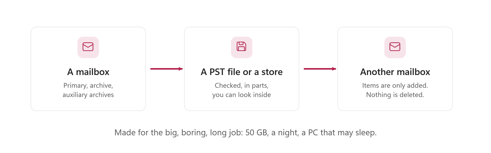

Think of a **removal van with a checklist**. The tool first writes down what goes into the van. It can stop on the road and carry on from where it stopped. It never throws anything away, and it never replaces what is already in the new house.

> [!NOTE]
> The tool has a window, called **the console**. It asks one question per page and tells you what to do next. You do not have to type commands. Everything the console does can also be done from a command line, and the console shows you that command line (see "The same from the command line" below and the [reference guide](MailboxTransfer-Guide.md)). Typing commands is never required in this guide, except for two lines in chapter 3.

### Which task is mine?

Ask yourself one question. Then read the right column.

| I want to… | My task | Changes a mailbox? |
|---|---|---|
| keep a copy of a mailbox, or of some of its folders, on my disk | **Browse and export** (chapter 4) | No. It only reads. |
| put the mail of a PST file, an export, or `.eml` files into a mailbox | **Import** (chapter 5) | Yes. It only adds. |
| Outlook says my PST file is damaged, or will not open it | **Check and repair a PST** (chapter 6) | No. It works on files. |
| only look inside a PST file or an export | **Open an export or a PST** (chapter 7) | No. |

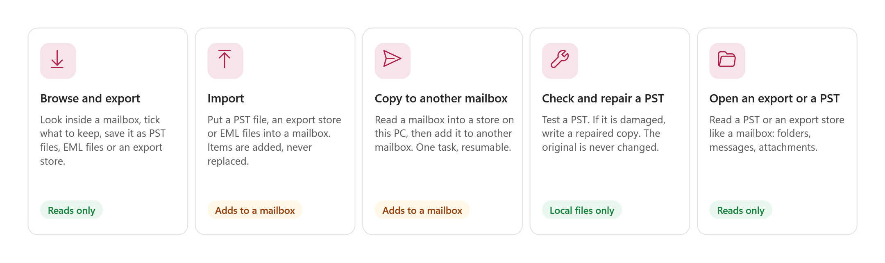

### The path

You do steps **1 to 4** of chapter 3 once. After that every task follows the same five pages, in the same order.

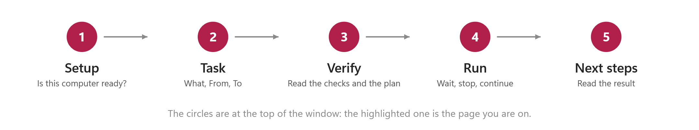

```steps
Setup | Check that this computer is ready and how you sign in. Nothing to type if the configuration file is filled in.
Task | Say what you want to do (What), where the mail comes from (From) and where it goes (To).
Verify | Read the checks and the plan. Nothing starts before you press Start.
Run | Wait. You can leave the window open and do other things. You can stop and continue later.
Next steps | Read the result in plain words. Buttons offer what to do next.
```

### What you will see on the screen

The window always looks the same. Learn these four places and you will never be lost.

| Where on the screen | What it is | Why you look at it |
|---|---|---|
| **Top of the window, the row of five circles** | The **stepper**: Setup, Task, Verify, Run, Next steps. Under **Task** three small words, **What**, **From** and **To**, show where you are inside it. The filled crimson circle is the page you are on. A circle with a tick is a page you finished. At the right end, a short line reminds you what you chose. | To know where you are. You can click a page you already passed to go back. Nothing can be clicked while a job runs. |
| **Top right corner of the window** | Three small buttons, **System**, **Light** and **Dark**, which change the look of the window (System follows Windows), then the version of the tool, then two links: **User guide** (this guide, in your browser) and **Latest release** (the download page on GitHub). | To change the look if you find it hard to read, or to open this guide again. |
| **The big area in the middle** | The page itself: one question, with safe answers already chosen. The answer marked **recommended** is the safe one. | To answer the question. |
| **Bottom of the window, the strip with two buttons** | **Back** on the left (on the Run page, **Stop and keep progress**). The main button on the right (**Choose a task**, **Continue**, **Start**…). A short sentence between them says what the page wants. | To move on. If the main button is grey, the sentence says what is missing. |

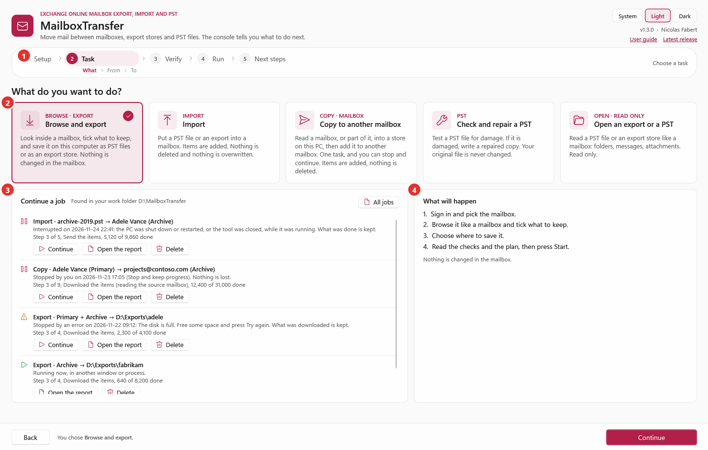

> [!TIP]
> **Every run is also an ordinary command.** The Verify page and the Next steps page show **The same from the command line**: the exact command of what you are about to run or just ran. **Copy** puts it on the clipboard, for a script or for your administrator. You never have to type it.

### The example in this guide

The pictures and the commands use one example. Replace the names in the right column with your own.

| What | In the example | Replace with |
|---|---|---|
| The company | `contoso.com` | your company name on the Internet |
| The person whose mailbox is used | `adele.vance@contoso.com` | the address of the mailbox |
| The work folder of the tool | `D:\MailboxTransfer` | a folder on a disk with free space (see chapter 2) |
| Where exports are saved | `D:\Exports\adele` | the folder you choose |
| An old PST file | `D:\PST\archive-2019.pst` | your file |

> [!IMPORTANT]
> **Words you will meet often.**
>
> - **Export store**: a folder where this tool keeps what it downloaded from a mailbox, checked item by item. Only this tool reads it.
> - **PST file**: one file that holds a mailbox's folders and messages. Outlook opens it. A big mailbox becomes several files: `adele.pst`, `adele-002.pst`…
> - **Archive** and **auxiliary archive**: see the glossary. A mailbox can have an archive. A very big archive can be split by Microsoft into auxiliary archives.

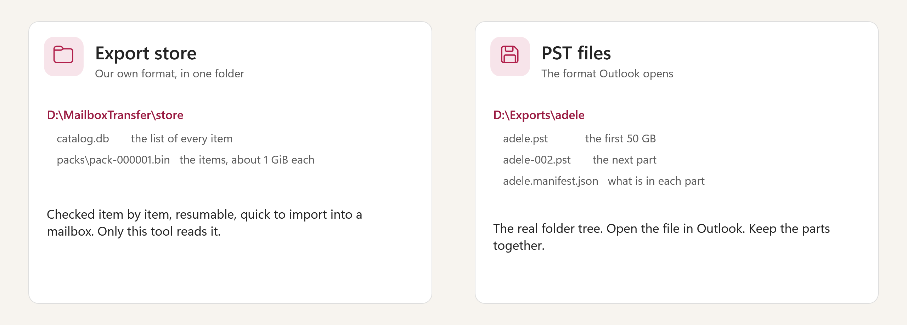

<!-- icon: checklist -->
## 2. Before you start

### Tick every box

If one box stays empty, stop and ask.

- [ ] I have a quiet hour for a small job, or a night for a big one. A 50 GB import takes more than half a day because Microsoft limits the speed (chapter 8).
- [ ] The PC is plugged in. Windows follows your company's power settings: if the PC goes to sleep, the job stops, and **Continue** does what is left. The box **Keep this PC awake while it runs** (**Expert mode** of the **Verify** page) asks Windows not to sleep by itself. It cannot stop a closed lid or a restart.
- [ ] There is free disk space: about **twice the size of what you copy** (the store plus the PST files). The console says how much is needed before you start.
- [ ] I know the address of the mailbox, for example `adele.vance@contoso.com`.
- [ ] For a first try I have a **test mailbox** or a small folder, not the boss's mailbox.
- [ ] My administrator has done the one-time set-up below and gave me two numbers (the tenant id and the application id).
- [ ] I know who to call (my administrator) if a step fails.
- [ ] The files of the tool are unblocked (the box at the top of this guide).

### Who does what

| Person | What they do |
|---|---|
| **The administrator** | Does the one-time set-up for the whole company (section "For your administrator" at the end of this chapter): registers the tool's application, gives the permissions, and, for a shared mailbox or a job without a person, prepares a certificate. Gives you the numbers. |
| **The operator** (you) | Puts the tool on a PC, writes the numbers in the configuration file, runs the console, reads the plan and decides when to press **Start**. |
| **The owner of the mail** | Decides what is copied, where it is kept and who may read the copy. A PST file or an export store holds private mail. |

### What to ask your administrator

A mailbox is protected. The tool signs in as **you**, and can only do what **you** may do and what the tool's application has been allowed to do. Give your administrator this table: one row per task. Words in brackets are the exact names they need.

| I want to… | Ask your administrator for… |
|---|---|
| **Browse and export** a mailbox | The sign-in set up (steps A and B below) with the **read** rights (`MailboxFolder.Read`, `MailboxItem.Read`, `MailboxItem.Export`). Add `Mail.Read` if you want to see subjects and senders while you browse. |
| **Import** into a mailbox | The same set-up with the **write** rights (`MailboxFolder.ReadWrite`, `MailboxItem.Read`, `MailboxItem.ImportExport`). For `.eml` files with the Exchange conversion option, also `Mail.ReadWrite`. |
| Work in a **shared mailbox**, or in another person's mailbox | The **FullAccess** right on that mailbox: it is enough to browse and export. To **import** there, the tool must sign in without a person (step C below): ask for it. |
| Skip typing the mailbox ids (optional) | `User.Read.All`. Without it you give the ids once (reference guide). |
| **Check and repair a PST**, or **Open an export or a PST** | **Nothing.** These tasks work on files on your PC and never contact Microsoft. |

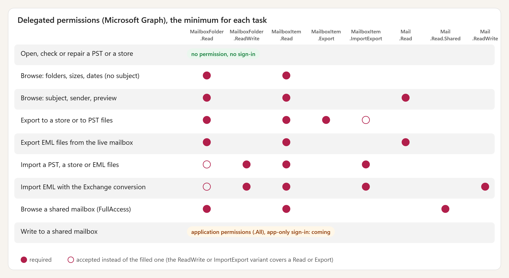

Then wait for **two numbers**: the **tenant id** and the **application (client) id**. If your administrator also prepared the certificate sign-in, you receive a third value, the **thumbprint** of the certificate. Chapter 3 says where to write them.

### For your administrator

This section is for the administrator. It is done **once for the whole company**, not once per person. The exact commands, the table of permissions per task and the Exchange RBAC steps are in [the reference guide](MailboxTransfer-Guide.md#4-the-exact-rights).

**Step A · Register the application.** In Microsoft Entra ID, create an **app registration** for the tool. It is a *public client*: no secret, no password. In **Authentication**, add the platform **Mobile and desktop applications** with the redirect address `ms-appx-web://microsoft.aad.brokerplugin/<application (client) id>` (the application id of this very registration; the Windows sign-in window needs it), and switch **Allow public client flows** on (the sign-in with a code needs it). The address `http://localhost`, which earlier versions asked for, is no longer needed to sign in: leave it if it is there, it does no harm.

**Step B · Give the permissions.** Add the **delegated** permissions that the operators need (Microsoft Graph; table in [reference guide 4.3](MailboxTransfer-Guide.md#43-minimum-delegated-permissions-per-task-a-person-signs-in)) and give **admin consent**. Nothing else is needed for browsing, exporting, or importing into the mailbox of the person who signs in.

**Step C · Only for a shared mailbox, or for a job without a person: a certificate application.** Signed in as a person, the tool can read a shared mailbox (with FullAccess) but **cannot write** into it, or into any mailbox other than the signed-in person's: Microsoft asks for *application* permissions for that, and the "delegated" versions do not exist. The answer is a sign-in without a person (**app-only**, with a certificate):

- The administrator creates a self-signed certificate on the PC that runs the tool (`Cert:\CurrentUser\My`, private key not exportable), uploads its public part (`.cer`) to the app registration, and gives the application the **application** permissions (admin consent), for example `MailboxFolder.ReadWrite.All`, `MailboxItem.Read.All` and `MailboxItem.ImportExport.All` to import, or the `.Read.All` and `MailboxItem.Export.All` ones to browse and export.
- To limit the application to some mailboxes, the administrator gives the same rights through **Exchange RBAC for Applications** instead of the consent (reference guide, [4.6](MailboxTransfer-Guide.md#46-no-person-present-certificate-app-only)).
- The administrator writes the tenant, the application id and the thumbprint in the **`Auth`** section of the operator's configuration file (chapter 3). The console then **reads them by itself**: nobody types them again at each run. The tenant of the application is the same as the one of the people in practice: if `Auth` has no `AppTenantId`, the tool uses the `TenantId` of the `Tenant` section. The mailbox to work on is never taken from the configuration: the operator types it.
- The end date of a certificate is not shown by the console. A certificate that has ended makes the sign-in fail until it is renewed. Look at it with `Get-ChildItem Cert:\CurrentUser\My | Format-Table Subject, NotAfter, Thumbprint`.

**Step D · Give the operator the values.** The **tenant id** and the **application (client) id** (and the **thumbprint** for step C). They go in the operator's configuration file (chapter 3).

> [!IMPORTANT]
> **A few rights could not be confirmed.** The permissions come from what the tool does. They were checked on one test tenant. Three points depend on your organisation and are not known for sure: which administrator role may read another person's mailbox with this tool; whether some organisations need an extra Exchange role in addition to the Graph permissions; and what the mailbox and archive **quotas** are (Microsoft's interfaces do not give them). They are listed in [the reference guide](MailboxTransfer-Guide.md#47-what-the-code-cannot-tell-you-to-confirm-in-your-tenant).

<!-- icon: download -->
## 3. Set up once

### 1. Get your rights

**Do:** give your administrator the table "What to ask your administrator" of chapter 2. Wait for the two numbers (application id and tenant id).

**You should see:** the two numbers, each like `00000000-0000-0000-0000-000000000000`.

**If not:** ask again. Nothing else works without them, except the tasks on files.

### 2. Put the tool on the PC

**Do:** download the tool, then put it on the PC.

1. Open **https://github.com/Nico77600/MailboxTransfer/releases/latest** in your browser.
2. Under **Assets**, click **`MailboxTransfer-1.1.0.zip`** (the number may be newer). Do **not** click *Source code*: that is a copy of the repository, not the tool.
3. Extract the ZIP into a folder such as `C:\Tools\MailboxTransfer` (right-click, *Extract All*). Write the files directly in that folder: `Start-MailboxTransferConsole.cmd` must be inside it, not one level deeper.
4. Unblock the folder (one command, once):

```powershell
Get-ChildItem "C:\Tools\MailboxTransfer" -Recurse -File -Force | Unblock-File
```

**You should see:** nothing. No message means it worked.

**If not:** a red message that mentions a path means the path is wrong. Fix the path and run it again.

> [!NOTE]
> **The tool checks itself.** Every script of the package is signed by its author, and a list of the other files with their fingerprints is signed too. Each time the tool starts, it verifies them. If a file was changed or is missing, the tool stops and names the file: download the ZIP again (see chapter 9, line 25). You do not have to do anything for this check.

### 3. Write your two numbers

**Do:** in the folder `config`, copy nothing, simply create a text file named `MailboxTransfer.config.local.psd1` with these lines, and your own numbers:

```powershell
@{
    Tenant = @{
        TenantId = '00000000-0000-0000-0000-000000000000'
        ClientId = '00000000-0000-0000-0000-000000000000'
    }
}
```

**You should see:** a file of six lines.

**If not:** keep the quotes and the braces exactly as above. A missing brace gives a red message when the window opens.

> [!NOTE]
> A file written for version 1.1.0, with a `Lab` section instead of `Tenant`, still works. If your administrator prepared the certificate sign-in, the same file also has an `Auth` section with the three values of step C of chapter 2; the console reads them for you.

### 4. Open the console

**Do:** double-click **`Start-MailboxTransferConsole.cmd`** in the tool's folder. If you prefer to type, open **PowerShell 7** (the program called `pwsh`), go to the tool's folder and type:

```powershell
cd C:\Tools\MailboxTransfer
.\Start-MailboxTransferConsole.ps1
```

**You should see:** after a few seconds, the window, on its first page, **Setup**. The first start prepares the engine of the tool and takes a few seconds longer. Nothing is installed.

**If not:** a message about the PowerShell version means you need PowerShell 7.5 or later. Ask your administrator to install it. PowerShell 7.6 works with this version of the tool.

> [!TIP]
> To look around without any mailbox, add `-Demo`: `.\Start-MailboxTransferConsole.ps1 -Demo`. The window shows made-up data and touches nothing.

### 5. Read the Setup page

The Setup page is the first page, each time you open the console. It answers one question: *Is this computer ready?*

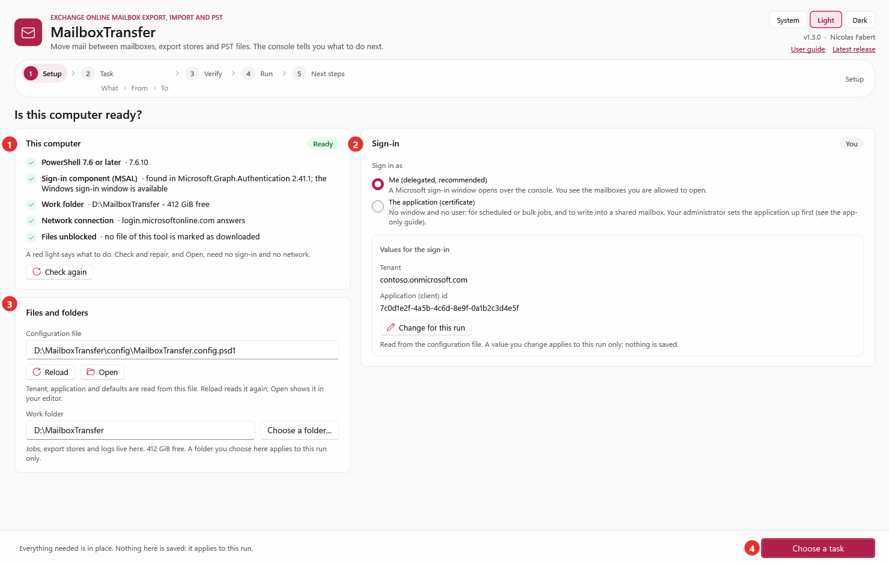

**Do:** look at the page. If everything is green, click **Choose a task** at the bottom right.

**You should see:** three boxes.

| Box | What it says, in plain words |
|---|---|
| **This computer** | The **lights**. **Ready** at the top right means that everything the tool needs is in place. The five lights are: **PowerShell 7.5 or later**; **Sign-in component (MSAL)**, the part that talks to Microsoft's sign-in, which also says whether the **Windows sign-in window** is available (if it is not, with the reason, the console signs in with a code); **Work folder**, with its path and its free space (red, with the reason, if the folder cannot be created or written to, or if less than 5 GiB is free); **Network connection**, which says whether Microsoft's sign-in answers; **Files unblocked**, which says whether Windows marked the tool as downloaded. **Check again** looks again. |
| **Files and folders** | The **configuration file** in use, the one you wrote in step 3. **Reload** reads it again, **Open** shows it in your editor. The **work folder** is where the tool keeps its jobs, its export stores and its logs. **Choose a folder...** picks another one **for this run only**. |
| **Sign-in** | **Sign in as: Me (delegated, recommended)**: a Microsoft sign-in window opens over the console and you sign in as yourself. Or **The application (certificate)**: no window and no person, for scheduled or bulk jobs and for writing into a shared mailbox. Below, the **values for the sign-in** (the tenant, the application id and, for the certificate, its thumbprint) are **read from the configuration file**. **Change for this run** lets you type other values, **for this run only**: nothing is saved. A value changed this way is marked *modified · this run only*. |

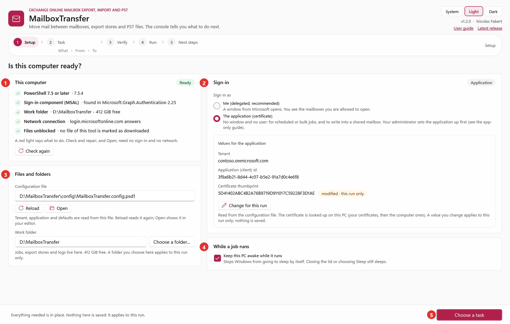

**If not:** a **red** light tells you what to fix, in plain words. Fix it, click **Check again** (or close the window and open it again). If you cannot, stop and ask. **Check and repair a PST** and **Open an export or a PST** need no sign-in and no network: they work even if the network light is red.

<!-- icon: search -->
## 4. A · Browse and export

You will look inside a mailbox, tick what to keep, and save it on your disk. **Path 1** is a small try. **Path 2** is the whole mailbox. The steps are the same: only what you tick changes. **Ask first:** the rights in the table "What to ask your administrator" of chapter 2.

> [!TIP]
> **Path 1, the try.** Tick one small folder (a few messages). Do the whole job. When it works, do **Path 2** with the whole mailbox.

### 4.1 Setup, then Task · What

**Do:** on the **Setup** page click **Choose a task**. On the **Task** page, **What**, click the card **Browse and export**, then **Continue** at the bottom right.

**You should see:** the card turns pink. Under **Task**, the small word **From** is now crimson.

**If not:** if **Continue** is grey, no card is chosen. Click a card.

### 4.2 Task · From: sign in

**Do:** type the address of the mailbox (`adele.vance@contoso.com`). Click **Sign in...**. A Microsoft sign-in window opens over the console: type the account that may open the mailbox (yourself, with the right on that mailbox). The window is a Windows one: nothing is loaded into your browser, and no browser tab opens. (You chose **Me** or **The application** on the Setup page; the box shows the choice, with **Change in Setup**.)

**You should see:** a green line: *Signed in as adele.vance@contoso.com. The sign-in is kept on this PC, encrypted for your Windows account.*

> [!TIP]
> **First sign-in of an account that Windows does not know.** If Windows asks whether to stay signed in to all your apps, choose **No, sign in to this app only**. The account is then used by this tool only, and not added to Windows.

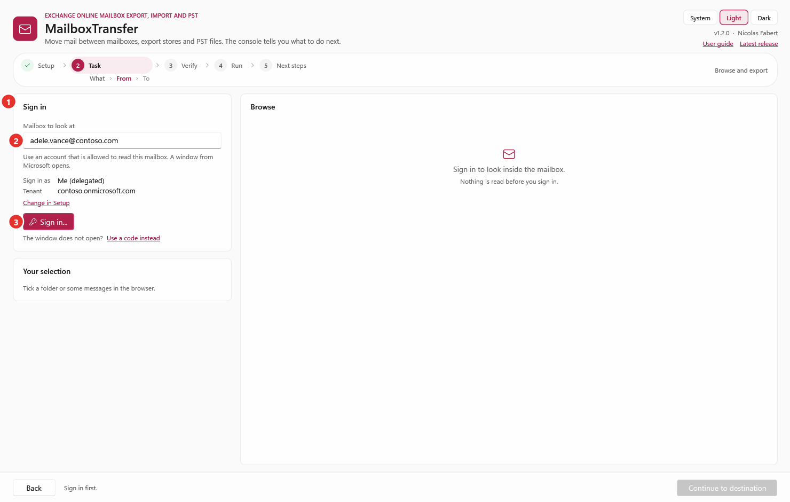

**If not:**

- *Nothing opens.* The sign-in window may be hidden behind the console or another window: look in the taskbar. Or click **Use a code instead**: a **code** appears (see the picture). On any device, open the web address shown, type the code, sign in. The code is valid for 15 minutes. After that the window says *The code has expired. Get a new code.* Click for a new one.
- *A red message that names a redirect address.* The application is not yet set up for the Windows sign-in window. Copy the address in the message (it starts with `ms-appx-web://microsoft.aad.brokerplugin/`) and send it to your administrator (step A of chapter 2). Meanwhile, click **Use a code instead**.
- *A red message about a permission.* Your administrator has not given you the rights of chapter 2. Copy the permission name in the message and send it to them.
- *Your sign-in has expired.* Sign in again. Nothing is lost.

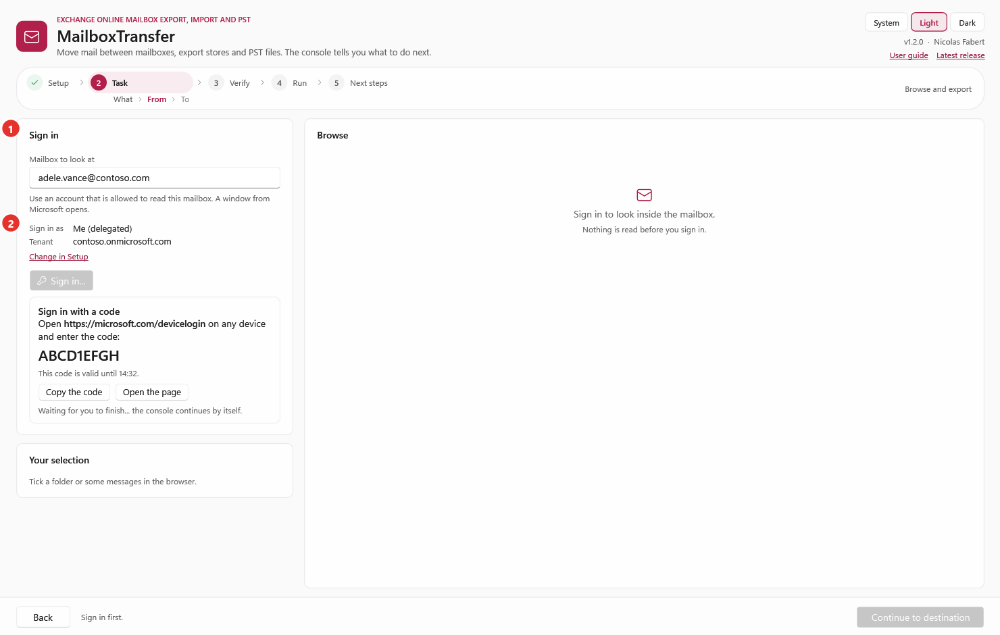

### 4.3 Task · From: pick the places to look

**Do:** in the box **Where to look**, tick the places you want: **Primary mailbox**, **Archive**, and any **Auxiliary archive** found. A line under each says how many items and how big.

**You should see:** the list of folders appears in the middle after a moment.

**If not:**

- *An amber note: "Auxiliary archive 1 is still being filled by Microsoft".* Normal on a very big archive. Some folders will say **not ready**. The tool tries them again later. Nothing is exported as empty. See chapter 9, topic 3.
- *The archive is missing from the list.* Click **The archive is missing from this list**. Your administrator can give you its id once (see the reference guide).
- *A shared mailbox.* Click **A shared mailbox, or another user's mailbox** and type its address. You need the FullAccess right (chapter 2).

**Deleted items (optional).** Tick **Include deleted items (Recoverable Items)** if you also need what was deleted and emptied from *Deleted Items* in Outlook. Exchange keeps it for a while (14 days, up to 30) in a hidden folder, and the browser then shows it like any other folder. Choose it before you tick: changing the box reloads the browser. The details (the four folders inside) are in the [reference guide](MailboxTransfer-Guide.md#recoverable-items).

### 4.4 Task · From: browse and tick

**Do:** click folders in the tree on the left of the browser. Click a folder's **checkbox** to take the whole folder, or open it and tick single messages on the right.

**You should see:** the box **Your selection** (and the line at the bottom of the window) counts the items, the size and the folders you ticked. A half-filled checkbox means "some of this folder".


**If not:** if you see *headers only until export* for an auxiliary archive, it is normal: Microsoft gives only sizes and dates for it until it is exported. If the messages show no subject, the permission `Mail.Read` is missing: you can still export, but you cannot see the subjects.

> [!NOTE]
> **This is read only.** Browsing never changes the mailbox. Deleted items you ticked are exported like any folder, but saved **apart**, under a folder named *Recoverable Items*, never mixed with your normal folders.

When you are ready, click **Continue to destination**.

### 4.5 Task · To: choose where to save

**Do:** pick **PST files** (Outlook opens them), **Export store only** (our format, quick to import later), or **EML files** (one `.eml` file per message). Pick a **folder on this computer** and a **file name**.

**You should see:** a box **Disk space** on the right: the size of your selection, the space needed, and the free space. A green line says *There is enough disk space.*

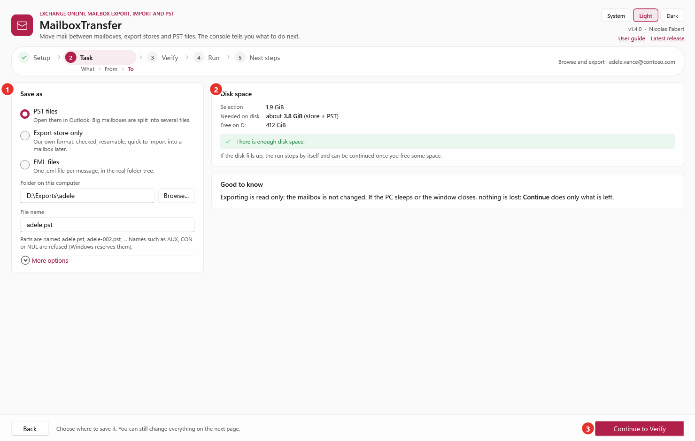

**If not:** a red line says the disk is too small. Choose another folder on a bigger disk, or tick fewer folders.

> [!NOTE]
> **Big PST files are split** into parts of about 50 GB (`adele.pst`, `adele-002.pst`…): keep them together. You can choose another size under **More options**. Windows keeps some file names for itself (`AUX`, `CON`, `NUL`…): the box refuses them. Details in the [reference guide](MailboxTransfer-Guide.md#6-pst-files).

> [!TIP]
> **Keep the working store** (ticked by default) lets you write the PST again, or import into a mailbox later, without downloading again. It uses more disk space.

Click **Continue to Verify**.

### 4.6 Verify: read the checks and the plan

**Do:** read the page. Then click **Start the export**.

**You should see:** on the left, **Checks** (every folder matched, the sign-in, the disk space, nothing overwritten) with a green tick each, then **What will be done** in numbered steps, with where it is saved, the size and the **time**. On the right, **What is in it**: the folders, the items and the sizes. Further down, **The same from the command line**, with a **Copy** button. At the very bottom, a fold named **Expert mode**.

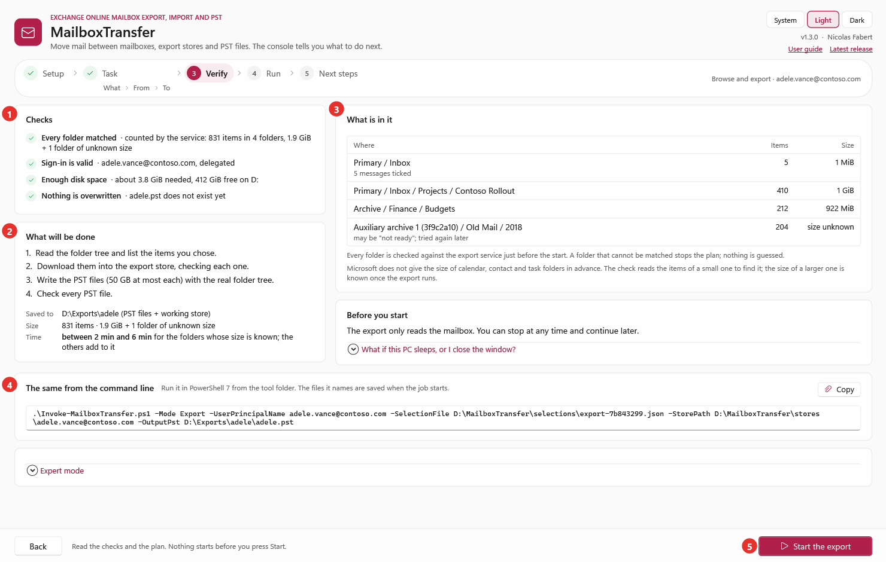

**While it waits:** the first check, *Checking the plan with the service*, says what it is doing (for example *1,240 folders read, 34 s*), and the line at the bottom says *Start unlocks when the plan is checked.* On a big mailbox this takes a few seconds to a minute. Microsoft gives no size for calendar, contact and task folders in advance: the check reads the items of a small one to find it, and the size of a larger one shows as *size unknown* until the export runs. After you click **Start**, the button reads *Starting...* and the Run page opens with *Preparing* and the same progress until the first item is counted.

**If not:** an amber line is a warning to read, not a stop. A red line means something does not fit: go **Back**. If the plan check says *Microsoft did not answer correctly (a temporary problem)*, click **Check again**: it is a hiccup of the service, not a problem with your choice.

> [!NOTE]
> **The time is a range, not a promise.** *Between 2 min and 6 min* means exactly that. Microsoft decides the speed. See chapter 8.

> [!NOTE]
> **Expert mode** holds four numbers for this run only (how many requests in parallel, how long to wait before a retry, how many tries per item, how long to wait before checking an uncertain item) and the box **Keep this PC awake while it runs**. You do not need it, and nothing in it is saved.

### 4.7 Run: wait

**Do:** nothing. You can leave the window open and do other things. Do not close it, if you can avoid it.

**You should see:** the **Run** page: a bar, the number of items, the size, the time elapsed, and **About 5 min left**. Below: the **Steps** with a tick, a triangle or a clock, and the **Folders** with their counts.

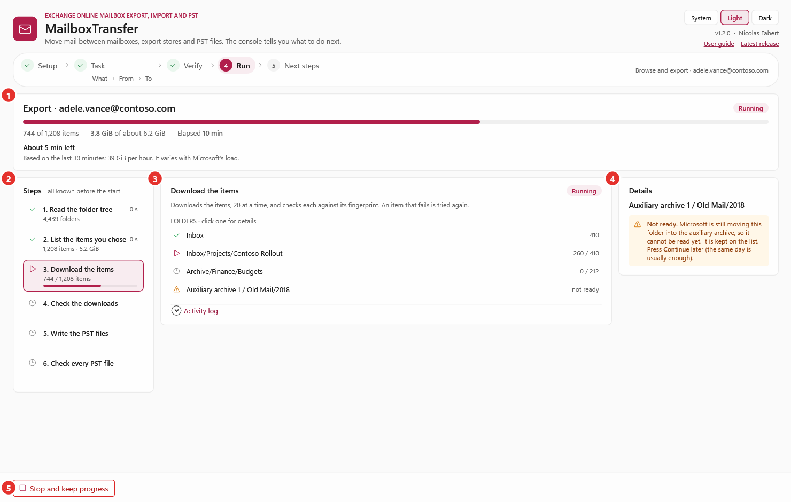

What the steps mean:

| Step | What happens |
|---|---|
| Read the folder tree | The tool asks Microsoft for the list of folders. |
| List the items you chose | It lists the items in them. |
| Download the items | It downloads them, 20 at a time, and checks each one. An item that fails is tried again. |
| Check the downloads | It checks everything it downloaded. |
| Write the PST files | It writes the PST parts. |
| Check every PST file | It reads each part back. |

**If not:** read the colours.

| You see | It means | You do |
|---|---|---|
| A **crimson** triangle | This step is running. | Wait. |
| An **amber** triangle, text *Not ready* | Microsoft is still moving this folder. | Nothing now. Press **Continue** later. |
| *Microsoft slowed us down 7 times* | Normal. See chapter 9, topic 1. | Wait. |
| *Resumed after sleep* | The PC slept. | Nothing. It carries on. |
| A **red** message | A real problem. | Read it, chapter 9. |

To stop on purpose, click **Stop and keep progress** (bottom left). A question asks you to confirm. Nothing is lost. See chapter 8.

### 4.8 Next steps: read the end

**Do:** read the **Next steps** page.

**You should see:** one of these, in the title and the colour:

| Title | Colour | Meaning |
|---|---|---|
| **Complete** | green | Everything you asked is done and checked. |
| **Finished, with refused items** | amber | The job is done, but Microsoft refuses some items for good. Nothing more can be done by running again: open the list (CSV) from the page. |
| **Not finished** | amber | Something is left, for instance a folder that was not ready. Nothing is lost. Press **Continue** later. |
| **Needs a decision** | amber | An item needs your choice (chapter 5, step 7). |
| **Error** | red | The job stopped. Read the message. Your files are kept. |

Under the result, **What to do next** offers buttons for the logical next step: after a finished export, **Import into a mailbox** and **How to open the PST in Outlook**; after a stopped one, **Continue**. **The same from the command line** shows the commands that were run, with **Copy**. **Reports and log** opens the report, the log or the folder. The report is a page for your browser, **report.html**, written at the end of every job: the result, the numbers, every step with its start, end and duration, what happened in time order (waits for Microsoft, sleeps of the PC, warnings, errors), one row for each folder, and what to do next. It needs no network and can be sent as it is. **report.csv** stays next to it for a spreadsheet; a job made by an older version has only the CSV. **Start another task** (bottom right) goes back to the Task page.

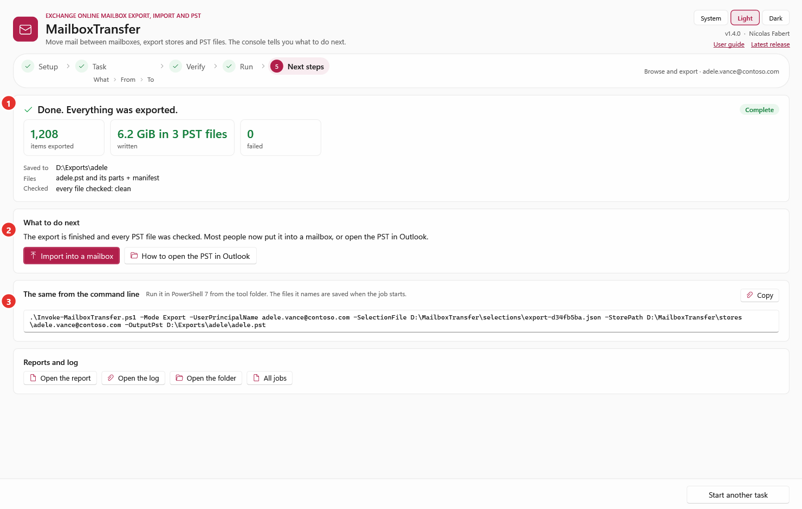

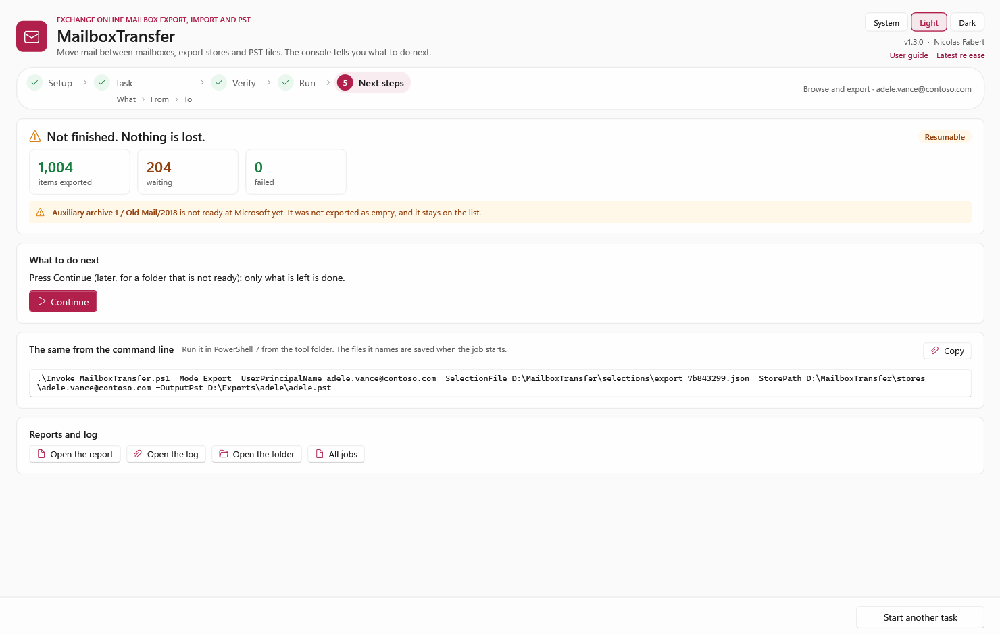

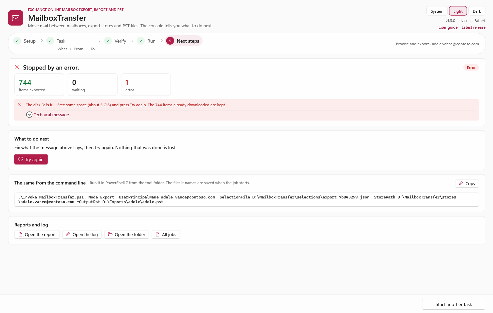

### 4.9 Open the PST in Outlook

**Do:** in Outlook choose **File > Open & Export > Open Outlook Data File** and pick `adele.pst`. For parts, open the first one; open the others the same way.

**You should see:** the folders of the mailbox, with their mail. There is also a **manifest** file, `adele.manifest.json`. It lists what is in each part. Keep it with the parts.

**If not:** see chapter 9, topics 15 and 16.

<!-- icon: upload -->
## 5. B · Import

You put mail from a PST file, an export store or `.eml` files **into a mailbox**. Items are **added**. Nothing is deleted. Nothing is overwritten. A **long job**: the guide says it again in chapter 8. **Ask first:** the write rights in the table "What to ask your administrator" of chapter 2.

> [!CAUTION]
> **An import writes to a real mailbox.** Do the first one into a **test mailbox**. An import cannot be undone by this tool: it never deletes. To remove what was added you have to delete it yourself in the mailbox.

### 5.1 Task · What and From: pick the file

**Do:** on the Setup page click **Choose a task**, click the card **Import**, **Continue**. On the **From** page, choose the kind of source (a PST file or a folder of parts, an export store, or EML files) and click **Browse…** to pick it.

**You should see:** the page checks the file **at once** and says what is in it: the size, the number of parts, and whether it is clean.

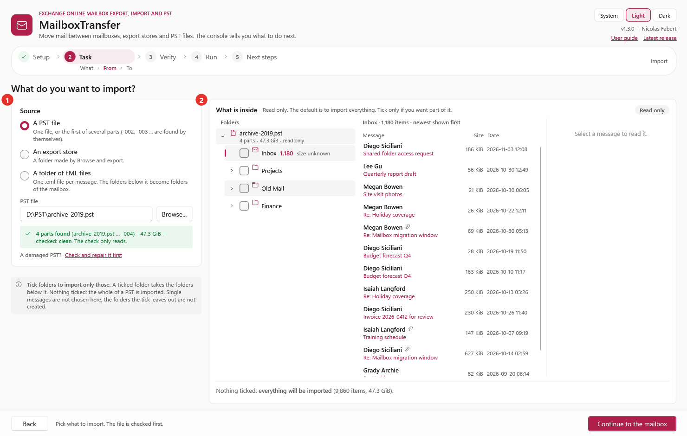

**Some folders only.** Tick the folders to import in the tree (a PST or a folder of `.eml` files); nothing ticked means everything. The plan counts only what you ticked.

**If not:** an amber line *the file has errors*: the file is damaged. Go to chapter 6, **Check and repair**, first. Or import anyway: the items that cannot be read are listed and skipped. See chapter 9, topic 13.

### 5.2 Task · To: sign in, pick the mailbox and the folder

**Do:** sign in as in 4.2. Pick **Primary mailbox** or **Archive**. Then choose where the folders go: **a new folder** (recommended, named for you, such as *Imported archive-2019 2026-11-12*), or **the same folder names** (merges into existing folders). Click **Continue to Verify**.

**You should see:** the page shows the mailbox, and for an archive its size and the quota when known.

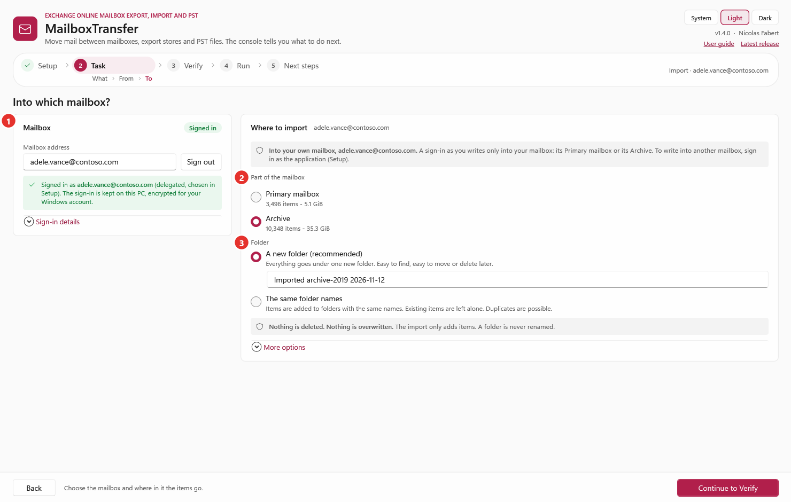

**If not:** if you picked a shared mailbox, the page says *this needs application permissions*: see chapter 2, step C.

> [!WARNING]
> **Two imports into "the same folder names" can create duplicates.** The tool adds items; it does not compare with what is already there. Use **a new folder** each time.

> [!NOTE]
> **Deleted items come back as ordinary items.** If the export holds deleted items, the import puts them in a normal folder named **Restored deleted items** (inside your new folder, if you chose one): Exchange does not accept an import into the hidden folder. The page says so, in a blue box. Details in the [reference guide](MailboxTransfer-Guide.md#recoverable-items).

### 5.3 Verify: read the checks, tick the box

**Do:** read the page. Under the big address of the mailbox, tick the box that names what will be written. Then click **Start the import into** that mailbox.

**You should see:** on the left, the **Checks** and the numbered steps, **the time** (often several hours). On the right, **Before anything is written**: the **target** in big letters (the mailbox, the archive or the primary mailbox, the new folder), the number of items and their size, and an amber line: *Adds only. Nothing is deleted or overwritten.* Then a box with an empty square and one sentence that says **what, where and how much**, for example *I checked: add 9,860 items to adele.vance@contoso.com · Archive · new folder Imported archive-2019 2026-11-12*. The **Start** button is grey, and the line at the bottom says *Tick the box to unlock Start.*

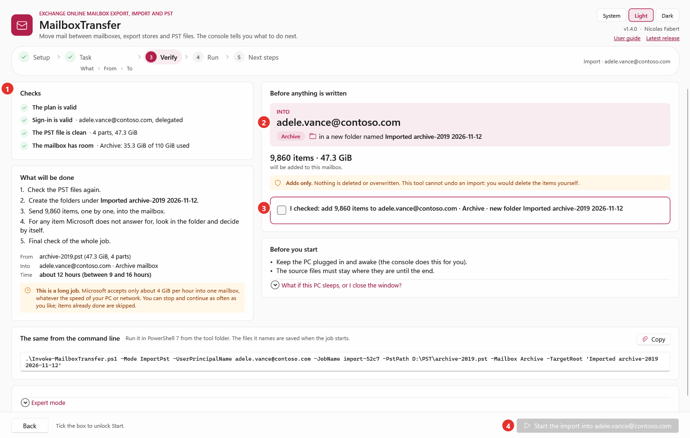

Tick the box: the line at the bottom says *Ready. Nothing is written before you press Start.* and **Start** turns crimson.

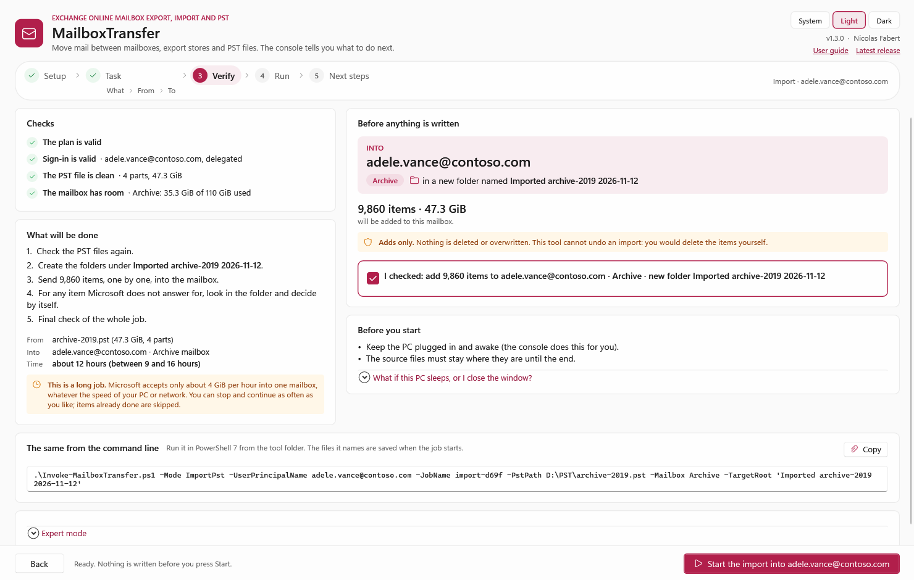

**If not:** if **Start** stays grey, the box is not ticked. If you go **Back** and change the mailbox, the folder, the source or anything the plan depends on, the tick **clears** and you tick again: the sentence always matches what will really happen. As on every Verify page, **The same from the command line** shows the exact command, and **Expert mode** holds settings you do not need.

### 5.4 Run: wait

**Do:** nothing. A big import takes hours. It is slow because Microsoft accepts only a few GiB per hour into one mailbox. More speed on your PC does not help. You can stop and continue as often as you like.

**You should see:** the **Run** page, like chapter 4.7, with the steps: *Check the PST files*, *Create the folders*, *Send the items*, *Check the uncertain items*, *Final check*.

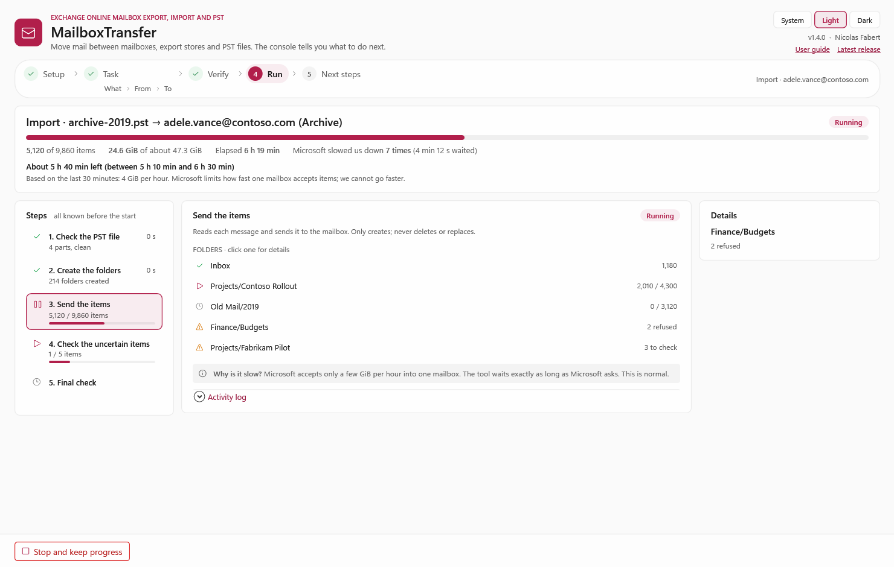

> [!NOTE]
> The time on the Run page is a **range** (for example *between 5 h 10 min and 6 h 30 min*), worked out from the last 30 minutes. It says nothing for the first 10 minutes, and again after a sleep, because it would be a guess.

### 5.5 Next steps: look in Outlook

**Do:** read the **Next steps** page, then open the mailbox in Outlook, or Outlook on the web. Find the new folder (for example *Imported archive-2019 2026-11-12*).

**You should see:** the folder tree of the PST, with the messages. The **received date** of the messages is the original one. Creation and last-modified dates are the time of the import (Exchange sets them). The folder name may take a few minutes to appear. The **What to do next** box on the page says the same, and **The same from the command line** shows what was run.

### 5.6 If you stopped, or the PC slept

**Do:** open the window again. On the **Task** page, in **Continue a job**, click **Continue** on the line of your job.

**You should see:** the job picks up. Only what is left is done. Items done before are skipped.


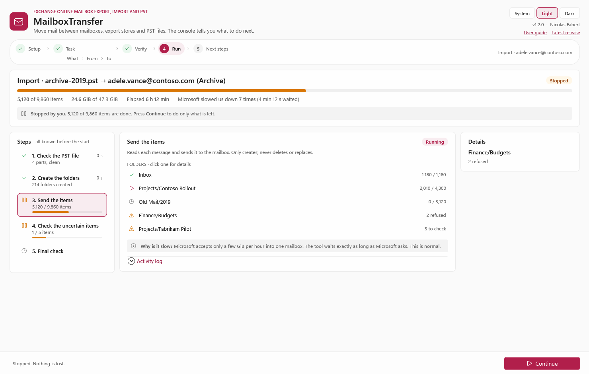

If the PC slept while the job ran, the page says *Resumed after sleep* and carries on by itself.

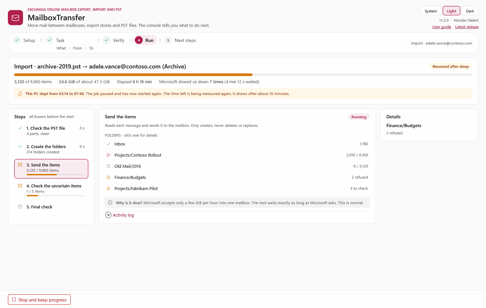

### 5.7 An item needs your decision

Sometimes the tool sent an item and **Microsoft never answered**. The item may or may not be in the mailbox. The tool then looks in the folder, five minutes later. If **exactly one** item matches, it marks it done. If none matches, it sends it again. If **two or more** could be the one, the tool **does not guess** and asks you.

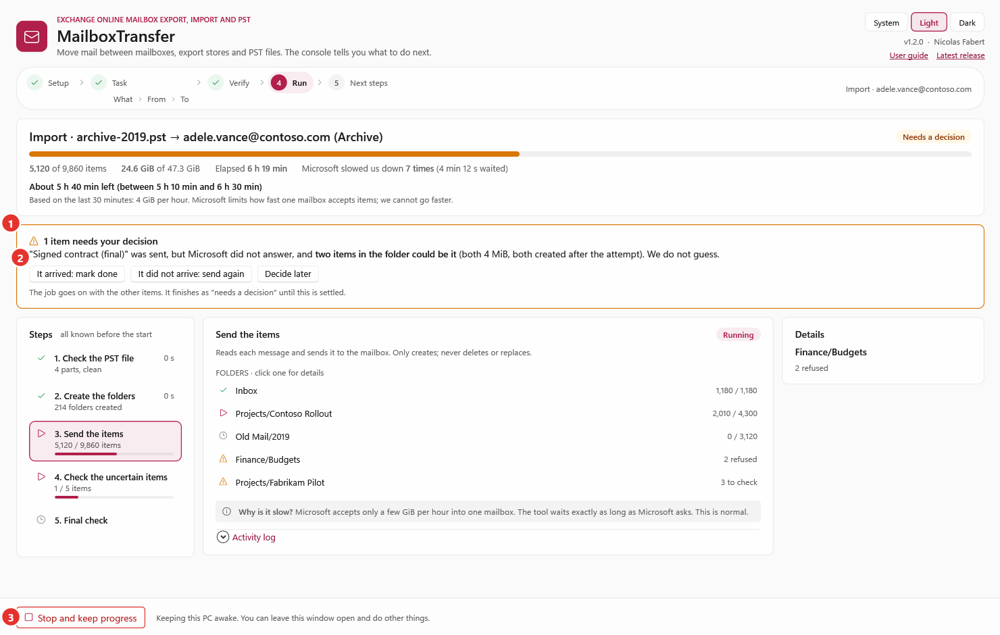

| Button | What it does | Risk |
|---|---|---|
| **It arrived: mark done** | Counts the item as imported. | If it is not really there, one item is missing. |
| **It did not arrive: send again** | Sends it again. | If it was there, one item appears twice. |
| **Decide later** | Leaves it. The job ends as *needs a decision*. | None. You decide later. |

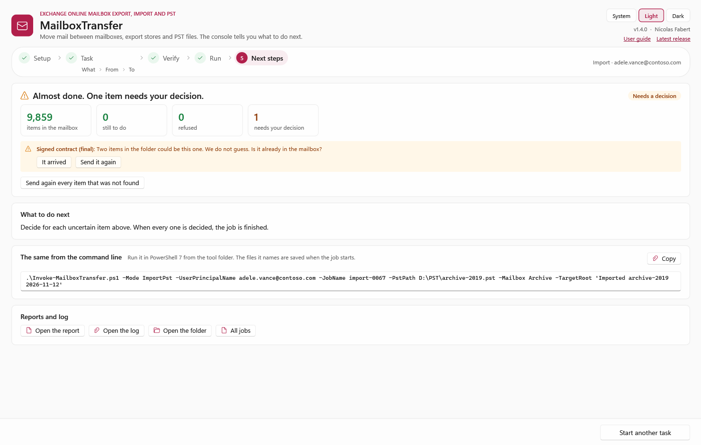

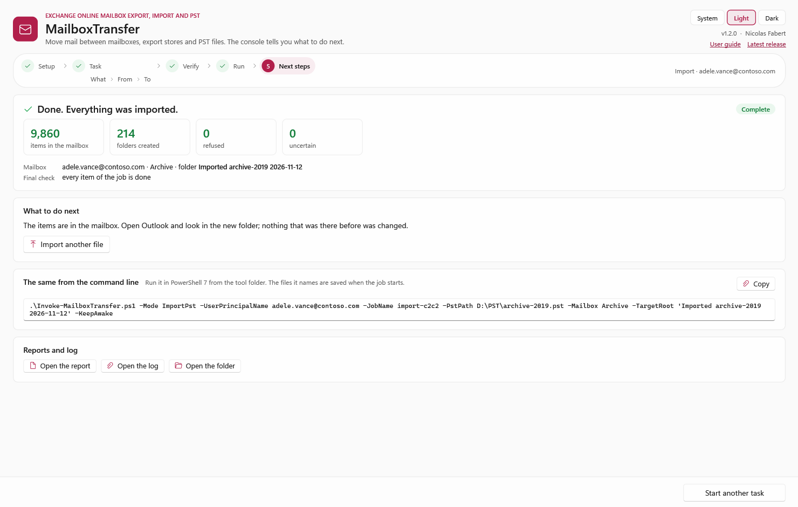

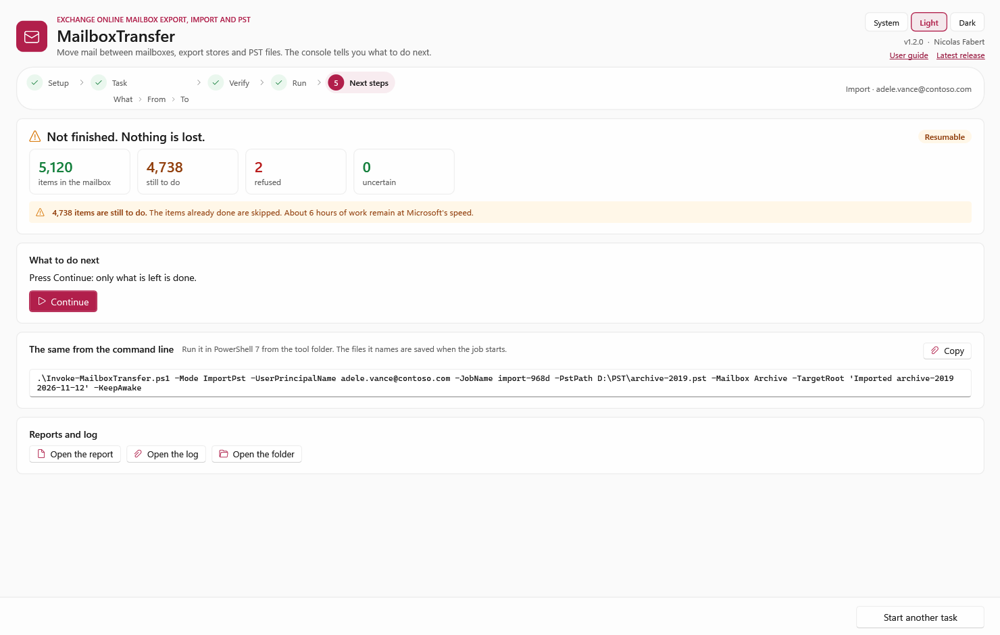

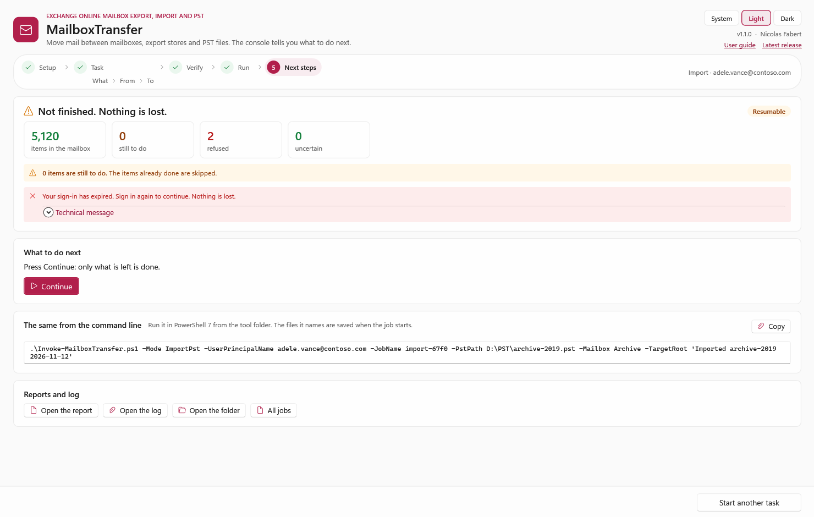

<!-- icon: tool -->
## 6. C · Check and repair a PST

Outlook says the file is damaged, or it will not open. The tool **checks** the file and, if needed, writes a **repaired copy**. **Your original is never changed.** Nothing to ask your administrator: this task works on files.

### 6.1 Task · What and From: pick the file

**Do:** on the Setup page click **Choose a task**, click the card **Check and repair a PST**, **Continue**, then **Browse…** and pick the file.

**You should see:** the check starts **by itself** as soon as you pick the file. It only reads.

### 6.2 Task · From: read the result in words

**You should see:** a title with the number of **errors** and **warnings**, a sentence such as *The file has damage, but it can probably be repaired*, and a table: **What was found**, how many, and which **repair level** fixes it.

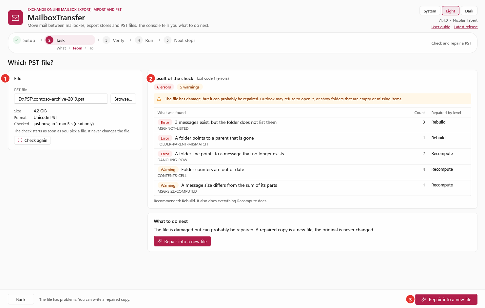

If the file is fine, the page says so, and there is nothing to repair.

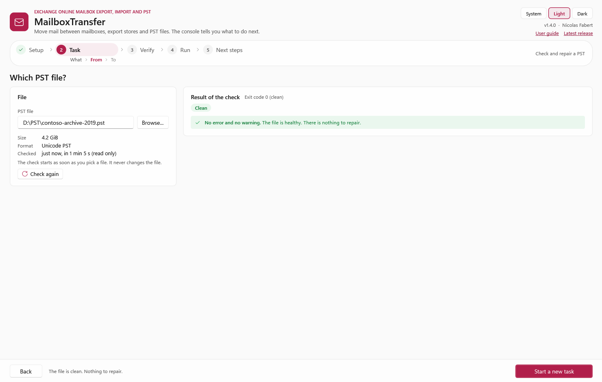

**If not:** the line **Exit code** is for your administrator. 0 means clean, 2 warnings, 1 errors.

### 6.3 Task · To, then Verify: repair into a new file

**Do:** click **Repair into a new file**. On the **To** page, choose the name of the new file (the page proposes `contoso-archive-2019.repaired.pst`) in a folder with enough space: **as much as the file** you repair. Click **Continue to Verify**, read the page, click **Start the repair**.

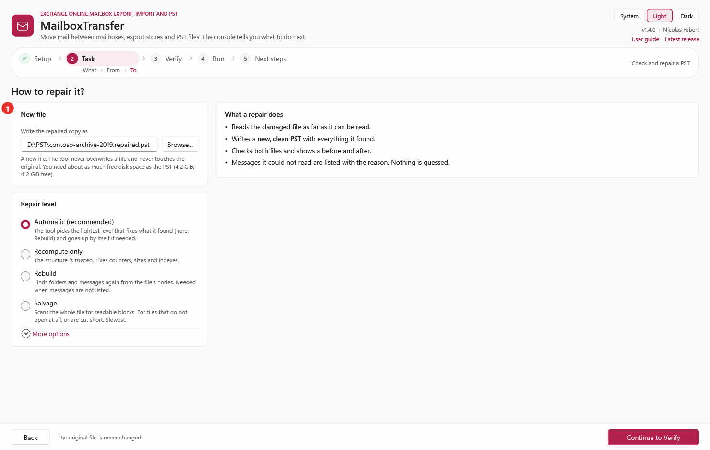

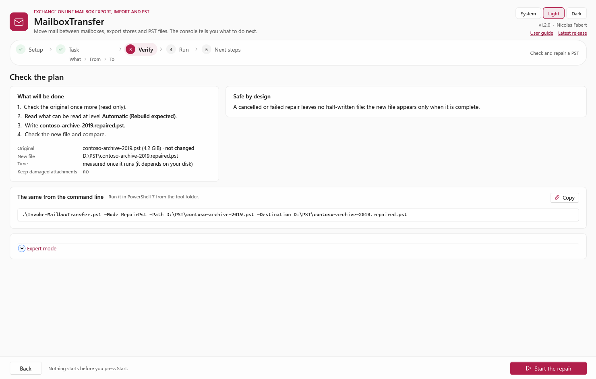

The **Run** page then shows the repair step by step.

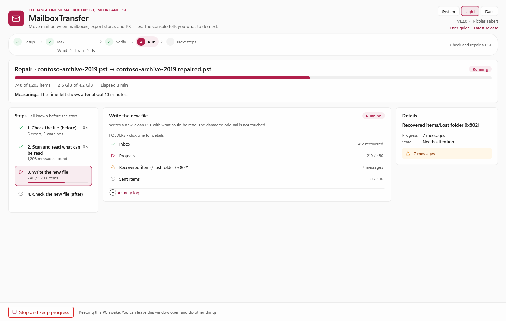

The **level** is **Automatic**: the tool starts at the level the check recommends and goes higher by itself if needed (see the picture below). Under **More options** you can choose, and tick **Keep damaged attachments** (off by default: a damaged attachment is renamed *name (damaged).ext* and may be unreadable).

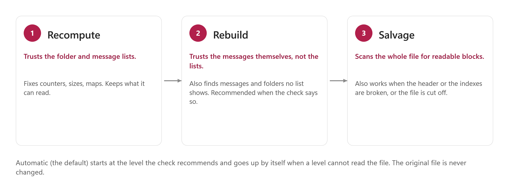

### 6.4 Next steps: read before and after

**You should see:** the **Next steps** page with **before** and **after**: errors and warnings, and how many messages were **kept**, **partly recovered** or **lost**. **What to do next** offers **Import into a mailbox** and **How to open the PST in Outlook**.

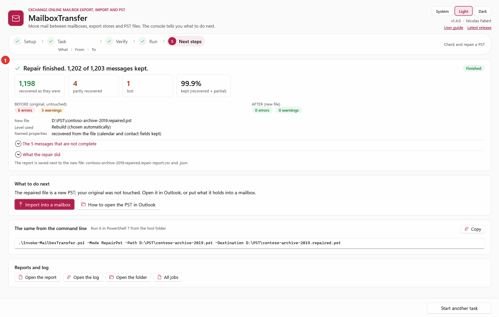

| Word | Meaning |
|---|---|
| **Kept** | The message was read completely. |
| **Partly recovered** | The message is there, but a part (often an attachment) could not be read. |
| **Lost** | Nothing of it could be read. |
| **Recovered items** | A folder in the new file. It holds messages whose folder was lost. Look there first for anything missing. |

### 6.5 Open the repaired file

**Do:** open the new file in Outlook, as in 4.9. Check the folders you care about. Keep the original until you are sure.

**If not:** see chapter 9, topic 14.

<!-- icon: folder -->
## 7. D · Open an export or a PST

You only want to look. Nothing is written. Nothing to ask your administrator.

**Do:** on the Setup page click **Choose a task**, click the card **Open an export or a PST**, **Continue**, pick the file or the export folder.

**You should see:** the same browser as in 4.4, on your file: folders on the left, messages on the right. You can tick folders or messages and send the ticks to **Import** or to a **new PST** (**Export my ticks to a PST...**: it goes through the **To**, **Verify**, **Run** and **Next steps** pages like any task). Click a message to read it (text, HTML and attachment names) in the reading pane; nothing is written.

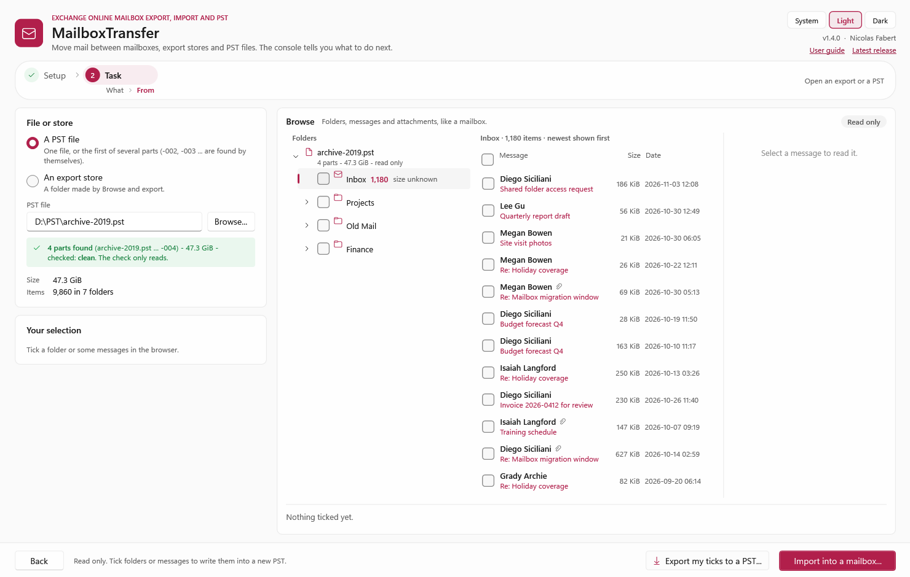

<!-- icon: clock -->
## 8. Long jobs: what to expect

### The honest time

Importing is slow **on purpose**. Microsoft limits how much goes into one mailbox: about **4 GiB per hour** (a GiB is a gigabyte, about a thousand million characters). A 50 GB import takes about half a day, whatever your PC. Exporting is faster: from 30 up to about 150 GiB per hour, depending on how busy Microsoft is. Writing, checking and repairing PST files go at the speed of your disk.

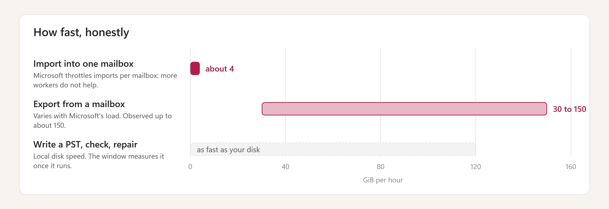

The window shows a **range** before you start and a better one while it runs. A range is honest. A single number would be a promise nobody can keep.

### Stop and continue

You can stop at any time, close the window, switch the PC off. **Nothing is lost.** The next time, click **Continue** on the Task page. Only what is left is done.

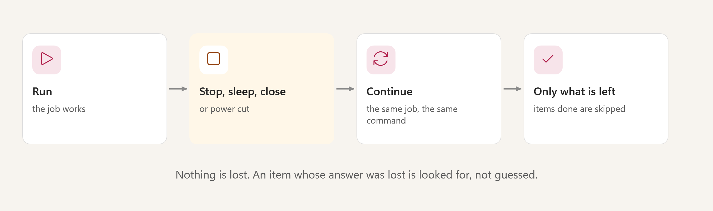

| What happened | What you see | What to do |
|---|---|---|
| You clicked **Stop and keep progress** | *Stopped* | Press **Continue** later. |
| The window was closed | The job is in the list **Continue a job** | Press **Continue**. |
| The PC went to sleep | *Resumed after sleep* | Nothing. It carries on. |
| The PC restarted or lost power | The job is in **Continue a job** | Press **Continue**. An item whose answer was lost is looked for, never guessed. |
| The network dropped | *We cannot reach Microsoft. Trying again every 30 seconds.* | Check the connection. It carries on. |

> [!NOTE]
> **Keep awake.** Windows follows your company's power settings unless you tick **Keep this PC awake while it runs** (in **Expert mode**, at the bottom of the Verify page; it is off by default). If the PC goes to sleep, the job stops and **Continue** does what is left. Ticked, the tool asks Windows not to sleep because of inactivity; it still cannot stop a closed lid, a Sleep you choose yourself, or a restart. The Verify page says so before you start (**What if this PC sleeps, or I close the window?**).

### Many jobs: one page for all of them

After a few dozen jobs the question is no longer "what did this job do" but "which of my jobs need me". The tool answers it with one page, **overview.html**, in the folder `jobs` of your work folder. It has one row for each job: when it started, the task, the mailbox or the source, the destination, the result, the items done (and failed), the data, the duration, and a link to the report of the job. The tiles at the top give the totals.

- **Open it**: press **All jobs** on the Task page (next to **Continue a job**) or on the Next steps page (in **Reports and log**). The button writes the page again from the status of every job and opens it in your browser. On the command line, the summary card of every job ends with an **All jobs** line that gives its path.
- **The jobs that need you come first**: failed, then waiting for a decision, interrupted, not complete, items refused; the finished ones come after. Click a column title to sort by it; **Reset the filters and the order** goes back.
- **Filter and search**: the buttons above the table filter by result, the lists by task and by period (today, 7, 30 or 90 days), and the box finds a mailbox, a folder or a job name.
- A page of thousands of jobs opens at once: it shows 200 rows and **Show more** adds more. It lists the 20,000 newest jobs and says so when there are more. The checks of a plan (**Check the plan**) are not jobs and are left out.
- The page is one file that needs no network. It follows the theme of your browser. It is rewritten at the end of every job; two jobs that end together cannot damage it. If it cannot be written, the job is not affected: a warning is shown. From PowerShell: `Write-MbtJobOverview -WorkFolder <work folder>`.

### Old jobs are tidied away

Each job leaves a folder in `jobs` (its report, its events, its status). After **90 days** the folder of a job that is **finished** (complete, or ended by an error) is removed, when the console starts and when a command line job starts; the overview is written again. The tool never removes a job that can still be continued (stopped, not complete, waiting for a decision, interrupted), a job whose folder it cannot read, or a folder that another job still names. The folders of the checks of a plan (**Check the plan**) write nothing and are removed after **one day**, whatever their state. The export stores, the selections you saved and the PST or EML files a job wrote are not in `jobs`: they are never touched. The names of the folders that were removed are in the log.

To change the delay, set `Jobs.RetentionDays` in `config\MailboxTransfer.config.local.psd1` (a number of days, from 1 to 3650; **0 keeps everything**):

```powershell
@{ Jobs = @{ RetentionDays = 30 } }
```

<!-- icon: lifebuoy -->
## 9. When something goes wrong

> [!WARNING]
> **Stop and ask** if the table does not help. A photo of the screen, plus the **technical message** (under the red message, click to open it), is what your administrator needs.

Three columns: **I see**, **It means**, **Do this**. The numbers are the topics the guide points to.

| # | I see | It means | Do this |
|---|---|---|---|
| 1 | *Microsoft slowed us down 7 times* | **Throttling.** Microsoft asks us to wait. The tool waits exactly as long as asked and goes slower, then faster again. Not an error. | Nothing. This is the reason a big import takes hours. |
| 2 | *Checking…* or *Needs your decision* | **Uncertain item.** An item was sent, no answer came. | Chapter 5.7. |
| 3 | *Not ready*, an amber note, the end says *Not finished* | **Auxiliary archive being filled.** Microsoft moves folders over hours and refuses to list them meanwhile. | Nothing now. Press **Continue** later (the same day is usually enough). Nothing is exported as empty. |
| 4 | *"AUX" is a name Windows keeps for itself* | A file name such as `AUX`, `CON`, `NUL`, `COM1`… is reserved by Windows. Outlook crashes on such a PST. | Type another name. |
| 5 | Many items **Refused**, *The mailbox is full* | The archive or the mailbox has no more room (the limit is set by Microsoft and your company). | Import into another mailbox, or ask your administrator for more room. |
| 6 | A code box, *The code has expired. Get a new code.* | The sign-in code is valid for 15 minutes. | Click for a new code. Type it at the web address shown, on any device. If Microsoft says *public client* (error AADSTS7000218), your administrator must switch on **Allow public client flows** (chapter 2, step A). |
| 7 | The sign-in window does not appear | It is behind the console or another window, or the Windows sign-in component is missing (the light **Sign-in component (MSAL)** on the **Setup** page says so). | Look in the taskbar. Or, on the **From** page (the **To** page for an import), use **Use a code instead**. |
| 8 | *This sign-in is not allowed to do this. Ask your administrator for the permission…* | A permission is missing (403). | Copy the name in the message to your administrator (chapter 2). |
| 9 | *Your sign-in has expired* | Your company's rules ask for a new sign-in (password change, security rule). | Sign in again, then **Continue**. Nothing is lost. |
| 10 | *We cannot find this mailbox* | Wrong address, or the mailbox is not in Exchange Online (on your own servers, for instance), or has no archive. | Check the address. |
| 11 | *…larger than Exchange accepts* | One item is bigger than your company allows. | The item is listed. It is skipped. Ask your administrator to raise the limit, or keep it out. |
| 12 | *The disk D: is full* | No room for the store or the PST files. | Free space or choose another disk. Press **Try again**. What was done is kept. |
| 13 | An amber line on the **From** page: the PST has errors | The file is damaged. | **Check and repair** (chapter 6) first. Or import anyway: unreadable items are listed and skipped. |
| 14 | After a repair: *partly recovered* or *lost* | Part of the data could not be read. | Look in **Recovered items**. Keep the original file. |
| 15 | The PST opens in Outlook but a part is missing | The parts of a split PST must stay together. | Open `adele-002.pst`, `adele-003.pst`… too. The manifest lists the parts. |
| 16 | Outlook says the PST is too big, or asks to repair it | Outlook's own limit, or Outlook rebuilding its own index. | Use the split size. Run our **Check**: if it says clean, let Outlook finish. |
| 17 | *Resumed after sleep*, *Stopped* | The PC slept or the job was stopped. | **Continue**. Nothing is lost. |
| 18 | *The export is already open by another process* | Only one job at a time can write to a store. | Wait for the other job, or close it. |
| 19 | A red light on the **Setup** page, or an error before the window opens | Windows blocked the files, or PowerShell is too old. | Unblock (top of this guide). PowerShell **7.5** or later is needed. Then **Check again**. |
| 20 | Duplicates after **the same folder names** | An import adds items, it does not compare. | Use **a new folder** next time. Delete the extras yourself in the mailbox. |
| 21 | Imported items show the **import date** as created date | Exchange sets it. The original received date is kept. | Nothing. |
| 22 | Slow even on a fast PC | It is Microsoft's limit per mailbox. | Chapter 8. Only several target mailboxes at once go faster. |
| 23 | A folder *Restored deleted items* appears after an import | The export held deleted items. Exchange does not accept an import there, so they are put in a normal folder. | Nothing. They are ordinary items now. See 5.2. |
| 24 | *The mailbox … cannot be reached by the mailbox import-export API* | The mailbox is **soft-deleted** (its user was deleted less than 30 days ago) or **inactive** (kept on hold after its user was deleted). Microsoft gives no way to read such a mailbox with this tool. | Ask your administrator to restore the user within 30 days, or to recover the inactive mailbox into an active one (reference guide, 13.1). Then run the export again. |
| 25 | *Microsoft does not accept the sign-in window for this application yet... redirect URI...* (error AADSTS50011) | The registration of the application lacks the redirect address of the Windows sign-in window. | Send the address shown in the message (`ms-appx-web://microsoft.aad.brokerplugin/<application id>`) to your administrator (step A of chapter 2). Meanwhile use **Use a code instead**. |
| 25 | *Package integrity: SHA256 mismatch*, *missing inventory path*, *unexpected stable file* or *verifier must have the trusted, timestamped owner signature* | The tool checks its own files each time it starts. A file was changed, deleted or added inside the tool's folder, or the files are not the ones of the release (a copy of the repository, a ZIP re-saved by another program). | Download the ZIP again from the **latest release** page (not *Source code*), extract it into a clean folder and unblock it. Do not edit the files of the tool. Your settings go in `config\MailboxTransfer.config.local.psd1`, which is never checked. Keep your exports outside the tool's folder. |
| 26 | *PackageIntegrity.psd1 is missing* | You started a copy of the repository, not the release. | Use the ZIP of the latest release. Only the maintainer starts a copy of the repository, with `-DevelopmentMode`. |
| 27 | The window closes by itself at the first click, and shows nothing | You use PowerShell **7.6** with version 1.1.0 of the tool. | Use version **1.2.0** or later (the **Latest release** link at the top right of the window). |
| 28 | On the Verify page of an import, **Start** stays grey: *Tick the box to unlock Start.* | The box that names what will be written is not ticked, or you changed the mailbox, the folder or the source after you ticked it: the tick clears by itself. | Tick the box again (5.3). |
| 29 | On the **From** page, **Continue to destination** is grey and the bottom line says *Sign in first.* | You are not signed in yet. | Sign in on the **From** page (4.2). To change *Me* or *The application*, go **Back** to **Setup**. |

<!-- icon: book -->
## 10. Picture dictionary and words

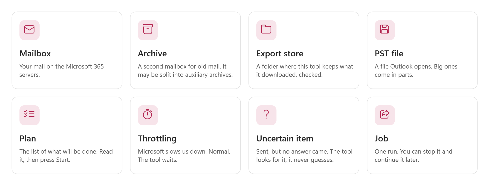

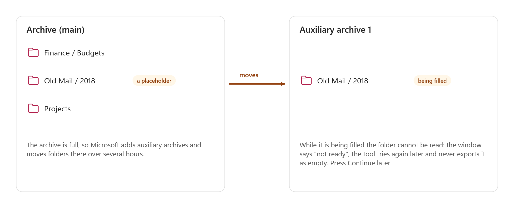

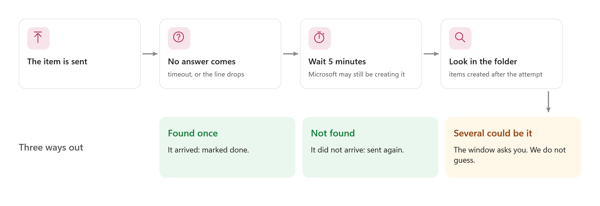

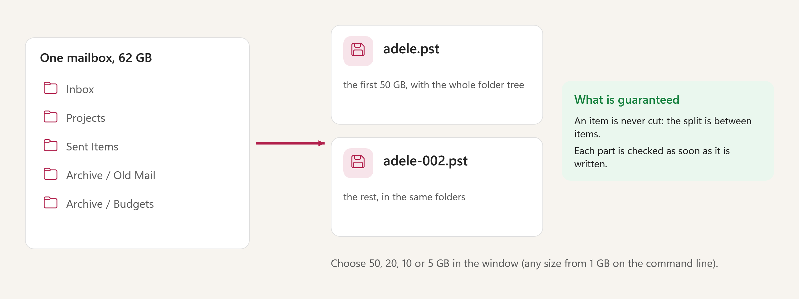

Every word below is a word you see on the screen or in this guide, explained with no other new word. **Where to look** says where you find it. Words that stay inside the tool are in the [reference guide](MailboxTransfer-Guide.md).

| Word | What it is | Where to look |
|---|---|---|
| **Mailbox** | Your mail, calendar and contacts on Microsoft's servers. | The box **Sign in** on the **From** page. |
| **Primary mailbox** | The main mailbox of a person. | **Where to look**, first line. |
| **Archive** | A second mailbox for old mail. | **Where to look**, second line. |
| **Auxiliary archive** | An extra archive that Microsoft adds by itself when an archive is full. | **Where to look**, third line, and in the folder tree. |
| **Not ready** | Microsoft is still moving a folder into an auxiliary archive. It cannot be read yet. | An amber note and the words *not ready* on the Run page. |
| **Item** | One thing in a mailbox: a message, an appointment, a contact. | The counts next to each folder. |
| **Recoverable Items** | A hidden folder where deleted mail waits (14 days by default, up to 30). | The box **Include deleted items**, and the folder in the browser. |
| **Shared mailbox** | A mailbox used by several people, with no password of its own. | The link **A shared mailbox, or another user's mailbox**. |
| **Export store** | A folder with what this tool downloaded, checked. | The **To** page, *Export store only*. |
| **PST file** | A file Outlook opens that holds a mailbox. | The **To** page, *PST files*. |
| **Selection** | What you ticked. | **Your selection**, on the **From** page. |
| **Plan** | The list of what will be done, with the time. Nothing starts before you press Start. | The **Verify** page. |
| **Job** | One run: an export, an import, a check. | **Continue a job** on the **Task** page. |
| **Continue** | Run the same job again. Only what is left is done. | The **Task** page, and the **Next steps** page. |
| **Stop and keep progress** | Ask the job to stop cleanly. Nothing is lost. | Bottom left of the Run page. |
| **Throttling** | Microsoft makes us wait because we ask too much, too fast. Normal. | *Microsoft slowed us down N times* on the Run page. |
| **Uncertain item** | An item sent for which no answer came. It may be in the mailbox or not. The tool looks for it, or asks you. | The step *Check the uncertain items*, and the amber box *1 item needs your decision*. |
| **Refused item** | An item the mailbox would not accept. It is listed with the reason and skipped. | The **Next steps** page. |
| **Check / Repair** | Check: a read-only test of a PST file. Repair: writing a new, repaired PST from a damaged one. | The **From** and **To** pages of *Check and repair a PST*. |
| **Delegated / app-only** | Delegated: the tool acts as **you** (*Me*). App-only: the tool acts as itself, with a certificate and no person (*The application*). | The box **Sign-in** of the **Setup** page. |
| **Sign-in window** | The Microsoft window that opens over the console, where you type your account. | The **From** page, **Sign in...**. |
| **Device code** | A short code you type on a web page, on any device, to sign in. | **Use a code instead**. |
| **Permission** | A right a program asks Microsoft for, such as `MailboxItem.Read`. The administrator says yes once, for the whole company (**admin consent**). | Chapter 2 of this guide. |
| **Tenant** and **application (client) id** | The **tenant** is your company's own space at Microsoft; the **application id** is the number of the tool's registration in your company. Both are long numbers. | The box **Sign-in** of the **Setup** page, and the configuration file. |
| **Configuration file** | The text file where your numbers are written (`config\MailboxTransfer.config.local.psd1`). | The box **Files and folders** of the **Setup** page. |
| **Work folder** | Where the tool keeps its jobs, its stores and its logs. | The box **Files and folders** of the **Setup** page. |
| **Expert mode** | Four numbers for one run and the box **Keep this PC awake while it runs**, at the bottom of the Verify page. You do not need it. | The **Verify** page. |
| **Command line** | The same job written as one line of text. The console shows it, with **Copy**. | **The same from the command line**, on the **Verify** and **Next steps** pages. |
| **Signed** | A digital stamp that proves a file comes from its author and was not changed. The tool checks it each time it starts. | Right-click a .ps1, *Properties*, *Digital Signatures*. |
| **Log file** | A text file that keeps, line by line, what a run did, with the time. You send it to your administrator when something fails. | **Open the log**, on the **Next steps** page. |

---

**Next:** the [reference guide](MailboxTransfer-Guide.md) has every setting, the exact rights, the file formats, the exit codes and the limits.
