# Mailbox Transfer — User guide

> Follow the path, one step after the other. Each step says **what to do**, **what you should see**, and **what to do if not**. You do not need to know anything before you start: every word is explained, and the glossary at the end says **where on the screen to look**. How the tool works inside, every setting, the exact rights and the file formats are in the [reference guide](MailboxTransfer-Guide.md). It is a second file, `MailboxTransfer-Guide.html`, in the same `docs` folder as this one.

> [!IMPORTANT]
> Windows marks files downloaded from the Internet. After you extract the ZIP, check the publisher first (right-click a `.ps1`, for example `Invoke-MailboxTransfer.ps1`, Properties, Digital Signatures: `Nicolas Fabert`), then unblock the extracted folder once:
>
> ```powershell
> Get-ChildItem "C:\Tools\MailboxTransfer" -Recurse -File -Force | Unblock-File
> ```
>
> Replace the example path with the folder where you extracted the ZIP.

> [!WARNING]
> **Stop and ask.** If a step does not go as written, do not guess and do not click again and again. Write down what you see. A photo of the screen is enough. Then call your administrator, or the person who gave you this guide. Exporting never changes a mailbox. Importing adds items to a real mailbox, so do your first import into a **test mailbox**.

<!-- icon: flow -->
## 1. Start here

### What this tool does

Mail lives in a **mailbox** on Microsoft's servers. Sometimes you need that mail somewhere else: a copy on your own disk, a file Outlook can open, or the contents of an old file put back into a mailbox. This tool does that, also when the mailbox is very big (tens of GB) and the job takes hours.

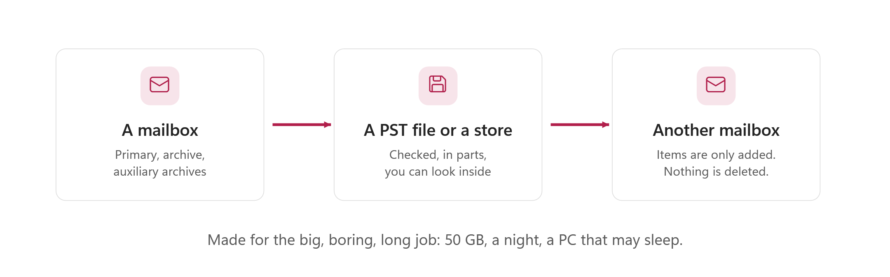

Think of a **removal van with a checklist**. The tool first writes down what goes into the van. It can stop on the road and carry on from where it stopped. It never throws anything away, and it never replaces what is already in the new house.

> [!NOTE]
> The tool has a window, called **the console**. It asks one question per page and tells you what to do next. You do not have to type commands. Everything the console does can also be done from a command line (see the [reference guide](MailboxTransfer-Guide.md)). Typing commands is never required in this guide, except for two lines in chapter 3.

### Which task is mine?

Ask yourself one question. Then read the right column.

| I want to… | My task | Changes a mailbox? |
|---|---|---|
| keep a copy of a mailbox, or of some of its folders, on my disk | **Browse and export** (chapter 4) | No. It only reads. |
| put the mail of a PST file, an export, or `.eml` files into a mailbox | **Import** (chapter 5) | Yes. It only adds. |
| Outlook says my PST file is damaged, or will not open it | **Check and repair a PST** (chapter 6) | No. It works on files. |
| only look inside a PST file or an export | **Open an export or a PST** (chapter 7) | No. |

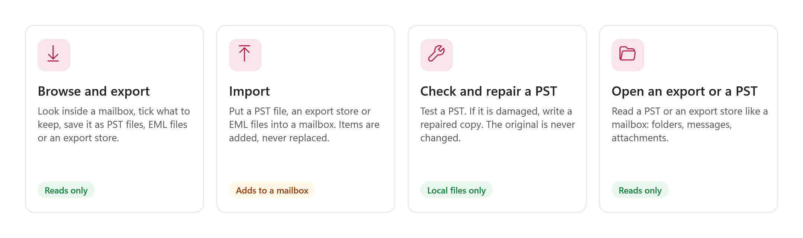

### The path

You do steps **1 to 4** of chapter 3 once. After that every task follows the same six pages.

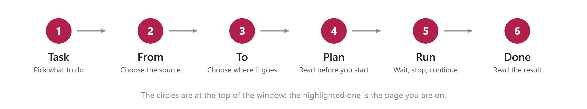

```steps
Task | Pick what you want to do.
From | Say where the mail comes from: a mailbox, or a file.
To | Say where it goes: a folder on your disk, or a mailbox.
Plan | Read what will be done. Nothing starts before you press Start.
Run | Wait. You can leave the window open and do other things. You can stop and continue later.
Done | Read the result in plain words.
```

### What you will see on the screen

The window always looks the same. Learn these four places and you will never be lost.

| Where on the screen | What it is | Why you look at it |
|---|---|---|
| **Top of the window, the row of six circles** | The **stepper**: Task, From, To, Plan, Run, Done. The filled crimson circle is the page you are on. A circle with a tick is a page you finished. | To know where you are. |
| **Top right corner of the window** | Three small buttons, **System**, **Light** and **Dark**, which change the look of the window (System follows Windows), then the version of the tool, then two links: **User guide** (this guide, in your browser) and **Latest release** (the download page on GitHub). | To change the look if you find it hard to read, or to open this guide again. |
| **The big area in the middle** | The page itself: one question, with safe answers already chosen. The answer marked **recommended** is the safe one. | To answer the question. |
| **Bottom of the window, the strip with two buttons** | **Back** on the left. The main button on the right (**Continue**, **Start**…). A short sentence between them says what the page wants. | To move on. If the main button is grey, the sentence says what is missing. |

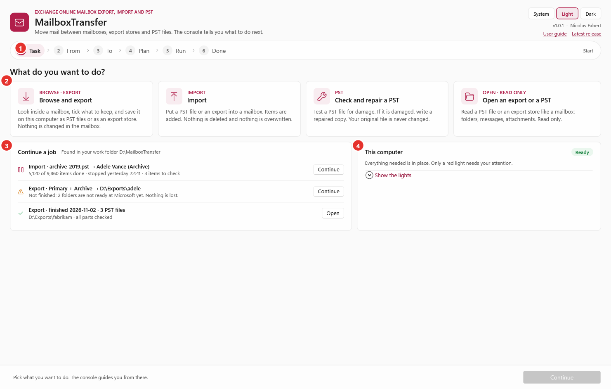

### The example in this guide

The pictures and the commands use one example. Replace the names in the right column with your own.

| What | In the example | Replace with |
|---|---|---|
| The company | `contoso.com` | your company name on the Internet |
| The person whose mailbox is used | `adele.vance@contoso.com` | the address of the mailbox |
| The work folder of the tool | `D:\MailboxTransfer` | a folder on a disk with free space (see chapter 2) |
| Where exports are saved | `D:\Exports\adele` | the folder you choose |
| An old PST file | `D:\PST\archive-2019.pst` | your file |

> [!IMPORTANT]
> **Words you will meet often.**
>
> - **Export store**: a folder where this tool keeps what it downloaded from a mailbox, checked item by item. Only this tool reads it.
> - **PST file**: one file that holds a mailbox's folders and messages. Outlook opens it. A big mailbox becomes several files: `adele.pst`, `adele-002.pst`…
> - **Archive** and **auxiliary archive**: see the glossary. A mailbox can have an archive. A very big archive can be split by Microsoft into auxiliary archives.

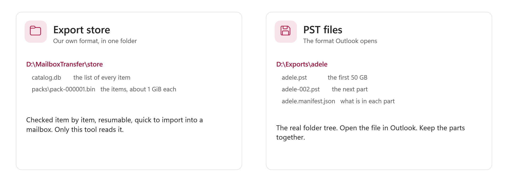

<!-- icon: checklist -->
## 2. Before you start

### Tick every box

If one box stays empty, stop and ask.

- [ ] I have a quiet hour for a small job, or a night for a big one. A 50 GB import takes more than half a day because Microsoft limits the speed (chapter 8).
- [ ] The PC is plugged in. The tool keeps it awake, but it cannot stop a closed lid or a restart.
- [ ] There is free disk space: about **twice the size of what you copy** (the store plus the PST files). The console says how much is needed before you start.
- [ ] I know the address of the mailbox, for example `adele.vance@contoso.com`.
- [ ] For a first try I have a **test mailbox** or a small folder, not the boss's mailbox.
- [ ] I know who to call (my administrator) if a step fails.
- [ ] The files of the tool are unblocked (the box at the top of this guide).
- [ ] I have **the rights** below, or my administrator has given them.

### Ask your administrator for these rights

A mailbox is protected. The tool signs in as **you**, and can only do what **you** may do and what the tool's application has been allowed to do. Give your administrator this table. It lists the **minimum** for each task.

> [!NOTE]
> **Nothing to ask** for the tasks "Check and repair a PST" and "Open an export or a PST": they work on files on your PC and never contact Microsoft.

| I want to… | Ask for these permissions (Microsoft Graph, delegated) |
|---|---|
| **Browse** a mailbox: folders, sizes, dates | `MailboxFolder.Read` and `MailboxItem.Read` |
| Browse **with subject, sender and preview** | the two above, and `Mail.Read` |
| **Export** to a store, PST files or EML files | `MailboxFolder.Read`, `MailboxItem.Read`, and `MailboxItem.Export` (or `MailboxItem.ImportExport`, which includes it) |
| **Import** into a mailbox | `MailboxFolder.ReadWrite`, `MailboxItem.Read`, and `MailboxItem.ImportExport` |
| Import `.eml` files with the **Exchange conversion** option | the import list, and `Mail.ReadWrite` |
| Work in a **shared mailbox** or another person's mailbox | the **FullAccess** right on that mailbox, plus: `Mail.Read.Shared` to see subjects when browsing. **Writing** (import) there needs a different kind of permission, see the box below. |
| Let the tool find the mailbox ids by itself (optional) | `User.Read.All`. Without it you give the ids once (see the reference guide). |

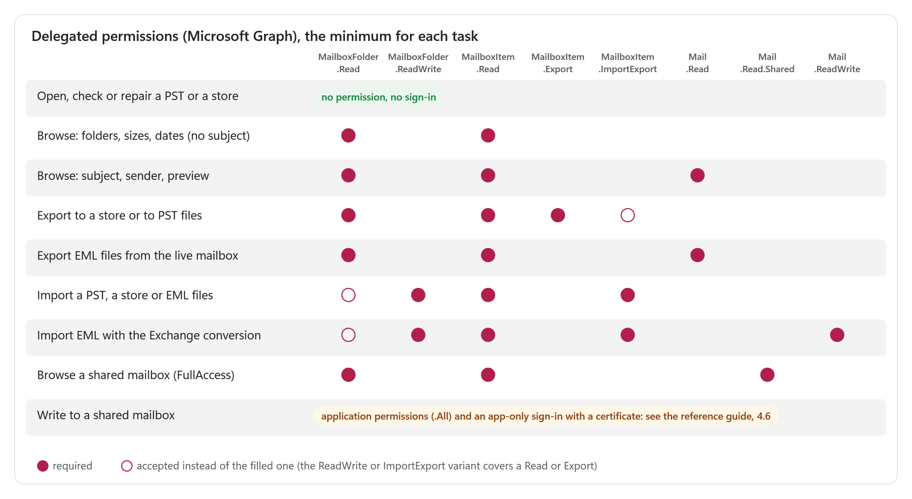

> [!WARNING]
> **Shared mailboxes: signed in as a person, you can read but not write.** With the FullAccess right you can browse and export a shared mailbox. **Importing into a shared mailbox, or into anyone else's mailbox, is refused** when you sign in as a person: Microsoft asks for *application* permissions (`MailboxFolder.ReadWrite.All` and `MailboxItem.ImportExport.All`), and the "delegated" versions for other mailboxes do not exist. The answer is a sign-in without a person (**app-only**, with a certificate): see the box below. Otherwise import into the mailbox of the signed-in person only.

> [!NOTE]
> **Sign-in with a certificate (no person present).** Your administrator registers a certificate for the tool's application and gives the application these permissions (Microsoft Graph, **application** type, admin consent):
>
> - to browse and export: `MailboxFolder.Read.All`, `MailboxItem.Read.All`, `MailboxItem.Export.All` (or `MailboxItem.ImportExport.All`), and `Mail.Read` for subjects;
> - to import: `MailboxFolder.ReadWrite.All`, `MailboxItem.Read.All`, `MailboxItem.ImportExport.All`.
>
> To limit the application to some mailboxes, the administrator gives the same rights through **Exchange RBAC for Applications** instead of the consent (exact steps in [the reference guide](MailboxTransfer-Guide.md#46-no-person-present-certificate-app-only)). **The certificate:** a self-signed one is enough. The administrator creates it on the PC that runs the tool (`Cert:\CurrentUser\My`, private key not exportable), uploads its public part (`.cer`) to the app registration, and gives you three values: the tenant, the application (client) id and the certificate thumbprint. **In the console**, at the sign-in, choose **The application (certificate)** and type those three values and the address of the mailbox to work on; they are used for this run only and are not saved. **The end date:** the console does not show it. Ask your administrator when the certificate ends, or look at it in PowerShell with `Get-ChildItem Cert:\CurrentUser\My | Format-Table Subject, NotAfter, Thumbprint`. A certificate that has ended makes the sign-in fail until it is renewed.

> [!IMPORTANT]
> **A few rights could not be confirmed.** The list above comes from what the tool does. It was checked on one test tenant. Three points depend on your organisation and are not known for sure: which administrator role may read another person's mailbox with this tool; whether some organisations need an extra Exchange role in addition to the Graph permissions; and what the mailbox and archive **quotas** are (Microsoft's interfaces do not give them). They are listed in [the reference guide](MailboxTransfer-Guide.md#4-the-exact-rights).

### What your administrator does once

This part is for the administrator. It is done **once for the whole company**, not once per person.

1. In Microsoft Entra ID, create an **app registration** for the tool. It is a *public client*: no secret, no password.
2. Add the redirect address `http://localhost`.
3. Switch **Allow public client flows** on (it is needed for the sign-in with a code, section 4.2).
4. Add the **delegated** permissions of the table above, and give **admin consent**.
5. Give you the **application (client) id** and the **tenant id**, two long numbers.

You put the two numbers in the file `config\MailboxTransfer.config.local.psd1` (chapter 3). Nobody else sees them, and the file is never part of a package.

<!-- icon: download -->
## 3. Set up once

### 1. Get your rights

**Do:** give your administrator the table of chapter 2. Wait for the two numbers (application id and tenant id).

**You should see:** the two numbers, each like `00000000-0000-0000-0000-000000000000`.

**If not:** ask again. Nothing else works without them, except the tasks on files.

### 2. Put the tool on the PC

**Do:** download the tool, then put it on the PC.

1. Open **https://github.com/Nico77600/MailboxTransfer/releases/latest** in your browser.
2. Under **Assets**, click **`MailboxTransfer-1.0.1.zip`** (the number may be newer). Do **not** click *Source code*: that is a copy of the repository, not the tool.
3. Extract the ZIP into a folder such as `C:\Tools\MailboxTransfer` (right-click, *Extract All*). Write the files directly in that folder: `Start-MailboxTransferConsole.cmd` must be inside it, not one level deeper.
4. Unblock the folder (one command, once):

```powershell
Get-ChildItem "C:\Tools\MailboxTransfer" -Recurse -File -Force | Unblock-File
```

**You should see:** nothing. No message means it worked.

**If not:** a red message that mentions a path means the path is wrong. Fix the path and run it again.

> [!NOTE]
> **The tool checks itself.** Every script of the package is signed by its author, and a list of the other files with their fingerprints is signed too. Each time the tool starts, it verifies them. If a file was changed or is missing, the tool stops and names the file: download the ZIP again (see chapter 9, line 25). You do not have to do anything for this check.

### 3. Write your two numbers

**Do:** in the folder `config`, copy nothing, simply create a text file named `MailboxTransfer.config.local.psd1` with these lines, and your own numbers:

```powershell
@{
    Lab = @{
        TenantId = '00000000-0000-0000-0000-000000000000'
        ClientId = '00000000-0000-0000-0000-000000000000'
    }
}
```

**You should see:** a file of five lines.

**If not:** keep the quotes and the braces exactly as above. A missing brace gives a red message when the window opens.

### 4. Open the console

**Do:** double-click **`Start-MailboxTransferConsole.cmd`** in the tool's folder. If you prefer to type, open **PowerShell 7** (the program called `pwsh`), go to the tool's folder and type:

```powershell
cd C:\Tools\MailboxTransfer
.\Start-MailboxTransferConsole.ps1
```

**You should see:** after a few seconds, the window of the first picture of this guide. The first start prepares the engine of the tool and takes a few seconds longer. Nothing is installed.

**If not:** a message about the PowerShell version means you need PowerShell 7.5 or later. Ask your administrator to install it.

> [!TIP]
> To look around without any mailbox, add `-Demo`: `.\Start-MailboxTransferConsole.ps1 -Demo`. The window shows made-up data and touches nothing.

### 5. Read the lights

**Do:** on the first page, look at the box named **This computer** (number 4 on the picture of chapter 1). It says **Ready** when everything needed is in place. Click **Show the lights** to see the list.

**You should see:** green ticks for: PowerShell 7.5 or later, the sign-in component, the work folder with its free space, the network connection, and the files unblocked.


**If not:** a **red** light tells you what to fix, in plain words. Fix it, close the window and open it again. If you cannot, stop and ask.

<!-- icon: search -->
## 4. A · Browse and export

You will look inside a mailbox, tick what to keep, and save it on your disk. **Path 1** is a small try. **Path 2** is the whole mailbox. The steps are the same: only what you tick changes.

> [!TIP]
> **Path 1, the try.** Tick one small folder (a few messages). Do the whole job. When it works, do **Path 2** with the whole mailbox.

### 4.1 Pick the task

**Do:** on the first page click the card **Browse and export**, then **Continue** at the bottom right.

**You should see:** the second circle, **From**, filled in crimson.

**If not:** if **Continue** is grey, no card is chosen. Click a card.

### 4.2 Sign in

**Do:** type the address of the mailbox (`adele.vance@contoso.com`). Click **Sign in**. A Microsoft sign-in window opens: sign in as yourself.

**You should see:** a green line: *Signed in as adele.vance@contoso.com. The sign-in is kept on this PC, encrypted for your Windows account.*

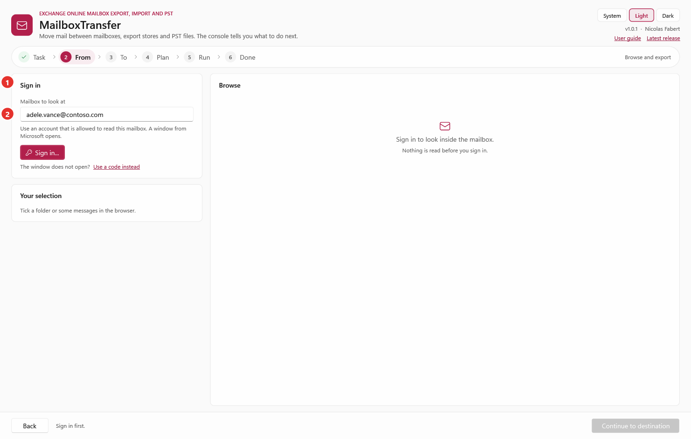

**If not:**

- *Nothing opens.* The sign-in window may be hidden behind another window. Or click **Use a code instead**: a **code** appears (see the picture). On any device, open the web address shown, type the code, sign in. The code is valid for 15 minutes. After that the window says *The code has expired. Get a new code.* Click for a new one.
- *A red message about a permission.* Your administrator has not given you the rights of chapter 2. Copy the permission name in the message and send it to them.
- *Your sign-in has expired.* Sign in again. Nothing is lost.

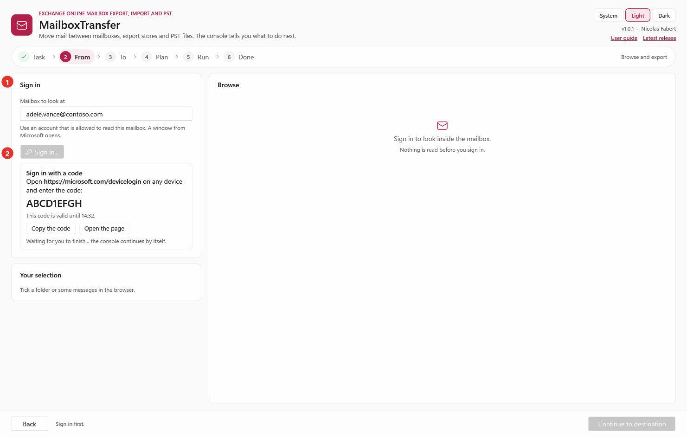

### 4.3 Pick the mailbox and the places to look

**Do:** in the box **Where to look**, tick the places you want: **Primary mailbox**, **Archive**, and any **Auxiliary archive** found. A line under each says how many items and how big.

**You should see:** the list of folders appears in the middle after a moment.

**If not:**

- *An amber note: "Auxiliary archive 1 is still being filled by Microsoft".* Normal on a very big archive. Some folders will say **not ready**. The tool tries them again later. Nothing is exported as empty. See chapter 9, topic 3.
- *The archive is missing from the list.* Click **The archive is missing from this list**. Your administrator can give you its id once (see the reference guide).
- *A shared mailbox.* Click **A shared mailbox, or another user's mailbox** and type its address. You need the FullAccess right (chapter 2).

**Deleted items (optional).** Tick **Include deleted items (Recoverable Items)** if you also need what was deleted. When someone empties *Deleted Items* in Outlook, the messages are not gone at once: Exchange keeps them for a while (14 days, up to 30) in a hidden folder named **Recoverable Items**. The browser then shows that folder, with four folders in it: **Deletions** (what was emptied from Deleted Items), **Purges** (what was removed for good), **Versions** (older versions of items that were changed) and **DiscoveryHolds** (what a hold keeps). Tick them like any other folder. Changing the box reloads the browser, so choose it before you tick. The line **What are deleted items (Recoverable Items)?** under the box says the same in short.

### 4.4 Browse and tick

**Do:** click folders in the tree on the left of the browser. Click a folder's **checkbox** to take the whole folder, or open it and tick single messages on the right.

**You should see:** the box **Your selection** (under **Where to look**, and in the line at the bottom of the window) counts the items, the size and the folders you ticked. A half-filled checkbox means "some of this folder".


**If not:** if you see *headers only until export* for an auxiliary archive, it is normal: Microsoft gives only sizes and dates for it until it is exported. If the messages show no subject, the permission `Mail.Read` is missing: you can still export, but you cannot see the subjects.

> [!NOTE]
> **This is read only.** Browsing never changes the mailbox. **Recoverable Items** (the hidden folder of deleted mail, shown when you ticked **Include deleted items**) is read the same way, and exported like any folder. Its items keep their full content and their attachments. In the export and in the PST they are saved **apart**, under a folder named *Recoverable Items* (*Recoverable Items / Deletions*…), never mixed with your normal folders. The time of the deletion is the last change time of the item.

### 4.5 Choose where to save

**Do:** pick **PST files** (Outlook opens them), **Export store only** (our format, quick to import later), or **EML files** (one `.eml` file per message). Pick a **folder on this computer** and a **file name**.

**You should see:** a box **Disk space** on the right: the size of your selection, the space needed, and the free space. A green line says *There is enough room.*

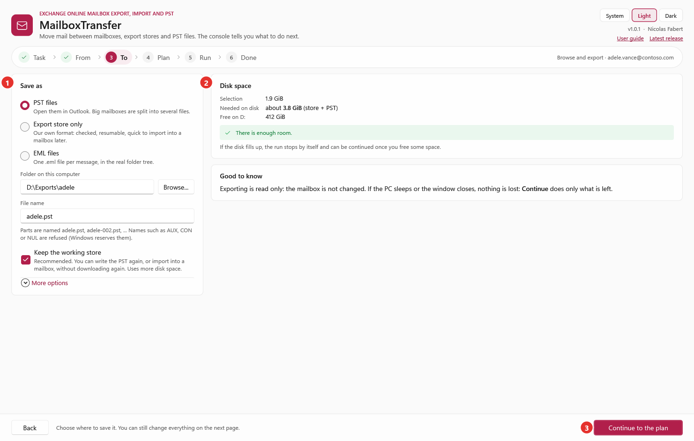

**If not:** a red line says the disk is too small. Choose another folder on a bigger disk, or tick fewer folders.

> [!NOTE]
> **Big PST files are split.** A PST is cut into parts of about 50 GB, because Outlook is made for that. The parts are `adele.pst`, `adele-002.pst`… Keep them together. You can choose 50, 20, 10 or 5 GB under **More options**. A file name that Windows keeps for itself (`AUX`, `CON`, `NUL`, `COM1`…) is refused, because Outlook crashes on such a file. The box tells you.

> [!TIP]
> **Keep the working store** (ticked by default) lets you write the PST again, or import into a mailbox later, without downloading again. It uses more disk space.

### 4.6 Read the plan

**Do:** read the page. Then click **Start the export**.

**You should see:** on the left, **What will be done** in numbered steps, with the mailbox, where it is saved, the size and the **time**. On the right, **What is in it**: the folders, the items and the sizes. A green box says *The plan is valid. Every folder was matched. Nothing starts before you press Start.*

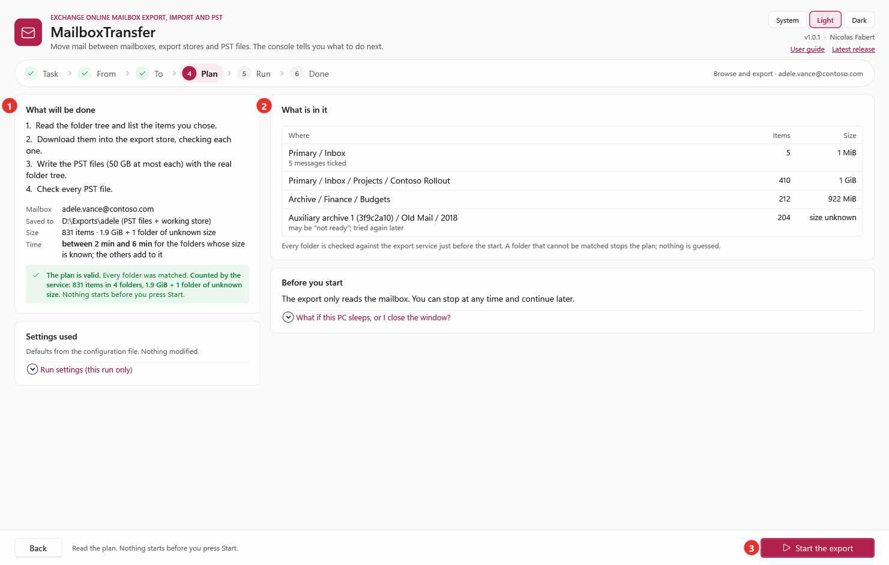

**If not:** an amber line is a warning to read, not a stop. A red line means something does not fit: go **Back**.

> [!NOTE]
> **The time is a range, not a promise.** *Between 2 min and 6 min* means exactly that. Microsoft decides the speed. See chapter 8.

### 4.7 Wait

**Do:** nothing. You can leave the window open and do other things. Do not close it, if you can avoid it.

**You should see:** the **Run** page: a bar, the number of items, the size, the time elapsed, and **About 5 min left**. Below: the **Steps** with a tick, a triangle or a clock, and the **Folders** with their counts.

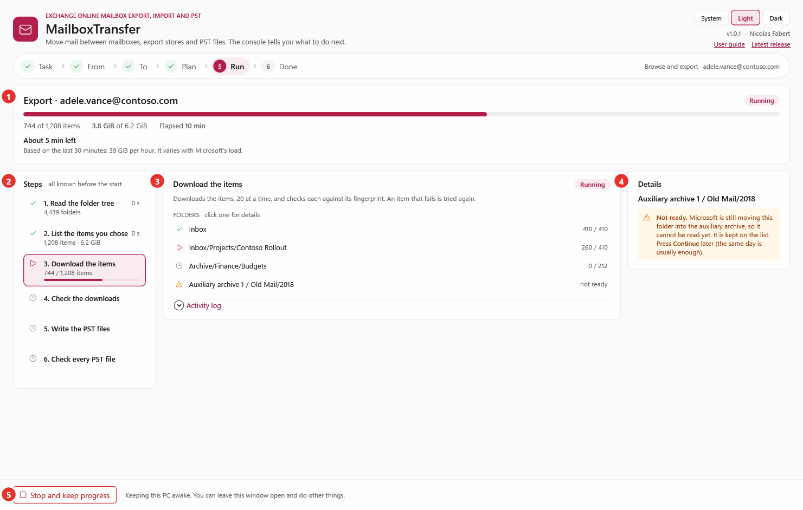

What the steps mean:

| Step | What happens |
|---|---|
| Read the folder tree | The tool asks Microsoft for the list of folders. |
| List the items you chose | It lists the items in them. |
| Download the items | It downloads them, 20 at a time, and checks each one. An item that fails is tried again. |
| Check the downloads | It checks everything it downloaded against its fingerprint. |
| Write the PST files | It writes the PST parts. |
| Check every PST file | It reads each part back. |

**If not:** read the colours.

| You see | It means | You do |
|---|---|---|
| A **crimson** triangle | This step is running. | Wait. |
| An **amber** triangle, text *Not ready* | Microsoft is still moving this folder. | Nothing now. Press **Continue** later. |
| *Microsoft slowed us down 7 times* | Normal. See chapter 9, topic 1. | Wait. |
| *Resumed after sleep* | The PC slept. | Nothing. It carries on. |
| A **red** message | A real problem. | Read it, chapter 9. |

To stop on purpose, click **Stop and keep progress** (bottom left). A question asks you to confirm. Nothing is lost. See chapter 8.

### 4.8 Read the end

**Do:** read the **Done** page.

**You should see:** one of these, in the title and the colour:

| Title | Colour | Meaning |
|---|---|---|
| **Complete** | green | Everything you asked is done and checked. |
| **Finished, with refused items** | amber | The job is done, but Microsoft refuses some items for good. Nothing more can be done by running again: open the list (CSV) from the page. |
| **Not finished** | amber | Something is left, for instance a folder that was not ready. Nothing is lost. Press **Continue** later. |
| **Needs a decision** | amber | An item needs your choice (chapter 5, step 7). |
| **Error** | red | The job stopped. Read the message. Your files are kept. |

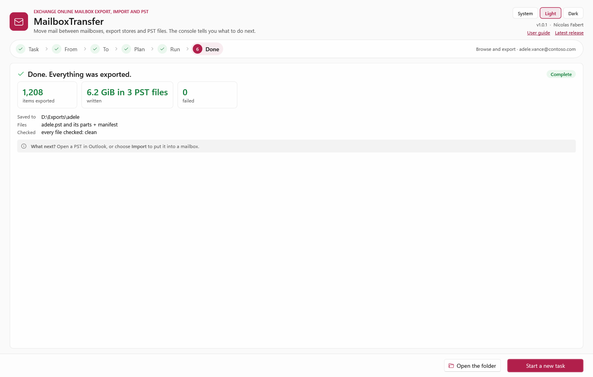

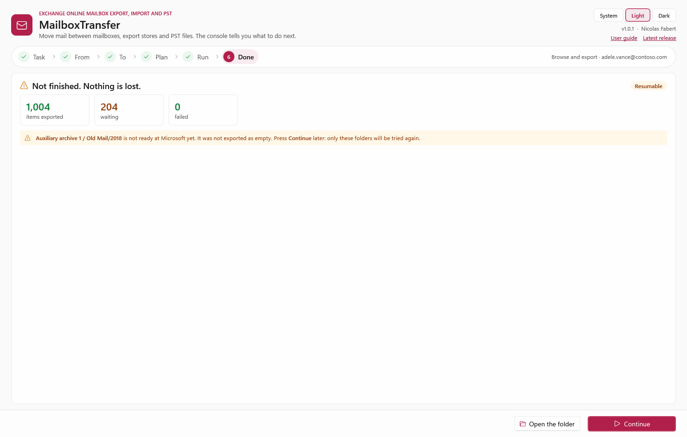

### 4.9 Open the PST in Outlook

**Do:** in Outlook choose **File > Open & Export > Open Outlook Data File** and pick `adele.pst`. For parts, open the first one; open the others the same way.

**You should see:** the folders of the mailbox, with their mail. There is also a **manifest** file, `adele.manifest.json`. It lists what is in each part. Keep it with the parts.

**If not:** see chapter 9, topics 15 and 16.

<!-- icon: upload -->
## 5. B · Import

You put mail from a PST file, an export store or `.eml` files **into a mailbox**. Items are **added**. Nothing is deleted. Nothing is overwritten. A **long job**: the guide says it again in chapter 8.

> [!CAUTION]
> **An import writes to a real mailbox.** Do the first one into a **test mailbox**. An import cannot be undone by this tool: it never deletes. To remove what was added you have to delete it yourself in the mailbox.

### 5.1 Pick the file

**Do:** click the card **Import**, **Continue**. On the **From** page, choose the kind of source (a PST file or a folder of parts, an export store, or EML files) and click **Browse…** to pick it.

**You should see:** the page checks the file **at once** and says what is in it: the size, the number of parts, and whether it is clean.

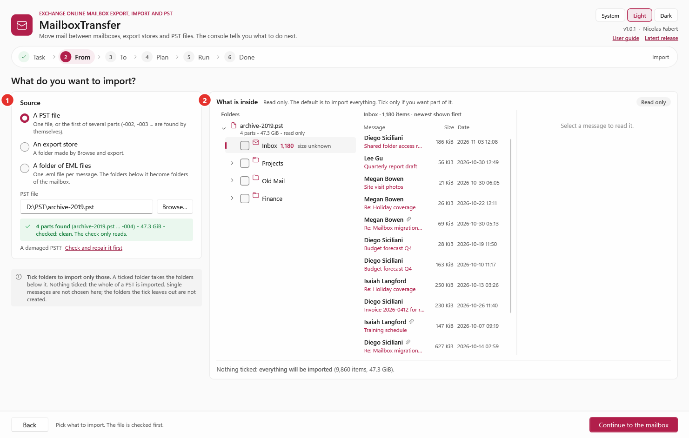

**Some folders only.** Tick the folders to import in the tree (a PST or a folder of `.eml` files); nothing ticked means everything. The plan counts only what you ticked.

**If not:** an amber line *the file has errors*: the file is damaged. Go to chapter 6, **Check and repair**, first. Or import anyway: the items that cannot be read are listed and skipped. See chapter 9, topic 13.

### 5.2 Pick the mailbox and the folder

**Do:** sign in as in 4.2. Pick **Primary mailbox** or **Archive**. Then choose where the folders go: **a new folder** (recommended, named for you, such as *Imported archive-2019 2026-11-09*), or **the same folder names** (merges into existing folders).

**You should see:** the page shows the mailbox, and for an archive its size and the quota when known.

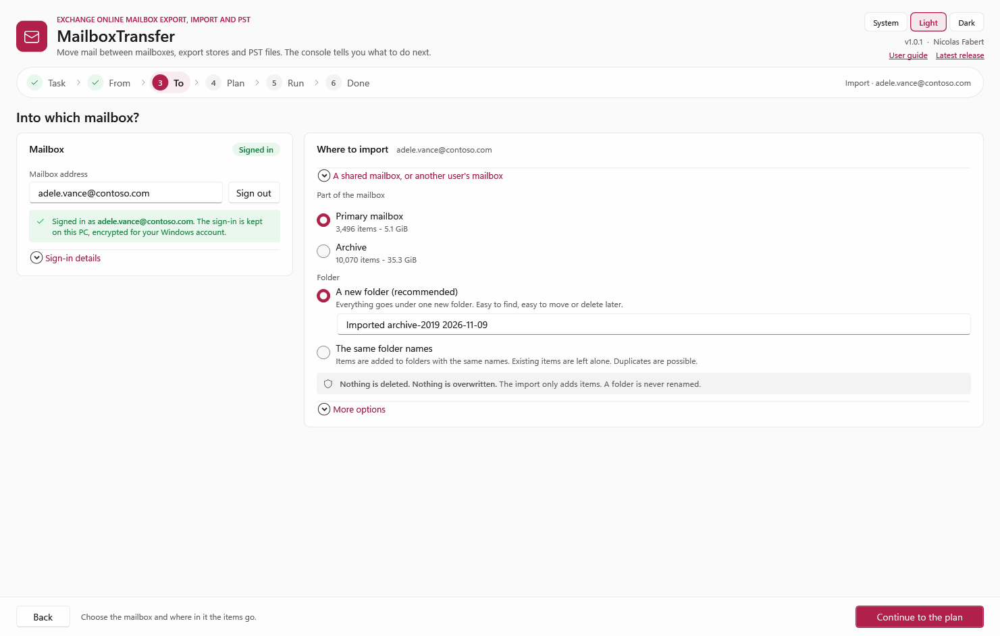

**If not:** if you picked a shared mailbox, the page says *this needs application permissions*: see chapter 2.

> [!WARNING]
> **Two imports into "the same folder names" can create duplicates.** The tool adds items; it does not compare with what is already there. Use **a new folder** each time.

> [!NOTE]
> **Deleted items come back as ordinary items.** If the export holds a folder *Recoverable Items* (see 4.3), the import puts its folders in a normal folder named **Restored deleted items** (inside your new folder, if you chose one), for instance *Restored deleted items / Deletions*. Exchange does not accept an import into Recoverable Items, so the items are never put back where they were deleted. The page says so, in a blue box, when your export holds them. Look in Outlook under *Restored deleted items*; move or delete the items as you like.

### 5.3 Read the plan, type IMPORT

**Do:** read the plan. In the box **Confirm** type `IMPORT`, then click **Start the import**.

**You should see:** the numbered steps, the folders, the number of items, **the time** (often several hours), and a box: *This adds 9,860 items to a real mailbox. Type IMPORT to confirm.* The **Start** button is grey until you type it.

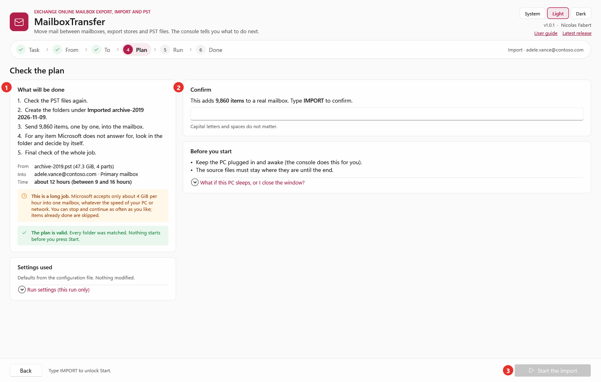

**If not:** capitals and spaces do not matter. If **Start** stays grey, you typed something else.

### 5.4 Wait

**Do:** nothing. A big import takes hours. It is slow because Microsoft accepts only a few GiB per hour into one mailbox. More speed on your PC does not help. You can stop and continue as often as you like.

**You should see:** the **Run** page, like chapter 4.7, with the steps: *Check the PST files*, *Create the folders*, *Send the items*, *Check the uncertain items*, *Final check*.

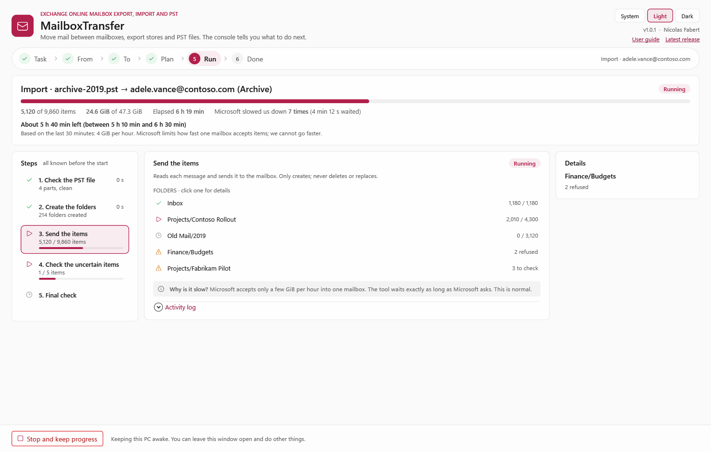

> [!NOTE]
> The time on the Run page is a **range** (for example *between 5 h 10 min and 6 h 30 min*), worked out from the last 30 minutes. It says nothing for the first 10 minutes, and again after a sleep, because it would be a guess.

### 5.5 Look in Outlook

**Do:** open the mailbox in Outlook, or Outlook on the web. Find the new folder (for example *Imported archive-2019 2026-11-09*).

**You should see:** the folder tree of the PST, with the messages. The **received date** of the messages is the original one. Creation and last-modified dates are the time of the import (Exchange sets them). The folder name may take a few minutes to appear.

### 5.6 If you stopped, or the PC slept

**Do:** open the window again. On the first page, in **Continue a job**, click **Continue** on the line of your job.

**You should see:** the job picks up. Only what is left is done. Items done before are skipped.


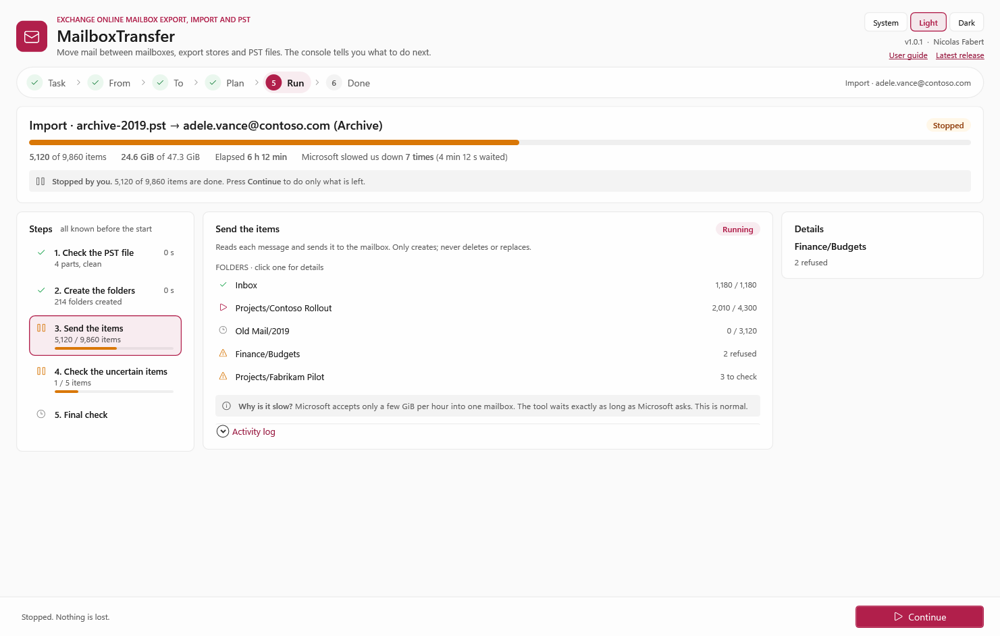

If the PC slept while the job ran, the page says *Resumed after sleep* and carries on by itself.

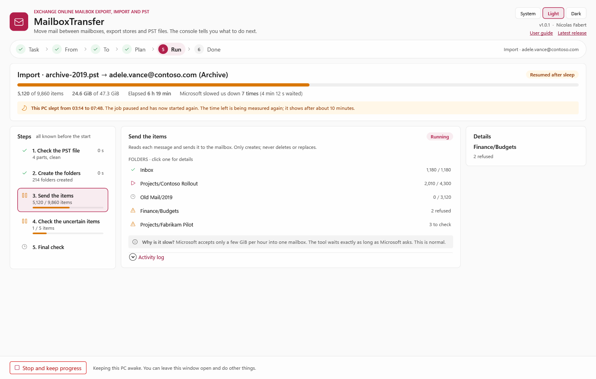

### 5.7 An item needs your decision

Sometimes the tool sent an item and **Microsoft never answered**. The item may or may not be in the mailbox. The tool then looks in the folder, five minutes later. If **exactly one** item matches, it marks it done. If none matches, it sends it again. If **two or more** could be the one, the tool **does not guess** and asks you.

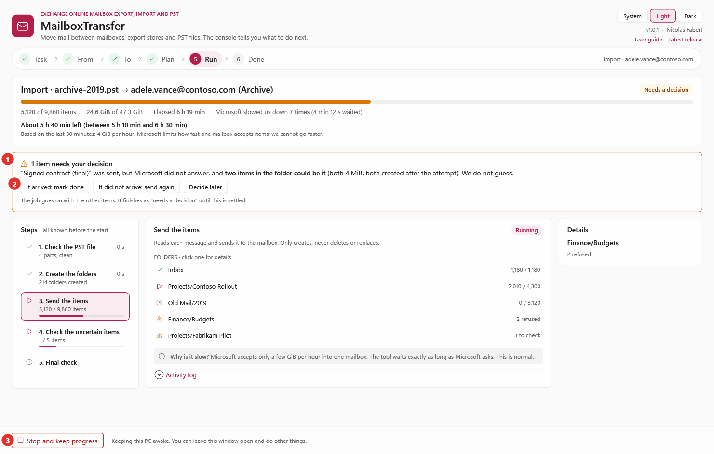

| Button | What it does | Risk |
|---|---|---|
| **It arrived: mark done** | Counts the item as imported. | If it is not really there, one item is missing. |
| **It did not arrive: send again** | Sends it again. | If it was there, one item appears twice. |
| **Decide later** | Leaves it. The job ends as *needs a decision*. | None. You decide later. |

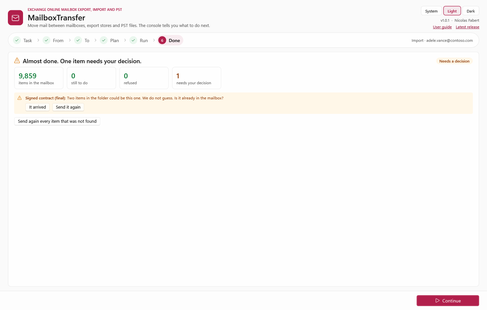

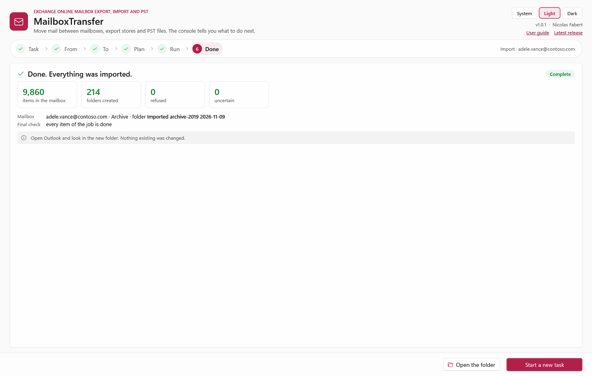

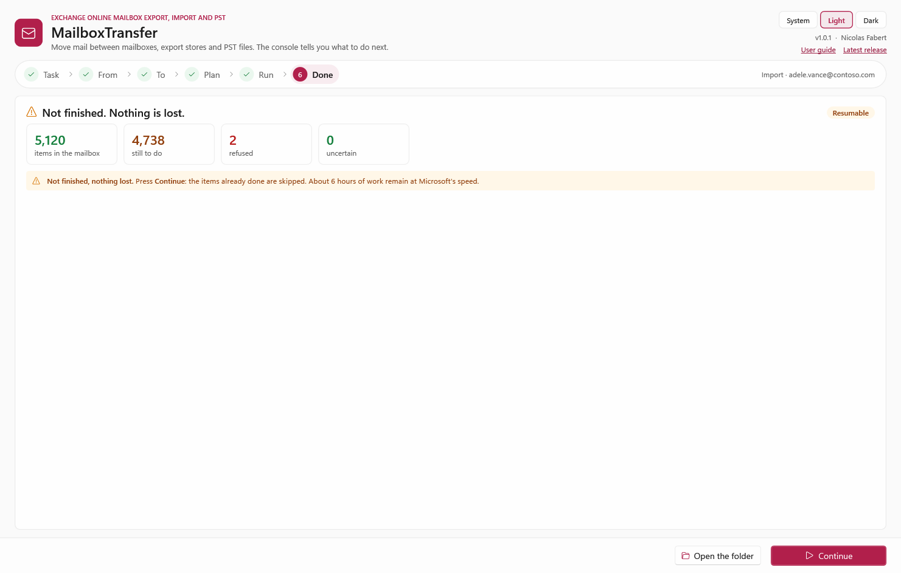

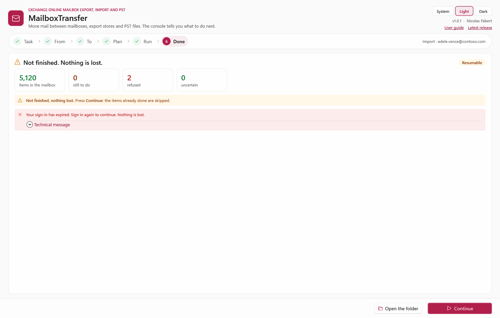

<!-- icon: tool -->
## 6. C · Check and repair a PST

Outlook says the file is damaged, or it will not open. The tool **checks** the file and, if needed, writes a **repaired copy**. **Your original is never changed.**

### 6.1 Pick the file

**Do:** click the card **Check and repair a PST**, **Continue**, then **Browse…** and pick the file.

**You should see:** the check starts **by itself** as soon as you pick the file. It only reads.

### 6.2 Read the result in words

**You should see:** a title with the number of **errors** and **warnings**, a sentence such as *The file has damage, but it can probably be repaired*, and a table: **What was found**, how many, and which **repair level** fixes it.

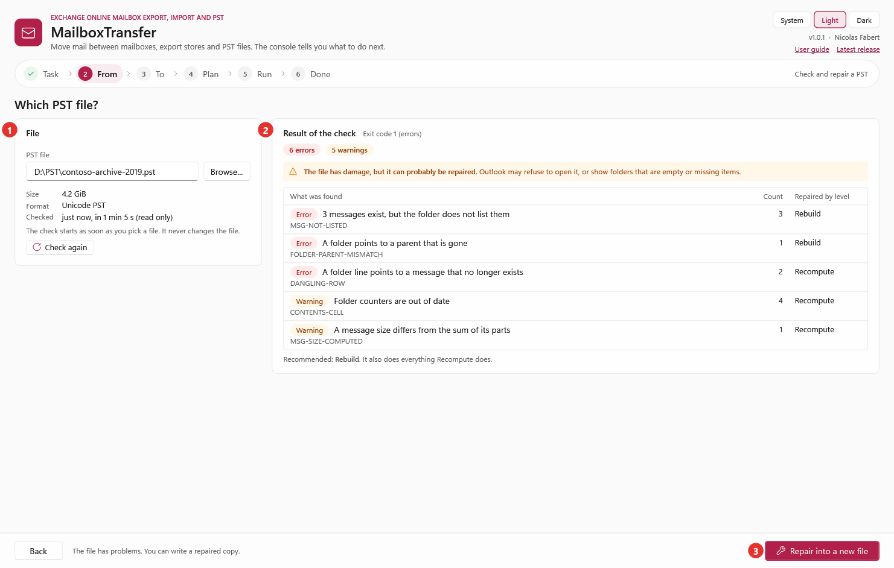

If the file is fine, the page says so, and there is nothing to repair.

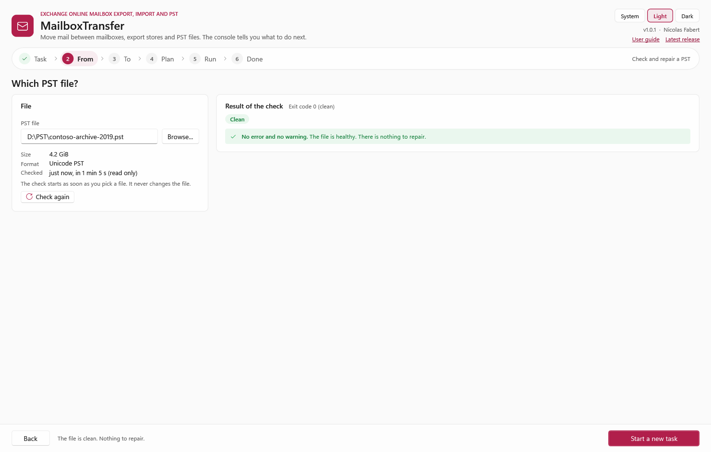

**If not:** the line **Exit code** is for your administrator. 0 means clean, 2 warnings, 1 errors.

### 6.3 Repair into a new file

**Do:** click **Repair into a new file**. Choose the name of the new file (the page proposes `contoso-archive-2019.repaired.pst`) in a folder with enough space: **as much as the file** you repair. Click **Continue**, read the plan, click **Start**.

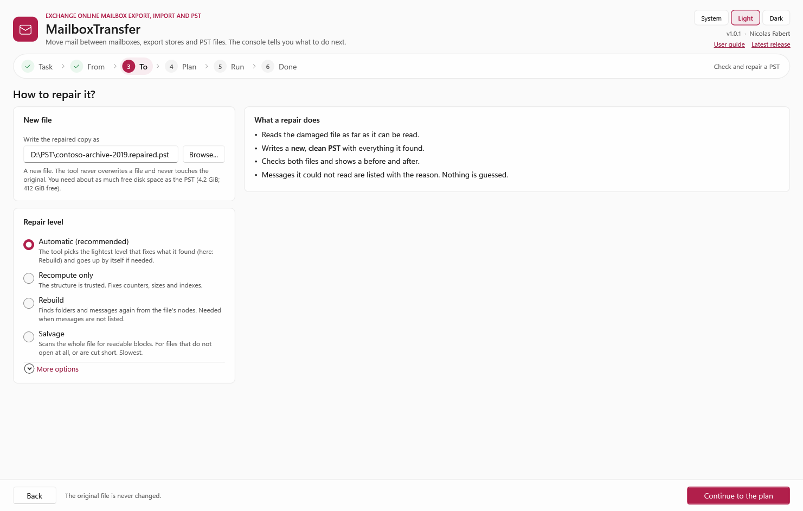

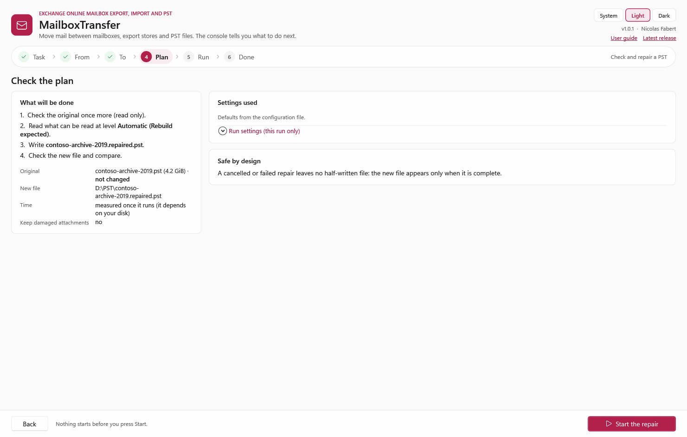

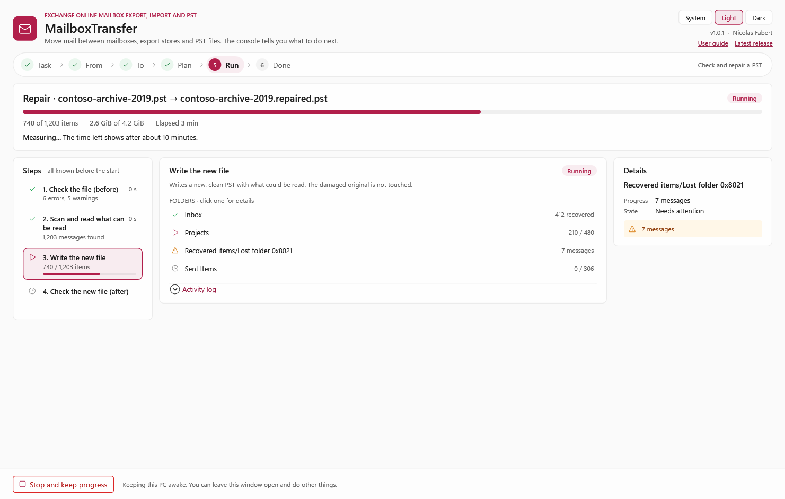

The **level** is **Automatic**: the tool starts at the level the check recommends and goes higher by itself if needed (see the picture below). Under **More options** you can choose, and tick **Keep damaged attachments** (off by default: a damaged attachment is renamed *name (damaged).ext* and may be unreadable).

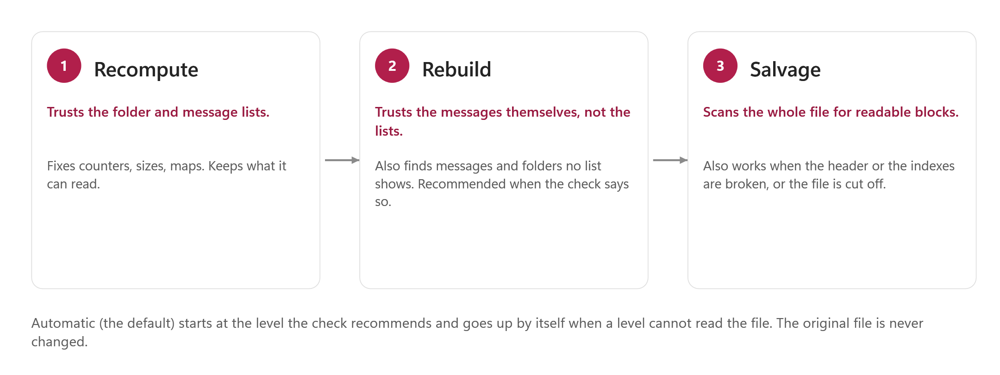

### 6.4 Read before and after

**You should see:** the **Done** page with **before** and **after**: errors and warnings, and how many messages were **kept**, **partly recovered** or **lost**.

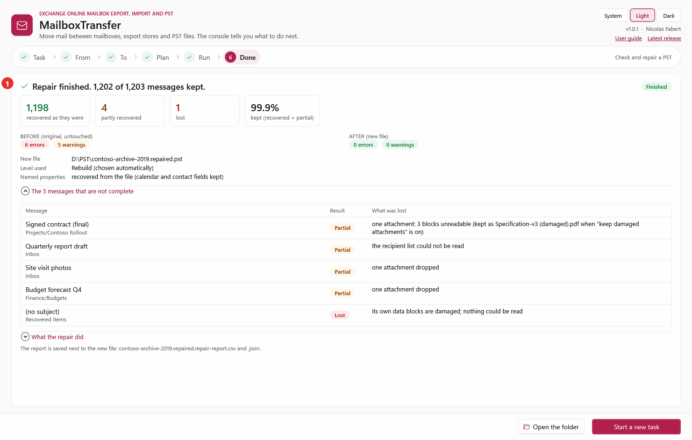

| Word | Meaning |
|---|---|
| **Kept** | The message was read completely. |
| **Partly recovered** | The message is there, but a part (often an attachment) could not be read. |
| **Lost** | Nothing of it could be read. |
| **Recovered items** | A folder in the new file. It holds messages whose folder was lost. Look there first for anything missing. |

### 6.5 Open the repaired file

**Do:** open the new file in Outlook, as in 4.9. Check the folders you care about. Keep the original until you are sure.

**If not:** see chapter 9, topic 14.

<!-- icon: folder -->
## 7. D · Open an export or a PST

You only want to look. Nothing is written.

**Do:** click the card **Open an export or a PST**, **Continue**, pick the file or the export folder.

**You should see:** the same browser as in 4.4, on your file: folders on the left, messages on the right. You can tick folders or messages and send the ticks to **Import** or to a **new PST** (**Export my ticks to a PST...**). Click a message to read it (text, HTML and attachment names) in the reading pane; nothing is written.

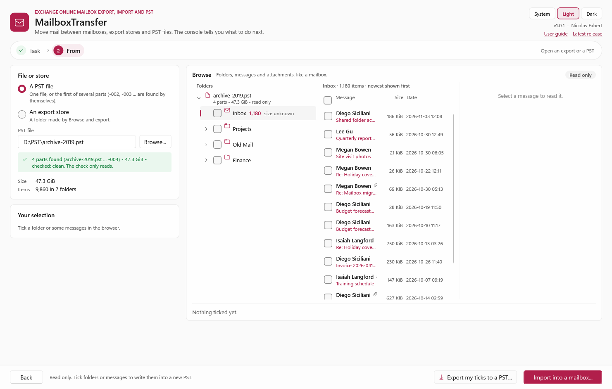

<!-- icon: clock -->
## 8. Long jobs: what to expect

### The honest time

Importing is slow **on purpose**. Microsoft limits how much goes into one mailbox: about **4 GiB per hour** (a GiB is a gigabyte, about a thousand million characters). A 50 GB import takes about half a day, whatever your PC. Exporting is faster: from 30 up to about 150 GiB per hour, depending on how busy Microsoft is. Writing, checking and repairing PST files go at the speed of your disk.

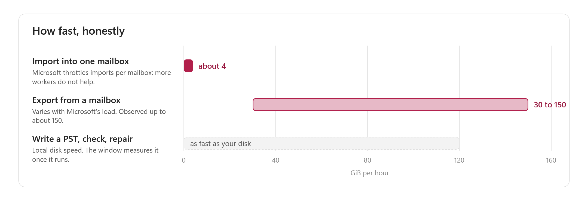

The window shows a **range** before you start and a better one while it runs. A range is honest. A single number would be a promise nobody can keep.

### Stop and continue

You can stop at any time, close the window, switch the PC off. **Nothing is lost.** The next time, click **Continue** on the first page. Only what is left is done.

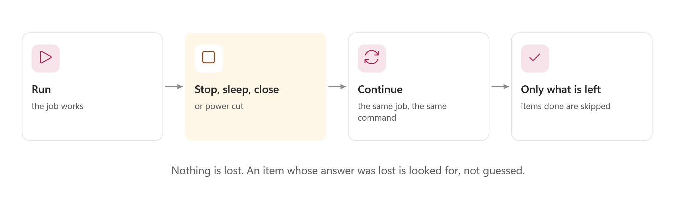

| What happened | What you see | What to do |
|---|---|---|
| You clicked **Stop and keep progress** | *Stopped* | Press **Continue** later. |
| The window was closed | The job is in the list **Continue a job** | Press **Continue**. |
| The PC went to sleep | *Resumed after sleep* | Nothing. It carries on. |
| The PC restarted or lost power | The job is in **Continue a job** | Press **Continue**. An item whose answer was lost is looked for, never guessed. |
| The network dropped | *We cannot reach Microsoft. Trying again every 30 seconds.* | Check the connection. It carries on. |

> [!NOTE]
> **Keep awake.** While a job runs, the tool asks Windows not to sleep because of inactivity. It cannot stop a closed lid, a Sleep you choose yourself, or a restart. The page says so before you start (**What if this PC sleeps, or I close the window?**).

<!-- icon: lifebuoy -->
## 9. When something goes wrong

> [!WARNING]
> **Stop and ask** if the table does not help. A photo of the screen, plus the **technical message** (under the red message, click to open it), is what your administrator needs.

Three columns: **I see**, **It means**, **Do this**. The numbers are the topics the guide points to.

| # | I see | It means | Do this |
|---|---|---|---|
| 1 | *Microsoft slowed us down 7 times* | **Throttling.** Microsoft asks us to wait. The tool waits exactly as long as asked and goes slower, then faster again. Not an error. | Nothing. This is the reason a big import takes hours. |
| 2 | *Checking…* or *Needs your decision* | **Uncertain item.** An item was sent, no answer came. | Chapter 5.7. |
| 3 | *Not ready*, an amber note, the end says *Not finished* | **Auxiliary archive being filled.** Microsoft moves folders over hours and refuses to list them meanwhile. | Nothing now. Press **Continue** later (the same day is usually enough). Nothing is exported as empty. |
| 4 | *"AUX" is a name Windows keeps for itself* | A file name such as `AUX`, `CON`, `NUL`, `COM1`… is reserved by Windows. Outlook crashes on such a PST. | Type another name. |
| 5 | Many items **Refused**, *The mailbox is full* | The archive or the mailbox has no more room (the limit is set by Microsoft and your company). | Import into another mailbox, or ask your administrator for more room. |
| 6 | A code box, *The code has expired. Get a new code.* | The sign-in code is valid for 15 minutes. | Click for a new code. Type it at the web address shown, on any device. If Microsoft says *public client* (error AADSTS7000218), your administrator must switch on **Allow public client flows** (chapter 2). |
| 7 | The sign-in window does not open | Hidden, or blocked. | Use **Use a code instead**. |
| 8 | *This sign-in is not allowed to do this. Ask your administrator for the permission…* | A permission is missing (403). | Copy the name in the message to your administrator (chapter 2). |
| 9 | *Your sign-in has expired* | Your company's rules ask for a new sign-in (password change, security rule). | Sign in again, then **Continue**. Nothing is lost. |
| 10 | *We cannot find this mailbox* | Wrong address, or the mailbox is not in Exchange Online (on your own servers, for instance), or has no archive. | Check the address. |
| 11 | *…larger than Exchange accepts* | One item is bigger than your company allows. | The item is listed. It is skipped. Ask your administrator to raise the limit, or keep it out. |
| 12 | *The disk D: is full* | No room for the store or the PST files. | Free space or choose another disk. Press **Try again**. What was done is kept. |
| 13 | An amber line on the **From** page: the PST has errors | The file is damaged. | **Check and repair** (chapter 6) first. Or import anyway: unreadable items are listed and skipped. |
| 14 | After a repair: *partly recovered* or *lost* | Part of the data could not be read. | Look in **Recovered items**. Keep the original file. |
| 15 | The PST opens in Outlook but a part is missing | The parts of a split PST must stay together. | Open `adele-002.pst`, `adele-003.pst`… too. The manifest lists the parts. |
| 16 | Outlook says the PST is too big, or asks to repair it | Outlook's own limit, or Outlook rebuilding its own index. | Use the split size. Run our **Check**: if it says clean, let Outlook finish. |
| 17 | *Resumed after sleep*, *Stopped* | The PC slept or the job was stopped. | **Continue**. Nothing is lost. |
| 18 | *The export is already open by another process* | Only one job at a time can write to a store. | Wait for the other job, or close it. |
| 19 | A red light, or an error before the window opens | Windows blocked the files, or PowerShell is too old. | Unblock (top of this guide). PowerShell **7.5** is needed. |
| 20 | Duplicates after **the same folder names** | An import adds items, it does not compare. | Use **a new folder** next time. Delete the extras yourself in the mailbox. |
| 21 | Imported items show the **import date** as created date | Exchange sets it. The original received date is kept. | Nothing. |
| 22 | Slow even on a fast PC | It is Microsoft's limit per mailbox. | Chapter 8. Only several target mailboxes at once go faster. |
| 23 | A folder *Restored deleted items* appears after an import | The export held deleted items (*Recoverable Items*). Exchange does not accept an import there, so they are put in a normal folder. | Nothing. They are ordinary items now. See 5.2. |
| 24 | *The mailbox … cannot be reached by the mailbox import-export API* | The mailbox is **soft-deleted** (its user was deleted less than 30 days ago) or **inactive** (kept on hold after its user was deleted). Microsoft gives no way to read such a mailbox with this tool. | Ask your administrator to restore the user within 30 days, or to recover the inactive mailbox into an active one (reference guide, 13.1). Then run the export again. |
| 25 | *Package integrity: SHA256 mismatch*, *missing inventory path*, *unexpected stable file* or *verifier must have the trusted, timestamped owner signature* | The tool checks its own files each time it starts. A file was changed, deleted or added inside the tool's folder, or the files are not the ones of the release (a copy of the repository, a ZIP re-saved by another program). | Download the ZIP again from the **latest release** page (not *Source code*), extract it into a clean folder and unblock it. Do not edit the files of the tool. Your settings go in `config\MailboxTransfer.config.local.psd1`, which is never checked. Keep your exports outside the tool's folder. |
| 26 | *PackageIntegrity.psd1 is missing* | You started a copy of the repository, not the release. | Use the ZIP of the latest release. Only the maintainer starts a copy of the repository, with `-DevelopmentMode`. |


<!-- icon: book -->
## 10. Picture dictionary and words

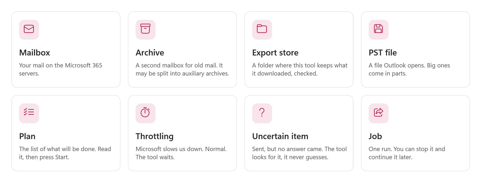

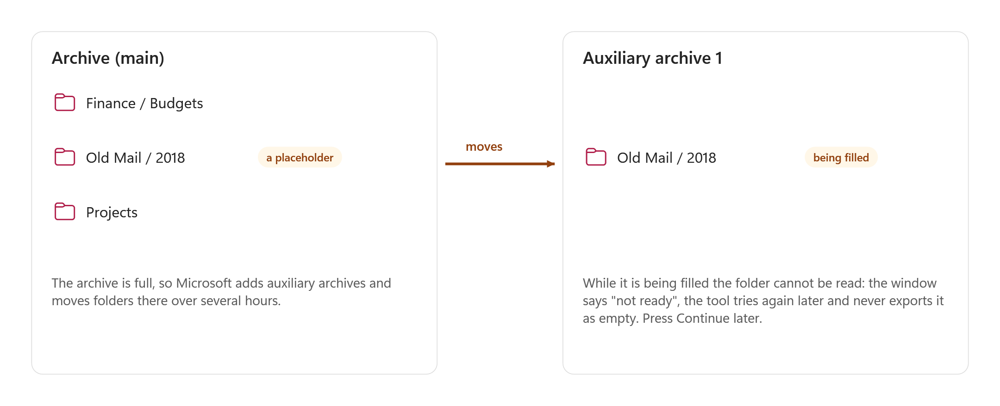

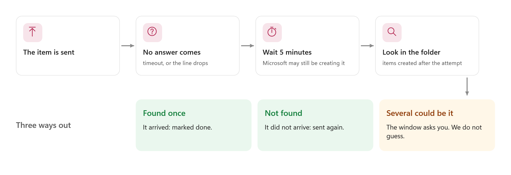

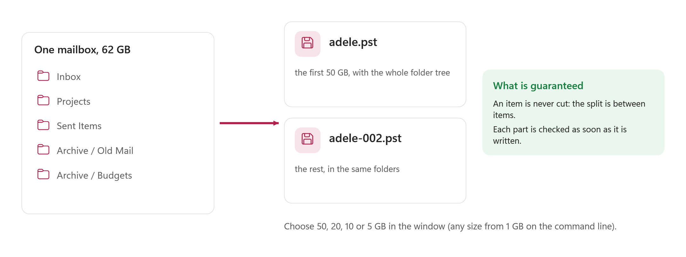

Every word below is explained with no other new word. **Where to look** says where you find it.

| Word | What it is | Where to look |
|---|---|---|
| **Mailbox** | Your mail, calendar and contacts on Microsoft's servers. | The box **Mailbox** on the From page. |
| **Primary mailbox** | The main mailbox of a person. | **Where to look**, first line. |
| **Archive** | A second mailbox for old mail. | **Where to look**, second line. |
| **Auto-expanding archive** | An archive that grows by itself: when full, Microsoft adds more archives. | The note under **Where to look**. |
| **Auxiliary archive** | One of the extra archives of an auto-expanding archive. | **Where to look**, third line, and in the folder tree. |
| **Being filled / Not ready** | Microsoft is still moving a folder into an auxiliary archive. It cannot be read yet. | An amber note and the word *not ready* on the Run page. |
| **Folder tree** | The folders and subfolders of a mailbox, like folders on a disk. | The left side of the browser. |
| **Item** | One thing in a mailbox: a message, an appointment, a contact. | The counts next to each folder. |
| **Message** | An item that is an email. | The right side of the browser. |
| **Attachment** | A file inside a message. | The paper-clip in the message list. |
| **Recoverable Items** | A hidden folder where deleted mail waits (14 days by default, up to 30). Tick **Include deleted items** to see and export it. | The box **Where to look**, and the folder in the browser. |
| **Restored deleted items** | The normal folder an import puts deleted items in (never back into Recoverable Items). | Your mailbox, after an import of an export that held deleted items. |
| **Shared mailbox** | A mailbox used by several people, with no password of its own. | The link **A shared mailbox, or another user's mailbox**. |
| **Export store** | A folder with what this tool downloaded, checked. | The **To** page, *Export store only*. |
| **PST file** | A file Outlook opens that holds a mailbox. | The **To** page, *PST files*. |
| **PST part** (`-002`) | One of several files of a big PST. | The **Done** page. |
| **Split** | Cutting a PST into parts of a given size (50 GB by default). | **More options** on the **To** page. |
| **Manifest** | A small file that lists what is in each PST part. | Next to the PST files. |
| **Fingerprint (SHA-256)** | A number computed from the content. If one letter changes, the number changes. The tool compares it to be sure nothing was damaged. | You do not see it. It is why the steps say *checked*. |
| **Selection** | What you ticked. | **Your selection**, bottom left of the browser. |
| **Plan** | The list of what will be done, with the time. Nothing starts before you press Start. | The **Plan** page. |
| **Run settings (this run only)** | Settings you change for one run. They are never written to the configuration file. | The **Plan** page, bottom left. |
| **Job** | One run: an export, an import, a check. | **Continue a job** on the first page. |
| **Continue** | Run the same job again. Only what is left is done. | The first page, and the Done page. |
| **Stop and keep progress** | Ask the job to stop cleanly. Nothing is lost. | Bottom left of the Run page. |
| **Throttling** | Microsoft makes us wait because we ask too much, too fast. Normal. | *Microsoft slowed us down N times* on the Run page. |
| **Uncertain item (Unknown)** | An item sent for which no answer came. It may be in the mailbox or not. | The amber box *1 item needs your decision*. |
| **Reconcile** | Looking in the folder to find out whether an uncertain item arrived. | The step *Check the uncertain items*. |
| **Refused item** | An item the mailbox would not accept. It is listed with the reason and skipped. | The Done page. |
| **Deferred folder** | A folder that could not be read yet and is kept for later. | The Done page, with *Not finished*. |
| **Check** | A read-only test of a PST file. | The **From** page of *Check and repair*. |
| **Repair** | Writing a new, repaired PST from a damaged one. | The **To** and **Run** pages of *Check and repair*. |
| **Recompute / Rebuild / Salvage** | The three repair levels, from gentle to strong. | The table of the check. |
| **Kept / Partly recovered / Lost** | The three results for a message after a repair. | The repair report. |
| **Recovered items** | A folder of the repaired file with messages whose folder was lost. | In the repaired PST. |
| **Named properties** | Special fields (of calendar items, contacts) kept in a PST by name. The tool keeps them. | You do not see them. |
| **Damaged attachment** | An attachment with unreadable parts. | *Keep damaged attachments*, under **More options** of the repair. |
| **Sign-in** | Proving who you are to Microsoft. | The **From** page, box **Mailbox**. |
| **Delegated / app-only** | Delegated: the tool acts as **you**. App-only: the tool acts as itself, with a certificate and no person. | **Sign in as** on the From page. |
| **Device code** | A short code you type on a web page, on any device, to sign in. | **Use a code instead**. |
| **Permission (scope)** | A right a program asks Microsoft for, such as `MailboxItem.Read`. | Chapter 2 of this guide. |
| **Admin consent** | The administrator saying yes to those permissions for the whole company. | Chapter 2 (for the administrator). |
| **Tenant** | Your company's own space at Microsoft. It has an id, a long number. | The configuration file. |
| **Application (client) id** | The long number of the tool's registration in your company. | The configuration file. |
| **Token cache** | The sign-in, kept on your PC, encrypted for your Windows account. | `%LOCALAPPDATA%\MailboxTransfer`. |
| **Work folder** | Where the tool keeps its jobs and stores. | **This computer**, the lights. |
| **Release** | The official download of the tool: one ZIP on the GitHub page *Releases*, signed by the author. | The link **Latest release** in the window. |
| **Signed / signature** | A digital stamp that proves a file comes from its author and was not changed. The tool checks it each time it starts. | Right-click a .ps1, *Properties*, *Digital Signatures*. |
| **Log file** | A text file that keeps, line by line, what a run did, with the time. You send it to your administrator when something fails. | The folder logs of the work folder (the console), or out\logs (the command line). |
| **Console** | The window of the tool. | The whole screen. |
| **Stepper** | The six circles at the top. | The top of the window. |
| **Engine** | The part of the tool that does the work. The window drives it. | You do not see it. |
| **PowerShell 7** | The program (`pwsh`) the tool runs in. | The first light. |
| **Unblock** | Telling Windows that files from the Internet are safe to run. | The box at the top of this guide. |
| **Quota** | The most a mailbox may hold. | The To page of an import, when known. |
| **Reserved name** | A file name Windows keeps for itself (`AUX`, `CON`, `NUL`, `COM1`…). | A red message on the **To** page. |
| **Import session** | An internal permission slip Microsoft gives for an import. The tool handles it. | You do not see it. |
| **FastTransfer** | The format Microsoft uses to move one item. | The [reference guide](MailboxTransfer-Guide.md) only. |

---

**Next:** the [reference guide](MailboxTransfer-Guide.md) has every setting, the exact rights, the file formats, the exit codes and the limits.
